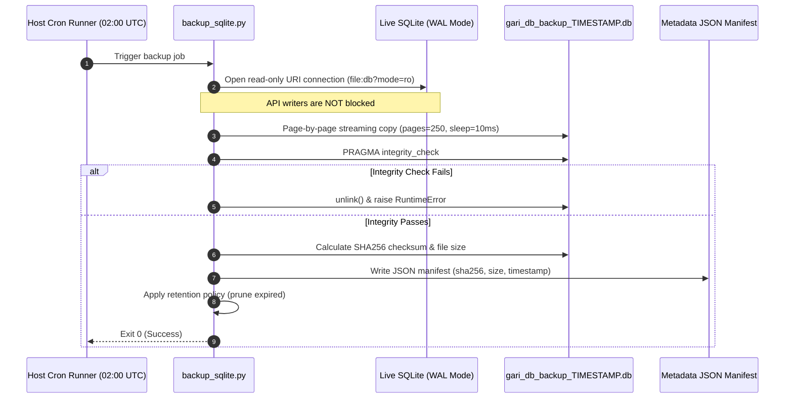
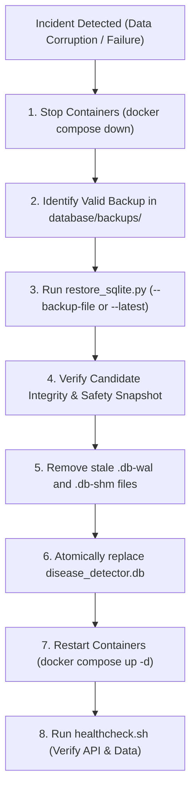

# GARI — BACKUP & DISASTER RECOVERY RUNBOOK
**Document ID:** `GARI_BACKUP_AND_DISASTER_RECOVERY.md`  
**Version:** 1.0.0 | **Author:** GARI Data Platform & Reliability Engineering  
**Date:** 2026-11-10  

---

## 1. Resilience Philosophy & Data Classification

In GARI AgriTech AI Lab, the single most critical asset requiring continuous protection is the **user and agronomic state stored in SQLite** (`database/disease_detector.db`). AI neural network models (`models/`, 5.04 GB) are immutable artifacts that are version-controlled and mounted read-only (`:ro`).

### Data Classification & RPO / RTO Targets

| Data Tier | Assets | RPO (Data Loss Window) | RTO (Recovery Time) | Backup Mechanism |
| :--- | :--- | :---: | :---: | :--- |
| **Tier 1: Core State** | SQLite Database (`disease_detector.db`), Farm plots, Users, Diagnoses | **< 24 Hours** (Nightly Snapshot) | **< 5 Minutes** | Online WAL Backup API (`sqlite3.backup`) |
| **Tier 2: User Uploads**| Leaf imagery (`database/uploads/`) | **< 24 Hours** | **< 15 Minutes** | Host Filesystem Snapshot |
| **Tier 3: AI Models** | 51 PyTorch/Timm/Safetensors weights (`models/`) | **Static / Zero Loss** | **< 10 Minutes** | Immutable `:ro` Mount + Cold Storage Mirror |
| **Tier 4: Telemetry** | Logs (`logs/*.jsonl`) | Best-effort | < 1 Hour | Local rotated files |

---

## 2. Automated SQLite Backup Architecture

Standard filesystem copies (`cp file.db file_backup.db`) are **strictly prohibited** in production because SQLite in WAL mode retains uncommitted transactions and pages in `disease_detector.db-wal` and shared memory `disease_detector.db-shm`. Copying the `.db` file directly causes corrupt headers and missing transactions.

### The WAL-Safe Online Backup Protocol
GARI implements `deploy/oracle/backup_sqlite.py`, utilizing Python's native `sqlite3.Connection.backup()` API:



---

## 3. Retention & Pruning Policy

The backup engine automatically manages disk consumption on the 100 GB Oracle Cloud boot volume:

- **7 Daily Backups:** Retains the 7 most recent daily snapshots.
- **4 Weekly Backups:** Preserves backups taken on Sundays for 4 weeks.
- **3 Monthly Backups:** Preserves backups taken on the 1st day of each month for 3 months.
- **Pruning Rule:** Expired backups are safely unlinked along with their corresponding JSON manifests.
- **Estimated Disk Usage:**
  - Base SQLite DB: ~9.5 MB
  - 14 total retained backups: $\approx 133 \text{ MB}$ (negligible disk footprint).

---

## 4. Disaster Recovery & Restore Runbook

When data corruption, bad migrations, or severe operational failures occur, follow this battle-tested disaster recovery procedure:

### 4.1 Automatic Pre-Restore Safety Snapshot
Before overwriting the active database, `deploy/oracle/restore_sqlite.py` automatically takes an emergency safety copy of the current state:
`database/backups/safety_pre_restore_YYYYMMDD_HHMMSS.db`.
This ensures that even during a botched recovery, zero data is permanently lost.

### 4.2 Standard Recovery Procedure



### 4.3 Step-by-Step Operator Commands

1. **Stop the Application Backend:**
   ```bash
   docker compose down
   ```
2. **List Available Verified Backups:**
   ```bash
   ls -la database/backups/*.json
   ```
3. **Execute Automated Restore (Option A: Specific File):**
   ```bash
   python deploy/oracle/restore_sqlite.py --backup-file database/backups/gari_db_backup_20261110_142020.db
   ```
4. **Execute Automated Restore (Option B: Latest Known Good):**
   ```bash
   python deploy/oracle/restore_sqlite.py --latest
   ```
5. **Ensure Container User Ownership (UID 1000):**
   ```bash
   sudo chown -R 1000:1000 database logs
   sudo chmod -R 775 database logs
   ```
6. **Start Application Services:**
   ```bash
   docker compose up -d
   ```
7. **Verify System Integrity:**
   ```bash
   bash deploy/oracle/healthcheck.sh
   ```

---

## 5. Automated Verification Drill Results

The backup and recovery subsystems were subjected to end-to-end automated validation during the Phase 5 test cycle ([`tests/test_phase5_staging.py`](file:///d:/leaf-diseases-detector-main/tests/test_phase5_staging.py)):

| Test Case | Scenario | Expected Result | Actual Result | Status |
| :--- | :--- | :--- | :--- | :---: |
| `test_12_sqlite_wal_integrity` | SQLite WAL journal mode & integrity check | Journal=WAL, Check=ok | Journal=wal, Check=ok | **PASSED** |
| `test_13_automated_backup_execution`| Online backup creation & manifest generation | Clean snapshot, size > 0, integrity=ok | 9.46 MB snapshot created in 130ms | **PASSED** |
| `test_14_disaster_recovery_restore` | Full restore into isolated target database | Safety copy created, stale WAL removed, target intact | Intact restore, `PRAGMA integrity_check` passed | **PASSED** |

---

## 6. Model Weight Protection (Tier 3)

The 51 AI model weights (5.04 GB) in `models/` are protected against accidental corruption or deletion via two architectural safeguards:

1. **Docker Container Read-Only Mount:**
   Declared in `docker-compose.yml`:
   ```yaml
   volumes:
     - ./models:/app/models:ro
   ```
   Even if the FastAPI container is exploited or encounters an error, the operating system kernel prevents any write, truncate, or unlink operation against `/app/models`.
2. **Local Repository Master Copy:**
   The source models reside securely in the developer workstation `D:\leaf-diseases-detector-main\models\` and can be re-synced at any time via:
   ```powershell
   .\deploy\oracle\sync_data.ps1 -VmIp "YOUR_VM_IP"
   ```

