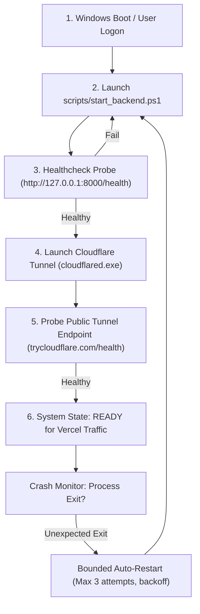

# GARI — WINDOWS AUTOMATED STARTUP & RECOVERY GUIDE
**Document ID:** `GARI_LOCAL_STARTUP_GUIDE.md`  
**Platform:** Windows 11 x64 | **Backend:** FastAPI + Cloudflare Tunnel  
**Date:** 2026-11-10  

---

## 1. Automated Boot Sequence

To achieve hands-off operation on your self-hosted workstation, GARI follows a strict sequential dependency chain at system startup:



---

## 2. Windows Task Scheduler Setup (Zero-Click Startup)

To have GARI start automatically whenever you log into Windows:

### Task 1: Auto-Start FastAPI Backend
Open PowerShell as Administrator and run:
```powershell
$actionBackend = New-ScheduledTaskAction -Execute "pwsh.exe" -Argument "-NoProfile -ExecutionPolicy Bypass -WindowStyle Hidden -File `"D:\leaf-diseases-detector-main\scripts\start_backend.ps1`""
$triggerLogon = New-ScheduledTaskTrigger -AtLogOn
$settings = New-ScheduledTaskSettingsSet -AllowStartIfOnBatteries -DontStopIfGoingOnBatteries -RestartCount 3 -RestartInterval (New-TimeSpan -Minutes 1)
Register-ScheduledTask -TaskName "GARI_Backend_Service" -Action $actionBackend -Trigger $triggerLogon -Settings $settings -User "$env:USERNAME"
```

### Task 2: Auto-Start Cloudflare Tunnel
```powershell
$actionTunnel = New-ScheduledTaskAction -Execute "D:\leaf-diseases-detector-main\cloudflared.exe" -Argument "tunnel --url http://127.0.0.1:8000"
Register-ScheduledTask -TaskName "GARI_Cloudflare_Tunnel" -Action $actionTunnel -Trigger $triggerLogon -Settings $settings -User "$env:USERNAME"
```

---

## 3. Crash Recovery & Watchdog Principles

If the FastAPI backend exits unexpectedly due to an unhandled system signal:
1. **Bounded Restarts (Max 3 Attempts):** The task settings configure a 1-minute retry delay with a hard limit of 3 restarts. This prevents infinite rapid crash loops that could consume CPU cycles or flood logs if a fatal syntax or configuration error occurs.
2. **Crash Event Logging:** Standard error output is automatically captured in:
   - `logs/backend_stderr.log`
   - `logs/backend_startup.log`
3. **Database Safety:** SQLite WAL mode ensures that an abrupt process crash leaves zero uncommitted or partially written corrupt rows; uncommitted transactions are cleanly rolled back during SQLite's next startup checkpoint.

---

## 4. Manual Operator Procedures

If you ever need to inspect or control the backend manually:

| Operational Action | Command to Run |
| :--- | :--- |
| **Check System Health** | `.\scripts\backend_healthcheck.ps1` |
| **Inspect Telemetry** | `.\scripts\gari_monitor.ps1` |
| **Gracefully Stop Backend** | `.\scripts\stop_backend.ps1` |
| **Start Backend** | `.\scripts\start_backend.ps1` |
| **Restart Backend** | `.\scripts\restart_backend.ps1` |
| **Take Database Backup**| `.\scripts\backup_database.ps1` |

---

## 5. Important Operator Best Practices

- **Sleep Mode Configuration:** To keep GARI accessible while you are away from your desk, configure Windows Power & Battery settings:
  * *When plugged in, put my device to sleep after:* **Never** (or allow display to turn off while keeping computer awake).
- **Windows Update Reboots:** When Windows automatically restarts for security updates, the scheduled tasks above will automatically bring both the FastAPI backend and Cloudflare Tunnel back online upon user logon.

