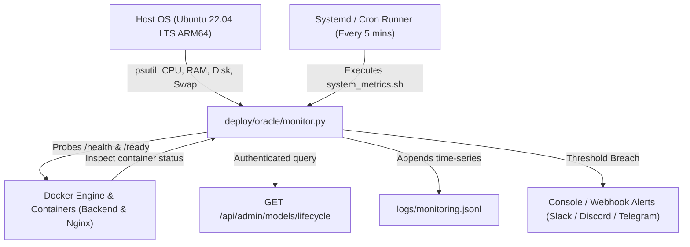

# GARI — PRODUCTION MONITORING & OBSERVABILITY GUIDE
**Document ID:** `GARI_MONITORING_GUIDE.md`  
**Version:** 1.0.0 | **Author:** GARI Site Reliability Engineering (SRE)  
**Date:** 2026-11-10  

---

## 1. Monitoring Philosophy & Design Principles

To ensure zero hosting costs while maintaining enterprise-grade reliability, GARI employs an **agentless, lightweight observability architecture** that incurs zero external SaaS fees (Datadog, New Relic, or AWS CloudWatch):

1. **Low Overhead:** Native OS telemetry and lightweight Python probes (`psutil`) consume < 0.5% CPU and < 25 MB RAM.
2. **Structured JSONL Logs:** Every transition, inference, error, and health probe is emitted as structured JSON lines for easy parsing and log rotation.
3. **Threshold-Based Alerts:** Proactive warnings trigger before user-facing failures occur (e.g. RAM > 85%, Disk > 85%).
4. **Isolated Lifecycle Introspection:** AI model load and unload metrics are tracked independently from HTTP routing to isolate performance bottlenecks.

---

## 2. Telemetry Architecture



---

## 3. Monitored Metrics

### 3.1 Host & Infrastructure Metrics

| Metric | Collection Method | Warning Threshold | Critical Threshold | Action Plan |
| :--- | :--- | :---: | :---: | :--- |
| **CPU Utilization** | `psutil.cpu_percent(interval=0.5)` | > 80% (5 min) | > 95% (2 min) | Inspect concurrent inference requests; throttle Nginx rate limit. |
| **RAM Utilization** | `psutil.virtual_memory().percent` | > 80% | > 85% | Trigger explicit model eviction via `check_and_unload_idle_models()`. |
| **Swap Usage** | `psutil.swap_memory().percent` | > 40% | > 70% | High swap paging degrades inference latency; restart idle models. |
| **Disk Space** | `psutil.disk_usage("/").percent` | > 80% | > 88% | Prune expired database backups; clean old Docker images (`docker image prune`). |
| **Container State** | `docker inspect --format='{{.State.Status}}'` | Restarting | Exited / Dead | Inspect `docker compose logs gari-backend`; trigger auto-recovery. |

### 3.2 Backend API & Database Metrics

| Metric | Collection Method | Healthy Target | Degraded Indicator |
| :--- | :--- | :---: | :---: |
| **API Health Probe** | `GET /health` | HTTP 200 (`"status":"healthy"`) | HTTP 503 / 502 / `"status":"degraded"` |
| **API Readiness Probe**| `GET /ready` | HTTP 200 (`"ready":true`) | HTTP 503 (Database unreachable or storage unmounted) |
| **Health Probe Latency**| Wall-clock measurement | < 50 ms | > 500 ms (Indicates event loop starvation) |
| **Database Integrity** | `PRAGMA integrity_check;` | `ok` | Non-ok result triggers immediate safety fallback |
| **WAL File Size** | Filesystem stat (`disease_detector.db-wal`) | < 30 MB | > 100 MB (Requires SQLite checkpoint `PRAGMA wal_checkpoint(TRUNCATE)`) |

### 3.3 AI Model Lifecycle Metrics

Accessible via authenticated endpoint `GET /api/admin/models/lifecycle`:

| Metric | Field in JSON | Explanation |
| :--- | :--- | :--- |
| **Active Loaded Models** | `active_models_count` | Number of model weights currently resident in RAM (Max: `MAX_CACHED_MODELS=3`). |
| **Process RSS (MB)** | `process_rss_mb` | Process physical RAM consumption measured via `psutil.Process().memory_info().rss`. |
| **Active Inferences** | `models[model_id].active_requests` | Number of simultaneous forward passes currently executing on this model. |
| **Model State** | `models[model_id].state` | `UNLOADED`, `LOADING`, `READY`, `INFERENCE_ACTIVE`, `UNLOADING`, `ERROR`. |
| **Model Load Latency** | `models[model_id].load_time_ms` | Time in milliseconds to load weights from disk into PyTorch memory. |
| **Idle Duration** | `models[model_id].seconds_since_last_used` | Elapsed seconds since last inference; compared against `MODEL_IDLE_TIMEOUT_SECONDS=300`. |

---

## 4. Structured Audit Log Specification

Every significant operational transition in GARI is recorded as a single JSON object in `logs/audit.jsonl` or `logs/monitoring.jsonl`:

### Example 1: Model Loaded Event
```json
{
  "timestamp": "2026-11-10T21:24:18.595Z",
  "event": "model_load_completed",
  "model_id": "Tomato",
  "state": "READY",
  "active_requests": 0,
  "duration_ms": 592.9,
  "rss_mb": 767.7,
  "details": {
    "arch": "convnext_small",
    "weights_size_mb": 94.38,
    "device": "cpu"
  }
}
```

### Example 2: Periodic Monitoring Metric Record
```json
{
  "timestamp": "2026-11-10T21:21:18.984Z",
  "system": {
    "cpu_percent": 38.0,
    "ram": {
      "total_mb": 11980.5,
      "used_mb": 10231.2,
      "available_mb": 1749.3,
      "percent": 85.4
    },
    "swap": {
      "total_mb": 4096.0,
      "used_mb": 420.0,
      "percent": 10.3
    },
    "disk": {
      "total_gb": 98.5,
      "used_gb": 87.2,
      "free_gb": 11.3,
      "percent": 88.6
    }
  },
  "api": {
    "endpoint": "http://127.0.0.1:8000/health",
    "status_code": 200,
    "latency_ms": 74.04,
    "is_healthy": true
  },
  "alerts": [
    "WARNING: High RAM utilization: 85.4% (>85%)",
    "WARNING: High Disk utilization: 88.6% (>85%)"
  ]
}
```

---

## 5. Log Rotation & Space Protection

To prevent disk saturation from log accumulation, GARI enforces dual-layer log rotation:

### 5.1 Docker Container Log Rotation
Configured in `docker-compose.yml`:
```yaml
logging:
  driver: "json-file"
  options:
    max-size: "50m"
    max-file: "3"
```
Ensures each container log is capped at 150 MB total across 3 rotated files.

### 5.2 Host Application Logrotate Configuration
Installed on the host at `/etc/logrotate.d/gari`:
```
/home/ubuntu/leaf-diseases-detector/logs/*.log
/home/ubuntu/leaf-diseases-detector/logs/*.jsonl {
    daily
    missingok
    rotate 14
    compress
    delaycompress
    notifempty
    create 0640 ubuntu ubuntu
}
```

---

## 6. SRE Runbook: Responding to Production Alerts

### Scenario A: RAM Utilization Exceeds 85%
1. Query the active model lifecycle status:
   ```bash
   curl -s -H "Authorization: Bearer $ADMIN_TOKEN" http://127.0.0.1:8000/api/admin/models/lifecycle | jq .
   ```
2. If models are idle but not unloaded, trigger an immediate manual garbage collection cycle:
   ```bash
   docker exec gari-backend python -c "from gari_inference_engine import GariInferenceEngine; e = GariInferenceEngine(); print(e.lifecycle.check_and_unload_idle_models())"
   ```
3. If memory remains saturated by non-model memory, perform a zero-downtime container restart:
   ```bash
   docker compose restart gari-backend
   ```

### Scenario B: API Returns HTTP 502 or 503
1. Check container health status:
   ```bash
   docker compose ps
   ```
2. Inspect the latest 50 lines of backend logs:
   ```bash
   docker compose logs --tail=50 gari-backend
   ```
3. Verify SQLite database lock state:
   ```bash
   fuser database/disease_detector.db
   ```
4. If database is locked by an orphaned process, execute emergency recovery:
   ```bash
   bash deploy/oracle/rollback.sh
   ```

---

## 7. Execution Commands

- **Run Single Health Probe:**
  ```bash
  bash deploy/oracle/healthcheck.sh
  ```
- **Run SRE Metrics Collector:**
  ```bash
  bash deploy/oracle/system_metrics.sh
  ```
- **Continuous Daemon Mode (Run every 30s):**
  ```bash
  python deploy/oracle/monitor.py --url http://127.0.0.1:8000 --loop 30
  ```

