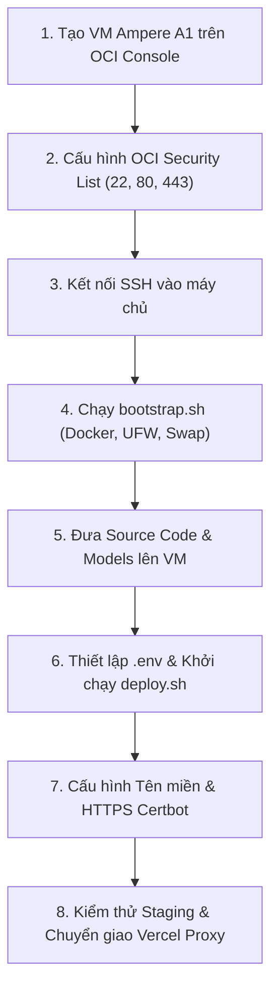

# HƯỚNG DẪN TRIỂN KHAI GARI LÊN ORACLE CLOUD INFRASTRUCTURE (OCI)
## GARI AgriTech AI Lab — Oracle Cloud VM Production Deployment Playbook

> **Mục tiêu:** Thiết lập máy chủ ảo độc lập trên Oracle Cloud Always Free (Ampere A1 ARM64), triển khai toàn bộ AI Inference Backend, FastAPI, SQLite WAL, Nginx Reverse Proxy và HTTPS Let's Encrypt. Đảm bảo hệ thống vận hành 24/7 độc lập hoàn toàn khỏi máy cá nhân.

---

## TỔNG QUAN QUY TRÌNH TRIỂN KHAI



---

## BƯỚC 1: KHỞI TẠO MÁY CHỦ ẢO TRÊN ORACLE CLOUD CONSOLE

1. Đăng nhập vào [Oracle Cloud Console](https://cloud.oracle.com).
2. Chọn menu $\equiv$ $\rightarrow$ **Compute** $\rightarrow$ **Instances** $\rightarrow$ Nhấn **Create instance**.
3. Cấu hình các thông số:
   - **Name:** `gari-production-vm`
   - **Placement:** Chọn Availability Domain mặc định (AD-1).
   - **Image:** Nhấn *Change image* $\rightarrow$ Chọn **Canonical Ubuntu** $\rightarrow$ Chọn phiên bản **Ubuntu 22.04 LTS** (hoặc Ubuntu 24.04).
   - **Shape:** Nhấn *Change shape*:
     - Chọn loại **Ampere** (ARM-based processor).
     - Chọn hình dạng: **`VM.Standard.A1.Flex`** (Always Free Eligible).
     - **OCPU:** Chọn **2 OCPU** (hoặc 4 OCPU nếu khả dụng).
     - **RAM:** Chọn **12 GB** (hoặc 24 GB nếu dùng hết quota).
   - **Networking:**
     - Virtual cloud network: Chọn *Create new virtual cloud network* hoặc VCN có sẵn.
     - Subnet: Chọn *Create new public subnet*.
     - Assign public IPv4 address: Chọn **Automatically assign public IPv4 address**.
   - **Add SSH keys:**
     - Chọn **Generate a key pair for me** $\rightarrow$ Nhấn **Save private key** (lưu tệp `.key` về máy bạn một cách an toàn) VÀ **Save public key**.
     - Hoặc tải lên khóa công khai `id_ed25519.pub` / `id_rsa.pub` có sẵn của bạn.
   - **Boot volume:**
     - Tích chọn *Specify a custom boot volume size*.
     - Nhập dung lượng: **80 GB** hoặc **100 GB** (nằm trong hạn mức 200 GB miễn phí).
4. Nhấn **Create** và chờ 1-2 phút cho instance chuyển sang trạng thái **RUNNING** màu xanh lá. Ghi lại địa chỉ **Public IP Address** của máy chủ (ví dụ `129.150.x.x`).

---

## BƯỚC 2: CẤU HÌNH TƯỜNG LỬA OCI (SECURITY LISTS)

Mặc định Oracle Cloud chặn tất cả lưu lượng bên ngoài ngoại trừ port 22. Bạn cần mở port 80 và 443:

1. Trong trang chi tiết Instance, click vào đường dẫn **Subnet** (ví dụ: `Public Subnet-...`).
2. Chọn **Default Security List for...**.
3. Nhấn **Add Ingress Rules**:
   - **Rule 1 (HTTP):**
     - Source CIDR: `0.0.0.0/0`
     - IP Protocol: `TCP`
     - Destination Port Range: `80`
     - Description: `Allow HTTP Nginx`
   - **Rule 2 (HTTPS):**
     - Source CIDR: `0.0.0.0/0`
     - IP Protocol: `TCP`
     - Destination Port Range: `443`
     - Description: `Allow HTTPS Nginx`
4. Nhấn **Add Ingress Rules**.
> [!CAUTION]
> **Tuyệt đối không mở port 8000 ra ngoài công khai.** Port 8000 là cổng API nội bộ của FastAPI, chỉ giao tiếp với Nginx bên trong Docker network hoặc qua localhost.

---

## BƯỚC 3: KẾT NỐI SSH VÀO MÁY CHỦ VM

Mở PowerShell hoặc Terminal trên máy cá nhân:
```powershell
# Phân quyền cho file SSH key (nếu dùng Linux/macOS: chmod 400 your_key.key)
ssh -i "path/to/your_private_key.key" ubuntu@<PUBLIC_IP_ADDRESS>
```
Khi kết nối thành công, bạn sẽ thấy giao diện dòng lệnh của máy chủ Ubuntu ARM64.

---

## BƯỚC 4: CHẠY BOOTSTRAP HỆ THỐNG

Tải repository hoặc script bootstrap để tự động cài đặt Docker, UFW firewall, fail2ban và cấu hình 4GB swapfile:

```bash
# Clone source code GARI về máy chủ
git clone https://github.com/<your-repo>/leaf-diseases-detector-main.git gari
cd gari

# Chạy bootstrap với quyền sudo
sudo bash deploy/oracle/bootstrap.sh
```

---

## BƯỚC 5: ĐƯA THƯ MỤC MODELS VÀ DỮ LIỆU LÊN VM

Thư mục mô hình AI (`models/`, ~5.04 GB) và database SQLite gốc cần được đồng bộ lên máy chủ.

Mở một cửa sổ PowerShell mới trên máy tính cá nhân (nơi chứa thư mục `D:\leaf-diseases-detector-main`):

### 5.1. Đồng bộ thư mục Models
```powershell
# Sử dụng SCP hoặc Rsync
scp -i "path/to/your_private_key.key" -r "D:\leaf-diseases-detector-main\models" ubuntu@<PUBLIC_IP_ADDRESS>:~/gari/
```

### 5.2. Đồng bộ Cơ sở dữ liệu SQLite hiện tại
```powershell
scp -i "path/to/your_private_key.key" "D:\leaf-diseases-detector-main\database\disease_detector.db" ubuntu@<PUBLIC_IP_ADDRESS>:~/gari/database/
```

---

## BƯỚC 6: THIẾT LẬP BIẾN MÔI TRƯỜNG VÀ KHỞI CHẠY BACKEND

Quay lại cửa sổ SSH trên máy chủ VM:

```bash
cd ~/gari

# Tạo tệp .env từ template
cp .env.example .env

# Mở tệp .env để kiểm tra/chỉnh sửa
nano .env
```
Thiết lập các biến quan trọng:
```ini
APP_ENV=production
DEBUG=False
PORT=8000
GARI_ALLOW_ORIGINS=https://gari-team.vercel.app
MAX_CACHED_MODELS=3
INFERENCE_TIMEOUT_SECONDS=30
```
Tạo khóa bí mật JWT ngẫu nhiên nếu chưa có:
```bash
sed -i "s/replace_with_a_secure_random_string_at_least_32_chars_long/$(openssl rand -hex 32)/" .env
```

Khởi chạy hệ thống bằng Docker Compose:
```bash
bash deploy/oracle/deploy.sh
```
Script sẽ tự động build image đa kiến trúc, khởi động container FastAPI và Nginx, sau đó xác nhận healthcheck chuyển sang trạng thái **HEALTHY**.

---

## BƯỚC 7: CẤU HÌNH TÊN MIỀN VÀ CHỨNG CHỈ SSL (HTTPS)

Để Frontend trên Vercel gọi được vào backend mà không bị lỗi mixed-content, backend bắt buộc phải chạy qua giao thức **HTTPS**.

### 7.1. Trỏ DNS Domain về IP Máy Chủ
Vào nhà cung cấp tên miền của bạn (Cloudflare, Namecheap, v.v.), tạo bản ghi:
- **Type:** `A`
- **Name:** `api` (hoặc tên miền con tùy chọn, ví dụ `api.gari.farm`)
- **Content:** `<PUBLIC_IP_ADDRESS_CỦA_VM>`
- **TTL:** Auto hoặc 300s

### 7.2. Cấp phát Chứng chỉ SSL Miễn phí bằng Certbot
Trên máy chủ VM:
```bash
# Dừng Nginx tạm thời để Certbot cấp chứng chỉ
docker compose stop nginx

# Chạy Certbot Standalone
sudo certbot certonly --standalone -d api.yourdomain.com --agree-tos -m your_email@example.com --non-interactive

# Tạo symlink hoặc thư mục chuẩn cho Nginx
sudo mkdir -p /etc/letsencrypt/live/gari
sudo cp /etc/letsencrypt/live/api.yourdomain.com/fullchain.pem /etc/letsencrypt/live/gari/
sudo cp /etc/letsencrypt/live/api.yourdomain.com/privkey.pem /etc/letsencrypt/live/gari/
sudo chmod -R 755 /etc/letsencrypt

# Khởi động lại Nginx
docker compose up -d nginx
```

### 7.3. Kích hoạt HTTPS trong Nginx
Mở tệp `deploy/oracle/nginx/conf.d/gari.conf`, bỏ comment phần chuyển hướng HTTP sang HTTPS:
```bash
docker compose exec nginx nginx -s reload
```

---

## BƯỚC 8: KIỂM THỬ SỨC KHỎE HỆ THỐNG VÀ TIẾN HÀNH CUTOVER

### 8.1. Kiểm thử từ bên ngoài bằng script chẩn đoán
Trên máy chủ VM:
```bash
bash deploy/oracle/healthcheck.sh https://api.yourdomain.com
```
*Kết quả:* Tất cả 5 bước kiểm tra phải báo **PASS** màu xanh lá.

### 8.2. Cập nhật Vercel Proxy
1. Đăng nhập [https://vercel.com](https://vercel.com) $\rightarrow$ Chọn dự án `gari-team`.
2. Vào **Settings** $\rightarrow$ **Environment Variables**.
3. Sửa biến `VERCEL_BACKEND_API_URL` thành:
   ```text
   https://api.yourdomain.com
   ```
4. Lưu và chọn **Redeploy** deployment mới nhất.

---

## BƯỚC 9: THIẾT LẬP SAO LƯU DỮ LIỆU TỰ ĐỘNG (BACKUP CRONJOB)

Để đảm bảo tệp SQLite không bao giờ bị mất, thiết lập sao lưu trực tiếp vào 02:00 sáng mỗi ngày:

```bash
crontab -e
```
Thêm dòng sau vào cuối tệp:
```cron
0 2 * * * cd /home/ubuntu/gari && sqlite3 database/disease_detector.db ".backup database/backups/backup_$(date +\%Y\%m\%d_\%H\%M\%S).db" && find database/backups/ -type f -name "*.db" -mtime +14 -delete
```
Lệnh trên thực hiện hot-backup an toàn với WAL mode và tự động dọn dẹp các bản sao lưu cũ hơn 14 ngày.

