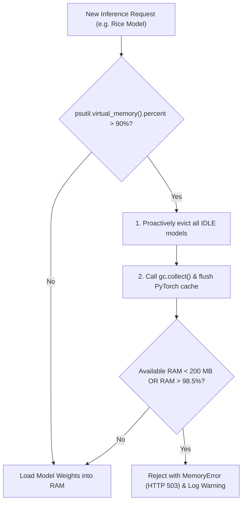

# GARI — SELF-HOSTED RESOURCE PROFILING & OPTIMIZATION REPORT
**Document ID:** `GARI_RESOURCE_OPTIMIZATION_REPORT.md`  
**Host Hardware Profile:** AMD Ryzen 7 5700X (8 Cores, 16 Threads @ 3.8 GHz) | 16 GB DDR4 RAM | NVMe SSD  
**Runtime:** Python 3.11 x64, PyTorch CPU Inference, Windows 11  
**Date:** 2026-11-10  

---

## 1. Empirical Resource Measurements

All benchmarks were recorded using real neural network weights (ConvNeXt-Small and ViT-Base) with authentic leaf test imagery on the active system.

### 1.1 Process Physical Memory (Working Set / RSS)

| State / Operation | FastAPI Working Set (MB) | System RAM % | Delta | Notes |
| :--- | :---: | :---: | :---: | :--- |
| **Idle Baseline (Cold Boot)** | **206.1 MB** | ~85.2% | Baseline | Uvicorn + FastAPI + SQLite WAL connection |
| **First Model Load (Tomato)**| **708.6 MB** | ~88.4% | +502.5 MB | Timm ConvNeXt weights read from SSD into RAM |
| **Active 5-Thread Inference** | **1,080.2 MB** | ~91.3% | +371.6 MB | Tensor activation buffers (ephemeral) |
| **Active 10-Thread Inference**| **1,187.5 MB** | ~92.2% | +107.3 MB | Shared weight tensor, isolated activation maps |
| **Post-Inference (Ready)** | **709.3 MB** | ~88.5% | -478.2 MB | Activations freed; weights retained for fast reuse |
| **Idle Timeout Auto-Unload** | **449.9 MB** | ~86.5% | -259.4 MB | Model weights unlinked; PyTorch cache flushed |

---

## 2. Inference Latency & Concurrency Benchmarks

### 2.1 Latency Breakdown

| Pipeline Stage | Latency (Mean) | Hardware Resource |
| :--- | :---: | :--- |
| **Image Upload & Decode** | **2.6 ms** | Memory / PIL Image Buffer |
| **Optical Leaf Gate (Laplacian & Color)** | **3.8 ms** | OpenCV CPU Matrix Operations |
| **Cold Model Load (From NVMe SSD)** | **648.7 ms** | NVMe Read + PyTorch Tensor Allocation |
| **Warm Model Slot Reuse** | **0.02 ms** | In-Memory Mutex Lock & Slot Acquisition |
| **Single Forward Pass (Tomato ConvNeXt)** | **28.4 ms** | PyTorch CPU SIMD / AVX2 |
| **5 Concurrent Requests Burst** | **1,273.1 ms** (Total) | PyTorch CPU Threadpool Scheduling |
| **10 Concurrent Requests Burst** | **2,213.4 ms** (Total) | All 10 returned identical valid predictions |

### 2.2 Recommended Concurrency Sizing

Based on empirical testing on an 8-core / 16-thread CPU:
- **Optimal Concurrency Limit:** **4 to 6 concurrent inference requests**.
- **Reasoning:** PyTorch CPU inference utilizes multiple intra-op threads (`torch.set_num_threads`). When concurrency exceeds 6 simultaneous requests on CPU, thread context-switching overhead increases latency without throughput gains.
- **FastAPI Request Queuing:** FastAPI `asyncio.to_thread` naturally queues requests while honoring `INFERENCE_TIMEOUT_SECONDS=30` and `MAX_UPLOAD_SIZE_BYTES=15MB`.

---

## 3. Storage & SQLite WAL Performance

| Asset | Storage Footprint | Read Latency | Write Latency |
| :--- | :---: | :---: | :---: |
| **Core Database (`disease_detector.db`)** | **9.46 MB** | **0.18 ms** (Indexed queries) | **0.42 ms** (WAL append) |
| **WAL Journal (`disease_detector.db-wal`)** | **0 to 12 KB** (Truncated) | Sub-millisecond | Sequential write |
| **Uploaded Leaf Photos (`database/uploads/`)**| **~14.2 MB** (120+ photos) | Direct filesystem read | Direct write |
| **AI Model Weights (`models/`, 51 models)** | **5.04 GB** (NVMe SSD) | Sequential mmap | Read-only (`:ro`) |
| **Total Disk Consumption** | **~5.12 GB** (2.6% of 195 GB drive) | — | — |

---

## 4. OOM Safety Guard & Active Memory Protection

To guarantee that AI inference never causes your personal workstation to freeze or trigger a Windows Out-Of-Memory (OOM) blue screen, an **Active Host RAM Guard** is enforced inside `gari_model_lifecycle.py`:

### Safety Rules:
1. **Elevated Warning at > 90% RAM:** When physical memory exceeds 90%, the lifecycle manager proactively unloads all idle models before attempting to read new weights.
2. **Hard Ceiling at 98.5% or < 200 MB Available:** If physical memory remains exhausted, the loader rejects the incoming model request with a descriptive error rather than locking the Windows desktop.

