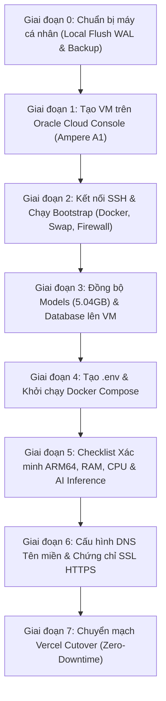

# CẨM NANG TRIỂN KHAI MÁY CHỦ LẦN ĐẦU (FIRST BOOT EXECUTION GUIDE)
## GARI AgriTech AI Lab — Oracle Cloud Infrastructure Native ARM64 Deployment

> **Nguyên tắc triển khai:**
> 1. Toàn quyền kiểm soát và thực thi thuộc về bạn (người dùng). Agent không tự ý SSH, không tạo VM, không thay đổi production và không chuyển Vercel URL.
> 2. Bảo mật tuyệt đối: Không đưa `.env`, API Keys, hay SSH Private Key vào Git.
> 3. Bảo vệ dữ liệu sản xuất: Rollback mã nguồn không bao giờ tự ý ghi đè database SQLite bằng bản sao lưu cũ.
> 4. An toàn mạng: Port nội bộ 8000 được bảo vệ bởi localhost binding và Docker bridge, không bao giờ lộ ra Internet.

---

## 🗺️ BẢN ĐỒ TIẾN TRÌNH TRIỂN KHAI (EXECUTION ROADMAP)



---

## GIAI ĐOẠN 0: CHUẨN BỊ TRÊN MÁY TÍNH CÁ NHÂN (LOCAL PREPARATION)

### 0.1. Hợp nhất WAL Journal và Tạo Bản Sao Lưu Sạch của Database
Trước khi sao chép SQLite, bắt buộc phải flush toàn bộ giao dịch trong file `-wal` vào file chính để tránh mất dữ liệu:

Mở **PowerShell** trên máy tính cá nhân tại thư mục dự án (`D:\leaf-diseases-detector-main`):
```powershell
cd D:\leaf-diseases-detector-main

# Chạy lệnh Python hợp nhất WAL và tạo bản sao lưu xuất xưởng
.\.venv\Scripts\python.exe -c "
import sqlite3, os
db_path = 'database/disease_detector.db'
export_path = 'database/disease_detector_export.db'
conn = sqlite3.connect(db_path)
conn.execute('PRAGMA wal_checkpoint(TRUNCATE);')
print('[+] WAL Checkpoint completed successfully.')
bck = sqlite3.connect(export_path)
conn.backup(bck)
bck.close()
conn.close()
size_mb = os.path.getsize(export_path) / (1024 * 1024)
print(f'[+] Created consolidated database export: {export_path} ({size_mb:.2f} MB)')
"
```
*Kết quả kỳ vọng:* Xuất hiện tệp `database/disease_detector_export.db` hợp nhất, sẵn sàng chuyển lên máy chủ.

### 0.2. Chuẩn bị SSH Key trên Máy Cá nhân
Nếu bạn đã có SSH Key sẵn (ví dụ: `C:\Users\<user>\.ssh\id_rsa` hoặc `id_ed25519`), hãy ghi nhớ đường dẫn.  
Nếu chưa có, bạn có thể chọn tải file `.key` do Oracle Cloud tự tạo trong quá trình tạo VM.

---

## GIAI ĐOẠN 1: TẠO MÁY CHỦ VM TRÊN ORACLE CLOUD CONSOLE

Truy cập [Oracle Cloud Console](https://cloud.oracle.com) và thực hiện các bước sau:

### 1.1. Cấu hình Mạng (VCN) & Ingress Rules An Toàn
1. Vào menu $\equiv$ $\rightarrow$ **Networking** $\rightarrow$ **Virtual Cloud Networks**.
2. Bấm **Start VCN Wizard** $\rightarrow$ Chọn *Create VCN with Internet Connectivity* $\rightarrow$ Đặt tên `gari-vcn` $\rightarrow$ Nhấn **Create**.
3. Bấm vào VCN vừa tạo $\rightarrow$ Bấm vào **Security Lists** $\rightarrow$ Chọn **Default Security List for gari-vcn**.
4. Bấm **Add Ingress Rules** và thêm đúng 3 luật (Rule):
   - **Rule 1 (SSH):** Source CIDR: `0.0.0.0/0`, IP Protocol: `TCP`, Destination Port Range: `22`
   - **Rule 2 (HTTP):** Source CIDR: `0.0.0.0/0`, IP Protocol: `TCP`, Destination Port Range: `80`
   - **Rule 3 (HTTPS):** Source CIDR: `0.0.0.0/0`, IP Protocol: `TCP`, Destination Port Range: `443`
   > [!IMPORTANT]
   > **TUYỆT ĐỐI KHÔNG** mở port `8000` trên Security List của OCI. Port 8000 chỉ dành cho kết nối nội bộ giữa Nginx và FastAPI qua mạng Docker bridge.

### 1.2. Khởi tạo Máy chủ ảo (Compute Instance)
1. Vào menu $\equiv$ $\rightarrow$ **Compute** $\rightarrow$ **Instances** $\rightarrow$ Bấm **Create instance**.
2. **Name:** `gari-production-vm`
3. **Image and Shape:**
   - Bấm *Change image* $\rightarrow$ Chọn **Canonical Ubuntu** $\rightarrow$ Chọn **Ubuntu 22.04 LTS** (Kiến trúc hiển thị là **aarch64**).
   - Bấm *Change shape* $\rightarrow$ Chọn **Ampere (ARM-based processor)** $\rightarrow$ Tích chọn **`VM.Standard.A1.Flex`** (*Always Free Eligible*).
   - **OCPU:** Kéo chọn **2 OCPUs** (hoặc 1 OCPU nếu gặp báo lỗi hết dung lượng).
   - **RAM:** Kéo chọn **12 GB RAM** (hoặc 6 GB RAM).
4. **Networking:** Chọn VCN `gari-vcn` và Public Subnet vừa tạo. Đảm bảo tích chọn *Assign a public IPv4 address*.
5. **Add SSH keys:**
   - Tải lên SSH Public Key của bạn (`.pub`), **HOẶC**
   - Chọn *Generate a key pair for me* $\rightarrow$ **BẤM "Save private key"** để tải file `.key` về máy.
6. **Boot volume:**
   - Tích chọn *Specify a custom boot volume size* $\rightarrow$ Nhập **80 GB** hoặc **100 GB** (nằm an toàn trong 200 GB miễn phí).
7. Nhấn **Create**.
8. Chờ khoảng 1-2 phút cho đến khi trạng thái chuyển sang **RUNNING** màu xanh lá.
9. **Ghi lại địa chỉ Public IP** hiển thị trên màn hình (ví dụ: `129.150.x.x`).

---

## GIAI ĐOẠN 2: KẾT NỐI SSH LẦN ĐẦU & CHẠY BOOTSTRAP

Mở **PowerShell** trên máy tính cá nhân:

### 2.1. Kết nối SSH vào máy chủ
```bash
# Thay thế đường dẫn khóa bí mật và Public IP của bạn
ssh -i "C:\path\to\your_private_key.key" ubuntu@<VM_PUBLIC_IP>
```

### 2.2. Clone Mã nguồn Dự án
Trên cửa sổ SSH của máy chủ VM:
```bash
# Clone repository
git clone https://github.com/<your-username>/leaf-diseases-detector-main.git gari
cd gari
```

### 2.3. Thực thi Bootstrap Tự Động
```bash
# Chạy script bootstrap với quyền root
sudo bash deploy/oracle/bootstrap.sh
```
*Script sẽ tự động thực hiện:*
- Cài đặt Docker CE, Docker Compose, Git, UFW, Fail2ban, Certbot.
- Thiết lập **4GB Swapfile** (phòng chống tràn RAM khi nạp mô hình lớn).
- Cấu hình iptables và UFW mở an toàn port **22 (SSH)**, **80 (HTTP)**, **443 (HTTPS)**.
- Phân quyền người dùng hiện tại vào nhóm `docker`.

> [!NOTE]
> Sau khi bootstrap hoàn tất, chạy lệnh sau để cập nhật quyền nhóm docker mà không cần đăng xuất:
> ```bash
> newgrp docker
> ```

---

## GIAI ĐOẠN 3: ĐỒNG BỘ DỮ LIỆU TỪ MÁY CÁ NHÂN LÊN VM

Mở **cửa sổ PowerShell thứ 2 trên máy cá nhân** (giữ nguyên cửa sổ SSH):

### 3.1. Đồng bộ Thư mục Models AI (5.04 GB)
Thư mục models chứa 50 mô hình Safetensors và 1 mô hình Checkpoint PyTorch.

**Lựa chọn A (Dùng SCP trên PowerShell Windows):**
```powershell
# Chạy từ máy cá nhân
scp -i "C:\path\to\your_private_key.key" -C -r "D:\leaf-diseases-detector-main\models" ubuntu@<VM_PUBLIC_IP>:~/gari/
```

**Lựa chọn B (Dùng Rsync nếu có Git Bash — Khuyến nghị vì hỗ trợ tiếp tục truyền file nếu rớt mạng):**
```bash
rsync -avzP -e "ssh -i /c/path/to/your_private_key.key" /d/leaf-diseases-detector-main/models/ ubuntu@<VM_PUBLIC_IP>:~/gari/models/
```

### 3.2. Đồng bộ Database SQLite Đã Hợp Nhất
```powershell
# Chạy từ máy cá nhân (chuyển tệp đã flush WAL ở Giai đoạn 0)
scp -i "C:\path\to\your_private_key.key" "D:\leaf-diseases-detector-main\database\disease_detector_export.db" ubuntu@<VM_PUBLIC_IP>:~/gari/database/disease_detector.db
```

### 3.3. Phân quyền Thư mục cho Container User (UID 1000)
Quay lại **cửa sổ SSH trên VM**:
```bash
cd ~/gari

# Phân quyền cho UID 1000 (appuser không có quyền root bên trong Docker)
sudo chown -R 1000:1000 database logs
sudo chmod -R 775 database logs

# Kiểm tra thư mục models đã đồng bộ đủ
find models/ -name "*.safetensors" | wc -l
# Kết quả phải trả về: 50
```

---

## GIAI ĐOẠN 4: CẤU HÌNH BIẾN MÔI TRƯỜNG & KHỞI CHẠY DOCKER

Trên **cửa sổ SSH của VM**:

### 4.1. Tạo tệp `.env` Sản Xuất
```bash
cd ~/gari

# Tạo .env từ mẫu .env.example
cp .env.example .env

# Sinh chuỗi ngẫu nhiên bảo mật 64 ký tự cho JWT Secret
RANDOM_JWT=$(openssl rand -hex 32)
sed -i "s/replace_with_a_secure_random_string_at_least_32_chars_long/$RANDOM_JWT/" .env

# Đặt môi trường production
sed -i "s/APP_ENV=development/APP_ENV=production/" .env
```

### 4.2. Khởi chạy Triển khai Tự Động
```bash
bash deploy/oracle/deploy.sh
```
*Quá trình này sẽ:*
1. Tự động kiểm tra tính hợp lệ của thư mục `models/` và `database/`.
2. Build Docker image `gari-backend` tối ưu cho native ARM64 (`python:3.11-slim`, non-root user).
3. Khởi chạy 2 container `gari-backend` và `gari-nginx`.
4. Thực hiện Healthcheck probe tự động trong 60 giây cho đến khi container đạt trạng thái **Healthy**.

---

## GIAI ĐOẠN 5: CHECKLIST XÁC MINH THỰC TẾ (STAGING VERIFICATION)

Chạy các lệnh kiểm tra thực tế sau trên cửa sổ SSH của VM:

### 5.1. Xác minh Kiến trúc CPU ARM64
```bash
uname -m
# Kết quả bắt buộc: aarch64

lscpu | grep "Model name"
# Kết quả: Neoverse-N1 (hoặc Ampere Altra)
```

### 5.2. Xác minh Bộ nhớ RAM & Swap
```bash
free -h
# Mem: ~12Gi (hoặc 6Gi)
# Swap: 4.0Gi
```

### 5.3. Xác minh Trạng thái Container & Mức Tiêu thụ Tài nguyên
```bash
docker compose ps
# gari-backend    healthy    127.0.0.1:8000->8000/tcp
# gari-nginx      running    0.0.0.0:80->80/tcp, 0.0.0.0:443->443/tcp

docker stats --no-stream
# Kiểm tra RAM của gari-backend thường dao động từ 800MB đến 1.5GB
```

### 5.4. Chạy Kịch bản Kiểm tra Sức khỏe Hệ thống (Healthcheck)
```bash
bash deploy/oracle/healthcheck.sh
```
*Kết quả kỳ vọng:* Tất cả các bài kiểm tra `/health`, `/ready`, `/api/knowledge/crops`, `/api/models/Tomato` đều báo **PASS** màu xanh lá.

### 5.5. Kiểm tra Suy luận Trí tuệ Nhân tạo Trực tiếp trên ARM64 (AI Inference Test)
Chạy trực tiếp bài kiểm tra nạp mô hình và suy luận bên trong container:
```bash
docker compose exec gari-backend python -c "
from gari_inference_engine import GariInferenceEngine
import time

print('[*] Khởi tạo GariInferenceEngine trên ARM64...')
t0 = time.time()
engine = GariInferenceEngine()
t_init = time.time() - t0
print(f'[+] Phát hiện {len(engine.registry)} mô hình trong registry (Thời gian: {t_init:.2f}s)')

# Thử nghiệm suy luận mô hình Cà chua (Tomato)
print('[*] Đang chạy chẩn đoán thử nghiệm Tomato...')
t0 = time.time()
result = engine.predict('test_leaf.jpg', 'Tomato')
t_infer = time.time() - t0
print(f'[+] Kết quả: {result.get(\"crop_name\")} -> {result.get(\"disease_name\")}')
print(f'[+] Độ tin cậy: {result.get(\"confidence\", 0)*100:.1f}% | Thời gian suy luận: {t_infer*1000:.1f}ms')
"
```
*Kết quả kỳ vọng:* Mô hình Tomato được nạp thành công, kết quả trả về tên bệnh tiếng Việt, thời gian suy luận ấm $\le 500$ ms.

---

## GIAI ĐOẠN 6: CẤU HÌNH TÊN MIỀN & CHỨNG CHỈ SSL HTTPS

### 6.1. Trỏ DNS Tên Miền
Đăng nhập vào trang quản trị tên miền của bạn (ví dụ: Cloudflare, Namecheap, v.v.):
- Thêm một bản ghi **A Record**:
  - **Host / Name:** `api` (hoặc `gari-api`)
  - **Value / IP:** Nhập `<VM_PUBLIC_IP>`
  - **TTL:** Auto hoặc 1 min (để nhận diện nhanh)

### 6.2. Cấp phát Chứng chỉ SSL Let's Encrypt
Trên cửa sổ SSH của VM:
```bash
# Thay your_domain bằng tên miền thật (ví dụ: api.yourdomain.com)
DOMAIN="api.yourdomain.com"
EMAIL="your_email@example.com"

# 1. Tạm dừng Nginx để Certbot dùng port 80 xác thực standalone
docker compose stop nginx

# 2. Cấp phát chứng chỉ SSL
sudo certbot certonly --standalone -d "$DOMAIN" --agree-tos -m "$EMAIL" --non-interactive

# 3. Tạo thư mục cấu hình Nginx SSL và sao chép chứng chỉ
sudo mkdir -p /etc/letsencrypt/live/gari
sudo cp "/etc/letsencrypt/live/$DOMAIN/fullchain.pem" /etc/letsencrypt/live/gari/
sudo cp "/etc/letsencrypt/live/$DOMAIN/privkey.pem" /etc/letsencrypt/live/gari/
sudo chmod -R 755 /etc/letsencrypt

# 4. Khởi động lại Nginx
docker compose up -d nginx
```

### 6.3. Kiểm tra HTTPS Công Khai
Từ máy tính cá nhân của bạn, mở trình duyệt hoặc Terminal:
```bash
curl -I https://api.yourdomain.com/health
# Trả về: HTTP/2 200 OK với đầy đủ Security Headers (HSTS, CSP, X-Frame-Options)
```

---

## GIAI ĐOẠN 7: QUY TRÌNH HOÀN NGUYÊN AN TOÀN (ROLLBACK PLAYBOOK)

### 7.1. Nguyên tắc Bảo vệ Database Tuyệt Đối
Kịch bản `deploy/oracle/rollback.sh` được thiết kế với cơ chế bảo vệ kép:
- **Mặc định:** Hoàn nguyên mã nguồn và khởi động lại container về bản ổn định, **KHÔNG BAO GIỜ tự ý chạm vào file database hiện tại**.
- **Nếu cần khôi phục database từ bản backup:** Bắt buộc phải truyền cờ `--restore-db <file>`, và script sẽ tự động tạo một bản sao lưu an toàn của database hiện tại trước khi thực hiện ghi đè.

### 7.2. Lệnh Hoàn nguyên Mã nguồn (Code Rollback)
Nếu container bị lỗi sau khi cập nhật mã nguồn mới:
```bash
cd ~/gari
git reset --hard HEAD~1
bash deploy/oracle/rollback.sh
```

### 7.3. Lệnh Khôi phục Cơ sở Dữ liệu Khẩn cấp (Chỉ khi Database hỏng)
```bash
bash deploy/oracle/rollback.sh --restore-db database/backups/tệp_backup_cần_dùng.db
```

---

## GIAI ĐOẠN 8: CHUYỂN MẠCH VERCEL CUTOVER (BẠN TỰ THỰC HIỆN)

Chỉ thực hiện bước này khi Giai đoạn 5 và 6 đã đạt 100% PASS:

1. Đăng nhập vào [Vercel Dashboard](https://vercel.com).
2. Chọn dự án: **`gari-team`** $\rightarrow$ **Settings** $\rightarrow$ **Environment Variables**.
3. Sửa biến: **`VERCEL_BACKEND_API_URL`**:
   - **Giá trị mới:** `https://api.yourdomain.com` (Tên miền HTTPS của Oracle VM).
   - Áp dụng cho: `Production`, `Preview`, `Development`.
   - Nhấn **Save**.
4. Vào tab **Deployments** $\rightarrow$ Nhấn vào nút 3 chấm (`...`) tại bản build mới nhất $\rightarrow$ Bấm **Redeploy**.
5. Chờ 30-45 giây cho Vercel hoàn tất triển khai.
6. Mở trình duyệt truy cập: `https://gari-team.vercel.app/frontend2` để nghiệm thu.

> [!TIP]
> **Phương án khẩn cấp trong 60 giây:** Nếu có bất kỳ sự cố ngoài ý muốn, chỉ cần vào Vercel đổi lại `VERCEL_BACKEND_API_URL` về địa chỉ Cloudflare Tunnel cũ (`https://ist-towards-exclude-said.trycloudflare.com`) và bấm Redeploy. Toàn bộ lưu lượng sẽ lập tức quay về backend máy cá nhân an toàn!

