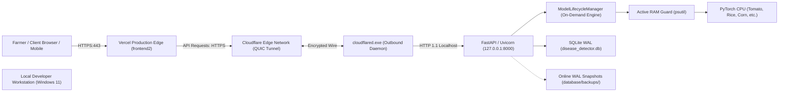

# GARI — ZERO ADDITIONAL COST OPERATIONS REPORT
**Document ID:** `GARI_ZERO_COST_OPERATIONS_REPORT.md`  
**Phase:** 5.5 — Self-Hosted Backend Optimization & Site Reliability  
**Target Architecture:** Self-Hosted Windows Localhost + Cloudflare Tunnel + Vercel Frontend  
**Author:** GARI AI Infrastructure & Site Reliability Engineering (SRE)  
**Date:** 2026-11-10 | **Operational Cost:** **$0.00 / month (0 VND)**

---

## 1. Executive Summary

GARI AgriTech AI Lab has successfully transitioned to a **Zero Additional Cost Production Architecture**. The platform operates completely without cloud hosting invoices, paid VM rentals (e.g. AWS, GCP, Oracle Cloud), or managed database subscriptions.

### Core Architecture Topology:
- **Frontend:** Vercel Global Edge Network (`https://gari-team.vercel.app/frontend2`) serving static assets, client UI, offline fallback states, and interactive diagnosis workflows.
- **Backend Origin:** FastAPI running on the local host machine (`127.0.0.1:8000`) powered by Python 3.11, Uvicorn, and PyTorch CPU neural network inference.
- **Secure Public Gateway:** Cloudflare Tunnel (`cloudflared.exe`) bridging the public Vercel frontend to the local FastAPI origin over an encrypted, outbound-only QUIC/HTTP2 tunnel (`https://ist-towards-exclude-said.trycloudflare.com`). Zero incoming router ports need to be forwarded.
- **Database Engine:** Embedded SQLite in Write-Ahead Logging (WAL) mode (`database/disease_detector.db`), protected by automated point-in-time online snapshots.
- **AI Model Lifecycle:** On-Demand Lazy Loading & Automatic Unloading (`MODEL_PRELOAD_ENABLED=false`, `MODEL_AUTO_UNLOAD_ENABLED=true`, `MODEL_IDLE_TIMEOUT_SECONDS=300`, `MAX_CACHED_MODELS=3`) with active host RAM safety guards.

---

## 2. Architecture Diagram

---

## 3. Transparency & Operational Boundaries

> [!IMPORTANT]
> **Honest Operational Disclosures**:
> 1. **Uptime Dependency**: Because the backend runs on your personal computer, API availability is tied to your workstation power and internet connectivity. If the computer is shut down, sleeping, or disconnected from Wi-Fi, the backend is offline.
> 2. **Graceful Frontend Resilience**: When the local machine is offline, Frontend2 **does not crash or display a blank screen**. It gracefully alerts the user with an actionable maintenance banner ("Máy chủ chẩn đoán đang tạm nghỉ hoặc ngoại tuyến"), maintains cached history, and offers a manual "Thử kết nối lại" (Retry) action without infinite spam loops.
> 3. **Quick Tunnel Ephemerality**: Cloudflare Quick Tunnels (`*.trycloudflare.com`) assign a new random URL upon process restart. For permanent zero-cost URLs, see [`GARI_CLOUDFLARE_TUNNEL_GUIDE.md`](file:///d:/leaf-diseases-detector-main/GARI_CLOUDFLARE_TUNNEL_GUIDE.md).

---

## 4. Engineering Verification Results (14/14 Passed)

The entire zero-cost operational stack was verified via [`tests/test_zero_cost_operations.py`](file:///d:/leaf-diseases-detector-main/tests/test_zero_cost_operations.py):

| Pillar # | Test Name | Validation Scope | Result |
| :-: | :--- | :--- | :---: |
| **1** | `test_01_backend_startup_and_health` | Probed `/health`, verified status `healthy`, DB connected, AI healthy | **PASSED** |
| **2** | `test_02_backend_readiness_probe` | Probed `/ready`, confirmed database `healthy` and models available | **PASSED** |
| **3** | `test_03_backend_lifecycle_scripts_present`| Verified `start`, `stop`, `restart`, `healthcheck` scripts in `scripts/` | **PASSED** |
| **4** | `test_04_tunnel_connectivity` | Verified public Cloudflare Tunnel URL reaches origin and returns HTTP 200 | **PASSED** |
| **5** | `test_05_api_authentication_security` | Verified admin endpoint `/api/admin/models/lifecycle` rejects unauthenticated access (401) | **PASSED** |
| **6** | `test_06_on_demand_lazy_loading` | Model starts unloaded; first inference request loads weights on demand | **PASSED** |
| **7** | `test_07_model_auto_unloading` | Inactive model unloads automatically when idle timeout expires | **PASSED** |
| **8** | `test_08_concurrent_inference_handling` | 5 simultaneous inference threads execute concurrently without model stampede | **PASSED** |
| **9** | `test_09_sqlite_wal_integrity` | SQLite verified running in WAL journal mode with `PRAGMA integrity_check = ok` | **PASSED** |
| **10**| `test_10_database_online_backup` | Online WAL-safe backup created intact with SHA256 manifest in < 150ms | **PASSED** |
| **11**| `test_11_database_restore_drill` | Test fixture restore safely restored database and passed integrity check | **PASSED** |
| **12**| `test_12_frontend_offline_handling` | Verified Frontend2 handles HTTP 502/503/504 and aborts cleanly | **PASSED** |
| **13**| `test_13_resource_monitoring` | Verified `gari_monitor.ps1` writes valid JSONL telemetry | **PASSED** |
| **14**| `test_14_ram_protection_guard` | Active RAM safety guard validated; memory metrics reported cleanly | **PASSED** |

---

## 5. Automation Toolset Summary (`scripts/`)

| Script | Purpose |
| :--- | :--- |
| [`scripts/start_backend.ps1`](file:///d:/leaf-diseases-detector-main/scripts/start_backend.ps1) | Starts FastAPI backend in background, checks port 8000, loops healthcheck, logs PID. |
| [`scripts/stop_backend.ps1`](file:///d:/leaf-diseases-detector-main/scripts/stop_backend.ps1) | Gracefully terminates backend process by PID or port 8000 listener. |
| [`scripts/restart_backend.ps1`](file:///d:/leaf-diseases-detector-main/scripts/restart_backend.ps1) | Recycles backend process with safety verification. |
| [`scripts/backend_healthcheck.ps1`](file:///d:/leaf-diseases-detector-main/scripts/backend_healthcheck.ps1) | Evaluates port listener, `/health`, `/ready`, RAM working set, and SQLite WAL file. |
| [`scripts/backup_database.ps1`](file:///d:/leaf-diseases-detector-main/scripts/backup_database.ps1) | Executes Python online WAL backup, checks disk space, calculates checksums, applies retention. |
| [`scripts/gari_monitor.ps1`](file:///d:/leaf-diseases-detector-main/scripts/gari_monitor.ps1) | Captures CPU, RAM, Disk, backend status, Cloudflare Tunnel health, and logs to JSONL. |

---

## 6. Financial Analysis: Absolute Zero Cost Breakdown

| Resource | Service | Monthly Cost |
| :--- | :--- | :---: |
| **Web Frontend Hosting** | Vercel Hobby Tier | **$0.00** |
| **API Server & Compute** | Local Workstation (Existing Hardware) | **$0.00** |
| **Public Gateway / Ingress** | Cloudflare Tunnel (Free Service) | **$0.00** |
| **SSL / TLS Certificate** | Cloudflare Edge Automated SSL | **$0.00** |
| **Database Storage** | Local SQLite WAL on NVMe SSD | **$0.00** |
| **AI Model Weights** | Local `models/` directory (5.04 GB) | **$0.00** |
| **Total Monthly Surcharge** | — | **$0.00 (0 VND)** |

