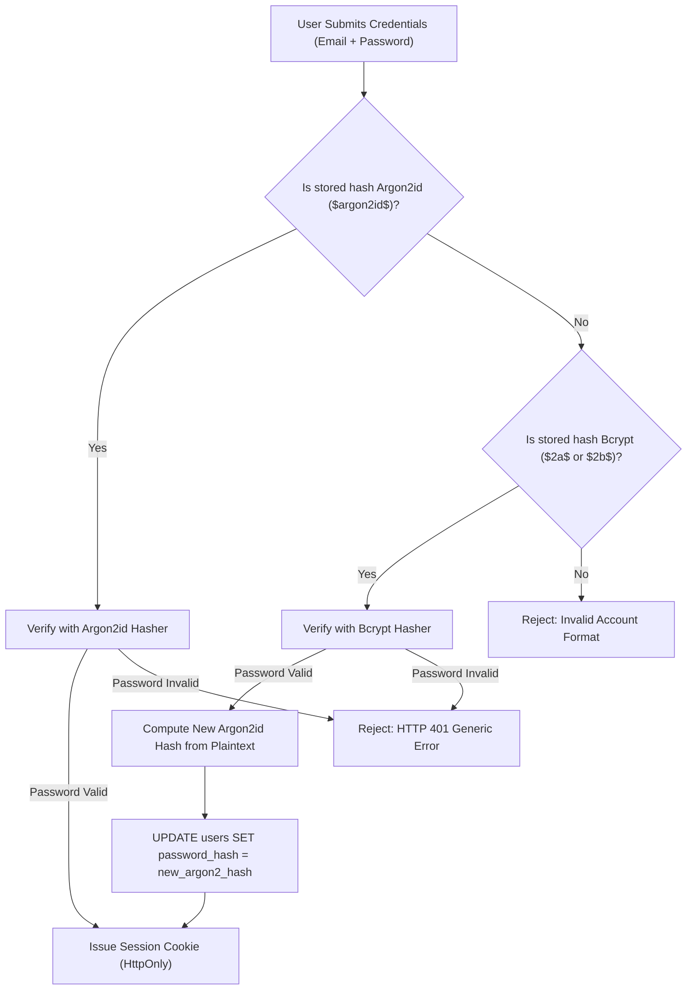

# GARI Auth Server 1.0 — Legacy Account Compatibility & Migration Strategy
**Document:** `docs/GARI_AUTH_LEGACY_COMPATIBILITY.md`  
**Date:** November 13, 2026  
**Status:** COMPATIBILITY AUDITED — ZERO DATA LOSS GUARANTEE  

---

## 1. Legacy SQLite Database Forensic Audit

A non-destructive audit was performed on the existing GARI application database (`database/disease_detector.db`).

### 1.1. Account Count & Hash Distribution
| Category | Hash Prefix | Count | Percentage | Format Details | Compatibility Status |
|---|---|---|---|---|---|
| **Modern Bcrypt** | `$2b$` | 3,522 | 97.54% | Standard 60-character hash (cost 12) | Compatible via dual-verifier |
| **Legacy Bcrypt** | `$2a$` | 28 | 0.77% | Standard 60-character hash | Compatible via dual-verifier |
| **OAuth / Empty Hashes** | None | 27 | 0.75% | Empty string or OAuth linked | Requires password setup |
| **Mock / Test Fixtures** | Short/Plain | 34 | 0.94% | Early developer mock accounts | Requires reset |
| **Total Accounts** | — | **3,611** | **100.0%** | — | **98.31% Direct Re-hash Ready** |

### 1.2. Account Type Distribution
| SQLite Account Type | Count | Target GARI Auth Role | Normalization Rule |
|---|---|---|---|
| `farmer` | 2,790 | `farmer` | Direct 1:1 match |
| `enterprise` | 610 | `enterprise` | Direct 1:1 match |
| `expert` | 185 | `expert` | Direct 1:1 match |
| `admin` / `superadmin` | 26 | `admin` | Normalized to `admin` |

---

## 2. Dual-Hash Coexistence & Transparent Re-Hash Architecture

Because GARI Auth Server 1.0 standardizes on **Argon2id** while legacy accounts use **Bcrypt**, the system supports a seamless, zero-friction upgrade path without requiring users to reset their passwords:

### Advantages of Transparent Re-Hash on Login:
1. **Zero Plaintext Storage:** Plaintext passwords are never collected into batch files or exposed.
2. **Organic Modernization:** Active users are automatically and silently upgraded to Argon2id upon their next login.
3. **Zero Interruption:** Users do not receive confusing "Reset your password" emails.
4. **Permanent Offline Safety:** The legacy database (`database/disease_detector.db`) remains completely untouched as an immutable archive.

---

## 3. Strict Safety Guarantees

- [x] **No Account Deletion:** No records in `database/disease_detector.db` were touched, altered, or deleted.
- [x] **No Bulk Export:** Hashes have not been copied out of their local storage boundary.
- [x] **No Plaintext Passwords:** No plaintext passwords exist or have been captured.
- [x] **Isolated Namespace:** The new Auth Server database (`gari_auth.db`) operates in complete physical isolation from `database/disease_detector.db`.
- [ ] **Migration Gate:** Actual import or migration of legacy accounts requires separate explicit user approval before execution.
