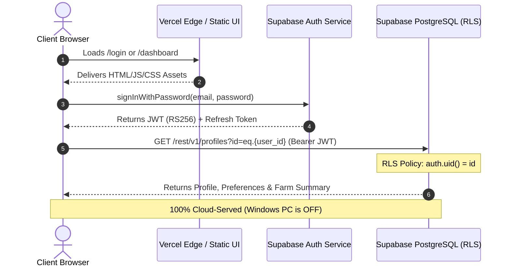
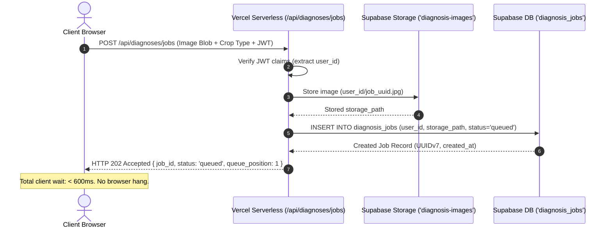
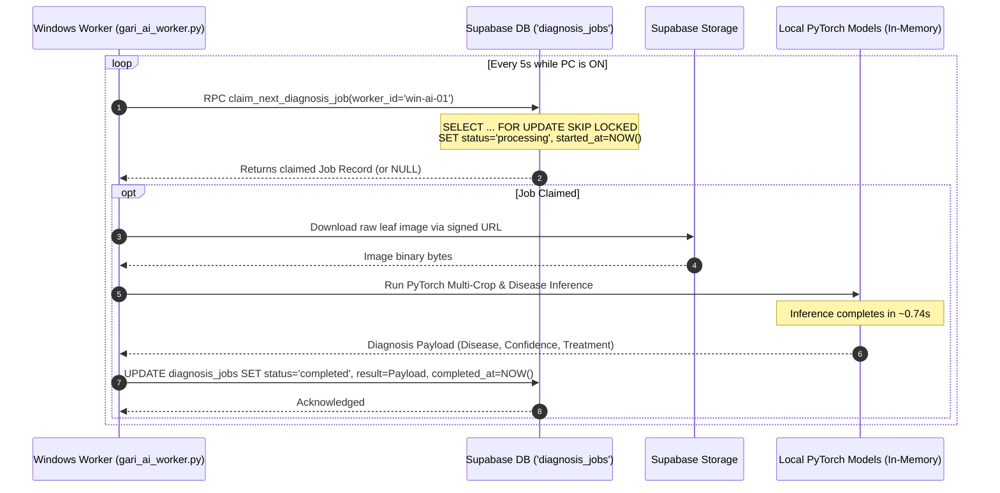
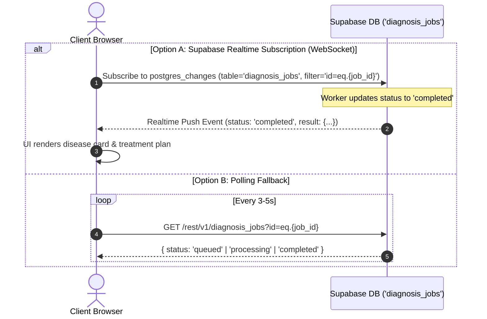

# GARI AgriTech AI Platform — Hybrid Cloud + Windows AI Worker Architecture

**Document ID:** GARI-ARCH-HYBRID-2026-01  
**Project:** GARI AgriTech AI Platform  
**Target Environment:** Vercel Edge + Supabase Cloud + Windows Self-Hosted PyTorch Worker  
**Date:** 2026-11-11  
**Status:** DRAFT SPECIFICATION — APPROVED FOR REVIEW  

---

## 1. Executive Summary & Problem Statement

### 1.1 The Operational Bottleneck
Currently, the GARI system couples the web presentation layer, authentication authority, SQLite database, and PyTorch AI vision inference onto a single Windows host machine (`D:\leaf-diseases-detector-main`). When the Windows PC is turned off, sleep-modes, or reboots:
- The entire web platform becomes unresponsive (Vercel returns HTTP 503 `BACKEND_UNAVAILABLE`).
- Users cannot log in, register, access their profiles, manage their farms, or review historical diagnoses.
- Client requests stall, degrade user trust, and breach standard SaaS availability expectations.

### 1.2 The Hybrid Architecture Solution
This architectural specification decouples GARI into two distinct execution tiers:
1. **Always-On Cloud Tier (24/7 Availability):**
   - **Frontend & Edge Routing:** Vercel Global CDN & Serverless Functions.
   - **Primary Identity Authority:** Supabase Auth (Email/Password, OAuth, JWT issuance).
   - **Cloud Data Store:** Supabase PostgreSQL (`public` schema with Row Level Security).
   - **Binary Object Store:** Supabase Storage (Private encrypted bucket for leaf images).
   - **Durable Job Queue:** PostgreSQL-backed queue table (`diagnosis_jobs`) tracking asynchronous diagnostic requests.
2. **On-Demand Local Worker Tier (Intermittent Execution):**
   - **Host Machine:** Windows PC running PyTorch with pre-warmed neural networks (53 models).
   - **Operational Duty Cycle:** Active 2–4 hours per day.
   - **Execution Role:** Headless asynchronous polling worker (`gari_ai_worker.py`). Pulls queued jobs from the cloud, performs local inference, and uploads diagnostic results back to Supabase.
   - **Perimeter Isolation:** Outbound HTTPS only; zero open inbound ports, zero local model file exposure.

```
=====================================================================================================
                                 GARI HYBRID TOPOLOGY OVERVIEW
=====================================================================================================

  [ End-User Browser / Mobile PWA ]
                 │
                 │ 1. 24/7 User Interaction (Auth, Profiles, Farms, Library, Job Submission)
                 ▼
  ┌────────────────────────────────────────────────────────────────────────┐
  │                           VERCEL CLOUD TIER                            │
  │  - Static Assets & Frontend UI (HTML5, Tailwind, Vanilla JS/Vite)      │
  │  - Edge Functions (Lightweight API routing, Config bootstrap)          │
  └───────────────────┬────────────────────────────────┬───────────────────┘
                      │                                │
     2. Supabase Auth │              3. PostgREST CRUD │ 4. Leaf Image
        & JWT Tokens  │                 & Job Queue    │    Direct Upload
                      ▼                                ▼    (Signed URL)
  ┌────────────────────────────────────────────────────────────────────────┐
  │                          SUPABASE CLOUD TIER                           │
  │  - Supabase Auth (Identity, Asymmetric RS256/ES256 JWT, Refresh Tokens)│
  │  - PostgreSQL 15 (Profiles, Farms, Plots, Tasks, Diagnosis History)     │
  │  - Storage Bucket: 'diagnosis-images' (Private, RLS-protected)         │
  │  - Table: 'diagnosis_jobs' (Durable Queue: queued, processing, etc.)    │
  └───────────────────────────────────▲────────────────────────────────────┘
                                      │
                                      │ 5. Outbound Worker Polling & Result Writeback
                                      │    (Service Role / Scoped Worker Key)
                                      │    [Only runs when PC is ON ~2-4 hrs/day]
                                      │
  ┌───────────────────────────────────┴────────────────────────────────────┐
  │                    WINDOWS PC ON-DEMAND AI WORKER                      │
  │  - Worker Daemon: gari_ai_worker.py (claim_next_diagnosis_job)         │
  │  - PyTorch Engine (53 localized plant disease vision models)           │
  │  - Local Hardware: CPU/GPU Tensor Execution (~0.74s per inference)     │
  │  - Zero Inbound Ports: Outbound-only polling (Cloudflare Tunnel opt)   │
  └────────────────────────────────────────────────────────────────────────┘
```

---

## 2. API Endpoint Inventory & Classification Matrix

The GARI codebase contains 373 total route declarations in [`api_server.py`](file:///d:/leaf-diseases-detector-main/api_server.py). Below is the comprehensive classification into four operational categories.

### 2.1 Category A: Cloud 24/7 Required (Always-On Cloud Tier)
*Endpoints that must never fail, regardless of whether the Windows host is powered on. These are served directly by Supabase Auth, Supabase PostgREST, or lightweight Vercel Serverless Functions.*

| Endpoint Path | HTTP Method | Target Cloud Handler | Data Store Dependency |
| :--- | :---: | :--- | :--- |
| `/api/auth/register` | `POST` | Supabase Auth API (`signUp`) | Supabase `auth.users` + `public.profiles` |
| `/api/auth/login` | `POST` | Supabase Auth API (`signInWithPassword`) | Supabase `auth.users` |
| `/api/auth/logout` | `POST` | Supabase Auth API (`signOut`) | Supabase Auth sessions |
| `/api/auth/refresh` | `POST` | Supabase Auth API (`refreshSession`) | Supabase Auth tokens |
| `/api/user/profile` | `GET`, `PUT` | Supabase PostgREST / Vercel Serverless | Supabase `public.profiles` |
| `/api/user/preferences` | `GET`, `PUT` | Supabase PostgREST | Supabase `public.user_preferences` |
| `/api/user/account-type` | `GET`, `POST`| Supabase PostgREST / Vercel Serverless | Supabase `public.profiles.account_type` |
| `/api/user/onboarding` | `GET`, `POST`| Supabase PostgREST | Supabase `public.user_onboarding_profiles` |
| `/api/farms/**` | `GET`, `POST`, `PUT`, `DELETE` | Supabase PostgREST | Supabase `public.farms` |
| `/api/plots/**` | `GET`, `POST`, `PUT`, `DELETE` | Supabase PostgREST | Supabase `public.farm_plots`, `farm_zones` |
| `/api/tasks/**` | `GET`, `POST`, `PUT`, `DELETE` | Supabase PostgREST | Supabase `public.cultivation_tasks` |
| `/api/knowledge/crops/**` | `GET` | Supabase PostgREST / Edge Static | Supabase `public.crops` |
| `/api/knowledge/diseases/**` | `GET` | Supabase PostgREST / Edge Static | Supabase `public.diseases` |
| `/api/community/**` | `GET`, `POST`, `DELETE` | Supabase PostgREST | Supabase `public.community_posts`, `comments` |
| `/api/diagnoses` (History) | `GET`, `DELETE` | Supabase PostgREST | Supabase `public.diagnoses` |
| `/api/diagnoses/jobs` | `POST` | Vercel Serverless / PostgREST | Supabase `diagnosis_jobs` + Storage Bucket |
| `/api/diagnoses/jobs/{id}` | `GET` | Supabase PostgREST / Vercel Serverless | Supabase `diagnosis_jobs` |
| `/api/billing/**` | `GET`, `POST`| Vercel Serverless | Supabase `public.subscriptions`, `payment_orders` |

### 2.2 Category B: Cloud Lightweight Optional (Best-Effort Cloud Tier)
*Endpoints providing supplementary services that run on Vercel Serverless using external managed APIs without local PyTorch dependencies.*

| Endpoint Path | HTTP Method | Target Handler | External Dependency |
| :--- | :---: | :--- | :--- |
| `/api/assistant/chat` | `POST` | Vercel Serverless Function | Google Gemini API (Cloud LLM) |
| `/api/weather/**` | `GET` | Vercel Serverless / Cache | OpenWeather / WeatherAPI |
| `/api/user/data-export` | `GET` | Vercel Serverless Function | Supabase PostgREST query aggregation |
| `/api/notifications/**`| `GET`, `PATCH`| Supabase PostgREST | Supabase `public.notifications` |
| `/api/analytics/telemetry` | `POST` | Vercel Analytics / Supabase | Cloud telemetry table |

### 2.3 Category C: Local AI Worker Required (Windows PC Only)
*Heavy computational workloads that require PyTorch neural model evaluation, local weight files, or multi-crop CNN classification.*

| Endpoint Path / Task | Processing Method | Engine & Dependencies | Operational Rule |
| :--- | :--- | :--- | :--- |
| **`POST /api/predict`** | Asynchronous Job Worker (`gari_ai_worker.py`) | PyTorch, `torchvision`, 53 model directories (`models/`) | Consumed from `diagnosis_jobs` queue when Windows PC is active |
| **Multi-Crop Leaf Detection** | Asynchronous Job Worker | YOLOv8 / CNN Local weights (`models/leaf_crop_detector/`) | Executed during worker pipeline step 1 |
| **Visual Symptom Localization** | Asynchronous Job Worker | Local CAM / Bounding Box extractor | Executed during worker pipeline step 2 |
| **Model Benchmark / Profiler** | Local maintenance script | `tools/audit_models.py`, `tests/benchmark_diagnosis_perf.py` | Operator-invoked locally only |

### 2.4 Category D: Legacy or Deprecated (Scheduled for Retirement)
*Endpoints tied to outdated local-only session mechanisms or unmaintained file structures.*

| Endpoint Path | Status | Reason & Replacement |
| :--- | :--- | :--- |
| `/api/auth/firebase-login` | Deprecated | Replaced by direct Supabase Auth integration |
| `/api/auth/provider-lookup`| Deprecated | Unnecessary; Supabase Auth manages identity lookup |
| Legacy Edge Auth Fallback | Removed | Security vulnerability; replaced by fail-closed 503 |
| Direct SQLite DB Download | Deprecated | Replaced by authenticated Supabase JSON data export |

---

## 3. End-to-End System Workflows

### 3.1 Workflow 1: 24/7 User Authentication & Profile Loading
*Operates seamlessly even when the Windows machine is completely powered off.*



### 3.2 Workflow 2: Asynchronous Diagnosis Job Submission
*The client uploads an image and enqueues a job without waiting for model execution or risking HTTP timeouts.*



### 3.3 Workflow 3: Windows AI Worker Polling & Result Processing
*When the Windows PC powers on, it claims and processes queued jobs sequentially.*



### 3.4 Workflow 4: Client Result Retrieval
*The user receives completed results either via real-time WebSocket push or gentle polling.*



---

## 4. Architectural Boundaries & Security Guarantees

1. **Model Intellectual Property Protection:**
   PyTorch `.pth`/`.pt` model weights never leave the local Windows machine. They are never committed to Git, uploaded to cloud storage, or accessible over public URLs.
2. **Zero Inbound Cloud Exposure on Windows:**
   The Windows worker acts as an outbound client to Supabase HTTPS endpoints (`https://<project-ref>.supabase.co`). It requires no port forwarding, no router NAT changes, and no public DNS entry.
3. **Decoupled Failure Domains:**
   - If the Windows PC is **OFF**: Web browsing, profile updates, task scheduling, community interactions, and job submissions continue without error.
   - If Supabase Cloud encounters an outage: The local worker gracefully pauses polling with exponential backoff.
4. **Fail-Safe Idempotency:**
   Every diagnosis job possesses a unique UUID. Jobs are claimed using atomic database locks (`SKIP LOCKED`). If the Windows PC powers off mid-inference, an automated watchdog resets stale processing locks after 2 minutes.

---

## 5. Architectural Readiness Assessment

| Architecture Requirement | Assessment | Notes |
| :--- | :---: | :--- |
| 24/7 Web & Auth Availability | **DESIGNED** | Decoupled from Windows host; delegated to Vercel + Supabase |
| 24/7 User Profile & Farm CRUD | **DESIGNED** | Managed in Supabase PostgreSQL with RLS |
| Intermittent Windows AI Worker | **DESIGNED** | Pulls from durable queue; handles cold shutdowns safely |
| Storage & Image Pipeline | **DESIGNED** | Private Supabase Storage bucket with signed URL downloads |
| Zero Open Ports on Windows Host | **VERIFIED** | Outbound HTTPS polling only |
| Zero PHP Strict Compliance | **VERIFIED** | 100% Python 3.11+, TypeScript, Node.js, SQL |

