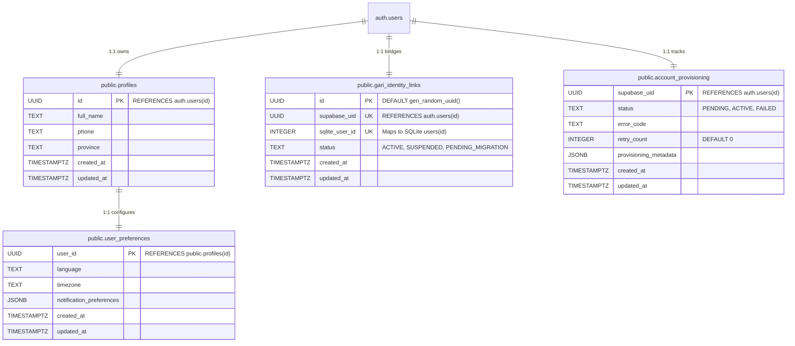

# GARI AgriTech AI Lab — Supabase Hybrid Schema & Migration Specification

**Document ID:** GARI-SPEC-SUPABASE-SCHEMA-2026-01  
**Project:** GARI AgriTech AI Lab  
**Target Database:** Supabase PostgreSQL (`public` schema)  
**Date:** 2026-11-11  
**Status:** DRAFT / APPROVED FOR PREVIEW STAGING  

---

## 1. Schema Overview & Entity Relationship Model

The Supabase PostgreSQL schema governs user identity, public profiles, preferences, and identity mapping to the local SQLite database.



---

## 2. Table Specifications & Constraints

### 2.1 Table: `public.profiles`
Stores user profile information directly linked to the Supabase authentication account.
* **`id` (UUID, PK):** Foreign key referencing `auth.users(id) ON DELETE CASCADE`.
* **`full_name` (TEXT, NOT NULL):** User's full display name (sanitized, 2–100 chars).
* **`phone` (TEXT):** User's contact telephone number.
* **`province` (TEXT, DEFAULT 'Lâm Đồng'):** Agricultural operational province.
* **`created_at` (TIMESTAMPTZ, DEFAULT NOW()):** Timestamp of profile creation.
* **`updated_at` (TIMESTAMPTZ, DEFAULT NOW()):** Auto-updated via trigger.

### 2.2 Table: `public.user_preferences`
Stores user UI localization, notification channels, and operational preferences.
* **`user_id` (UUID, PK):** Foreign key referencing `public.profiles(id) ON DELETE CASCADE`.
* **`language` (TEXT, DEFAULT 'vi'):** ISO language code ('vi', 'en').
* **`timezone` (TEXT, DEFAULT 'Asia/Ho_Chi_Minh'):** IANA timezone.
* **`notification_preferences` (JSONB, DEFAULT '{}'):** Key-value flags (e.g. `{"sms": false, "email": true, "push": true}`).
* **`created_at` (TIMESTAMPTZ, DEFAULT NOW())**
* **`updated_at` (TIMESTAMPTZ, DEFAULT NOW())**

### 2.3 Table: `public.gari_identity_links`
The authoritative identity bridge connecting a Supabase user with their SQLite internal integer ID.
* **`id` (UUID, PK):** Primary surrogate key (`gen_random_uuid()`).
* **`supabase_uid` (UUID, UNIQUE, NOT NULL):** Foreign key referencing `auth.users(id) ON DELETE CASCADE`.
* **`sqlite_user_id` (INTEGER, UNIQUE, NOT NULL):** The integer primary key in SQLite `database/disease_detector.db:users.id`.
* **`status` (TEXT, DEFAULT 'ACTIVE'):** Check constraint: `status IN ('ACTIVE', 'SUSPENDED', 'PENDING_MIGRATION')`.
* **`created_at` (TIMESTAMPTZ, DEFAULT NOW())**
* **`updated_at` (TIMESTAMPTZ, DEFAULT NOW())**

### 2.4 Table: `public.account_provisioning`
Tracks the asynchronous or synchronous onboarding state machine between Supabase and FastAPI/SQLite.
* **`supabase_uid` (UUID, PK):** Foreign key referencing `auth.users(id) ON DELETE CASCADE`.
* **`status` (TEXT, NOT NULL, DEFAULT 'PENDING'):** Check constraint: `status IN ('PENDING', 'ACTIVE', 'FAILED')`.
* **`error_code` (TEXT):** Diagnostic failure code if status is `FAILED`.
* **`retry_count` (INTEGER, DEFAULT 0):** Number of idempotent provisioning retries.
* **`provisioning_metadata` (JSONB, DEFAULT '{}'):** Contextual details (e.g. registration IP, client version).
* **`created_at` (TIMESTAMPTZ, DEFAULT NOW())**
* **`updated_at` (TIMESTAMPTZ, DEFAULT NOW())**

---

## 3. Row-Level Security (RLS) Policy Design

In compliance with Phase 2 requirements, **every exposed public table has RLS explicitly enabled**, and policies enforce strict row ownership using `auth.uid()`.

| Table | Policy Name | Command | Permitted Roles | Condition / Using Expression |
|---|---|:---:|:---:|---|
| `profiles` | `profiles_select_own` | `SELECT` | `authenticated` | `auth.uid() = id` |
| `profiles` | `profiles_update_own` | `UPDATE` | `authenticated` | `auth.uid() = id` |
| `profiles` | `profiles_service_role` | `ALL` | `service_role` | `true` |
| `user_preferences` | `prefs_select_own` | `SELECT` | `authenticated` | `auth.uid() = user_id` |
| `user_preferences` | `prefs_update_own` | `UPDATE` | `authenticated` | `auth.uid() = user_id` |
| `user_preferences` | `prefs_service_role` | `ALL` | `service_role` | `true` |
| `gari_identity_links`| `links_select_own` | `SELECT` | `authenticated` | `auth.uid() = supabase_uid` |
| `gari_identity_links`| `links_service_all`| `ALL` | `service_role` | `true` |
| `account_provisioning`| `prov_select_own` | `SELECT` | `authenticated` | `auth.uid() = supabase_uid` |
| `account_provisioning`| `prov_service_all` | `ALL` | `service_role` | `true` |

> [!IMPORTANT]
> **No Direct Client Insert/Update on Identity Links:**
> The `authenticated` role is granted `SELECT` only on `gari_identity_links` and `account_provisioning`. Only the trusted FastAPI backend running with `service_role` (or via trusted server-side provisioning) can link a `supabase_uid` to a `sqlite_user_id`. This prevents malicious users from claiming another user's SQLite ID.

---

## 4. Complete PostgreSQL Migration Script

```sql
-- ============================================================================
-- GARI AgriTech AI Lab — Supabase PostgreSQL Schema Migration (V1.0)
-- Target: Supabase PostgreSQL (Preview Instance)
-- ============================================================================

-- Enable required extensions
CREATE EXTENSION IF NOT EXISTS "uuid-ossp";

-- ----------------------------------------------------------------------------
-- 1. Helper Function: Auto-update updated_at timestamp
-- ----------------------------------------------------------------------------
CREATE OR REPLACE FUNCTION public.handle_updated_at()
RETURNS TRIGGER AS $$
BEGIN
    NEW.updated_at = NOW();
    RETURN NEW;
END;
$$ LANGUAGE plpgsql SECURITY DEFINER;

-- ----------------------------------------------------------------------------
-- 2. Table: public.profiles
-- ----------------------------------------------------------------------------
CREATE TABLE IF NOT EXISTS public.profiles (
    id UUID PRIMARY KEY REFERENCES auth.users(id) ON DELETE CASCADE,
    full_name TEXT NOT NULL,
    phone TEXT,
    province TEXT DEFAULT 'Lâm Đồng',
    created_at TIMESTAMPTZ NOT NULL DEFAULT NOW(),
    updated_at TIMESTAMPTZ NOT NULL DEFAULT NOW()
);

-- Index for phone search
CREATE INDEX IF NOT EXISTS idx_profiles_phone ON public.profiles(phone);

-- Trigger for updated_at
DROP TRIGGER IF EXISTS set_profiles_updated_at ON public.profiles;
CREATE TRIGGER set_profiles_updated_at
    BEFORE UPDATE ON public.profiles
    FOR EACH ROW
    EXECUTE FUNCTION public.handle_updated_at();

-- ----------------------------------------------------------------------------
-- 3. Table: public.user_preferences
-- ----------------------------------------------------------------------------
CREATE TABLE IF NOT EXISTS public.user_preferences (
    user_id UUID PRIMARY KEY REFERENCES public.profiles(id) ON DELETE CASCADE,
    language TEXT NOT NULL DEFAULT 'vi',
    timezone TEXT NOT NULL DEFAULT 'Asia/Ho_Chi_Minh',
    notification_preferences JSONB NOT NULL DEFAULT '{"email": true, "sms": false, "push": true}'::jsonb,
    created_at TIMESTAMPTZ NOT NULL DEFAULT NOW(),
    updated_at TIMESTAMPTZ NOT NULL DEFAULT NOW(),
    CONSTRAINT chk_language CHECK (language IN ('vi', 'en'))
);

DROP TRIGGER IF EXISTS set_user_preferences_updated_at ON public.user_preferences;
CREATE TRIGGER set_user_preferences_updated_at
    BEFORE UPDATE ON public.user_preferences
    FOR EACH ROW
    EXECUTE FUNCTION public.handle_updated_at();

-- ----------------------------------------------------------------------------
-- 4. Table: public.gari_identity_links (Bridge Table)
-- ----------------------------------------------------------------------------
CREATE TABLE IF NOT EXISTS public.gari_identity_links (
    id UUID PRIMARY KEY DEFAULT gen_random_uuid(),
    supabase_uid UUID UNIQUE NOT NULL REFERENCES auth.users(id) ON DELETE CASCADE,
    sqlite_user_id INTEGER UNIQUE NOT NULL,
    status TEXT NOT NULL DEFAULT 'ACTIVE',
    created_at TIMESTAMPTZ NOT NULL DEFAULT NOW(),
    updated_at TIMESTAMPTZ NOT NULL DEFAULT NOW(),
    CONSTRAINT chk_link_status CHECK (status IN ('ACTIVE', 'SUSPENDED', 'PENDING_MIGRATION'))
);

CREATE INDEX IF NOT EXISTS idx_identity_links_sqlite ON public.gari_identity_links(sqlite_user_id);

DROP TRIGGER IF EXISTS set_gari_identity_links_updated_at ON public.gari_identity_links;
CREATE TRIGGER set_gari_identity_links_updated_at
    BEFORE UPDATE ON public.gari_identity_links
    FOR EACH ROW
    EXECUTE FUNCTION public.handle_updated_at();

-- ----------------------------------------------------------------------------
-- 5. Table: public.account_provisioning (State Machine)
-- ----------------------------------------------------------------------------
CREATE TABLE IF NOT EXISTS public.account_provisioning (
    supabase_uid UUID PRIMARY KEY REFERENCES auth.users(id) ON DELETE CASCADE,
    status TEXT NOT NULL DEFAULT 'PENDING',
    error_code TEXT,
    retry_count INTEGER NOT NULL DEFAULT 0,
    provisioning_metadata JSONB DEFAULT '{}'::jsonb,
    created_at TIMESTAMPTZ NOT NULL DEFAULT NOW(),
    updated_at TIMESTAMPTZ NOT NULL DEFAULT NOW(),
    CONSTRAINT chk_provisioning_status CHECK (status IN ('PENDING', 'ACTIVE', 'FAILED'))
);

DROP TRIGGER IF EXISTS set_account_provisioning_updated_at ON public.account_provisioning;
CREATE TRIGGER set_account_provisioning_updated_at
    BEFORE UPDATE ON public.account_provisioning
    FOR EACH ROW
    EXECUTE FUNCTION public.handle_updated_at();

-- ----------------------------------------------------------------------------
-- 6. Trigger: Automatic Profile & Provisioning Record on User Signup
-- ----------------------------------------------------------------------------
CREATE OR REPLACE FUNCTION public.handle_new_user_signup()
RETURNS TRIGGER AS $$
BEGIN
    -- 1. Insert Profile
    INSERT INTO public.profiles (id, full_name, phone, province)
    VALUES (
        NEW.id,
        COALESCE(NEW.raw_user_meta_data->>'full_name', NEW.raw_user_meta_data->>'name', 'Nông dân Gari'),
        COALESCE(NEW.raw_user_meta_data->>'phone', ''),
        COALESCE(NEW.raw_user_meta_data->>'province', 'Lâm Đồng')
    ) ON CONFLICT (id) DO NOTHING;

    -- 2. Insert Default User Preferences
    INSERT INTO public.user_preferences (user_id)
    VALUES (NEW.id)
    ON CONFLICT (user_id) DO NOTHING;

    -- 3. Initialize Provisioning Record
    INSERT INTO public.account_provisioning (supabase_uid, status, retry_count)
    VALUES (NEW.id, 'PENDING', 0)
    ON CONFLICT (supabase_uid) DO NOTHING;

    RETURN NEW;
END;
$$ LANGUAGE plpgsql SECURITY DEFINER;

DROP TRIGGER IF EXISTS on_auth_user_created ON auth.users;
CREATE TRIGGER on_auth_user_created
    AFTER INSERT ON auth.users
    FOR EACH ROW
    EXECUTE FUNCTION public.handle_new_user_signup();

-- ----------------------------------------------------------------------------
-- 7. Row-Level Security (RLS) Configuration
-- ----------------------------------------------------------------------------

-- Enable RLS on all tables
ALTER TABLE public.profiles ENABLE ROW LEVEL SECURITY;
ALTER TABLE public.user_preferences ENABLE ROW LEVEL SECURITY;
ALTER TABLE public.gari_identity_links ENABLE ROW LEVEL SECURITY;
ALTER TABLE public.account_provisioning ENABLE ROW LEVEL SECURITY;

-- 7.1 Profiles RLS
CREATE POLICY "profiles_select_own" ON public.profiles
    FOR SELECT TO authenticated
    USING (auth.uid() = id);

CREATE POLICY "profiles_update_own" ON public.profiles
    FOR UPDATE TO authenticated
    USING (auth.uid() = id)
    WITH CHECK (auth.uid() = id);

CREATE POLICY "profiles_service_role" ON public.profiles
    FOR ALL TO service_role
    USING (true)
    WITH CHECK (true);

-- 7.2 User Preferences RLS
CREATE POLICY "prefs_select_own" ON public.user_preferences
    FOR SELECT TO authenticated
    USING (auth.uid() = user_id);

CREATE POLICY "prefs_update_own" ON public.user_preferences
    FOR UPDATE TO authenticated
    USING (auth.uid() = user_id)
    WITH CHECK (auth.uid() = user_id);

CREATE POLICY "prefs_service_role" ON public.user_preferences
    FOR ALL TO service_role
    USING (true)
    WITH CHECK (true);

-- 7.3 GARI Identity Links RLS (Strict Server-Only Modification)
CREATE POLICY "links_select_own" ON public.gari_identity_links
    FOR SELECT TO authenticated
    USING (auth.uid() = supabase_uid);

CREATE POLICY "links_service_role" ON public.gari_identity_links
    FOR ALL TO service_role
    USING (true)
    WITH CHECK (true);

-- 7.4 Account Provisioning RLS
CREATE POLICY "prov_select_own" ON public.account_provisioning
    FOR SELECT TO authenticated
    USING (auth.uid() = supabase_uid);

CREATE POLICY "prov_service_role" ON public.account_provisioning
    FOR ALL TO service_role
    USING (true)
    WITH CHECK (true);
```

