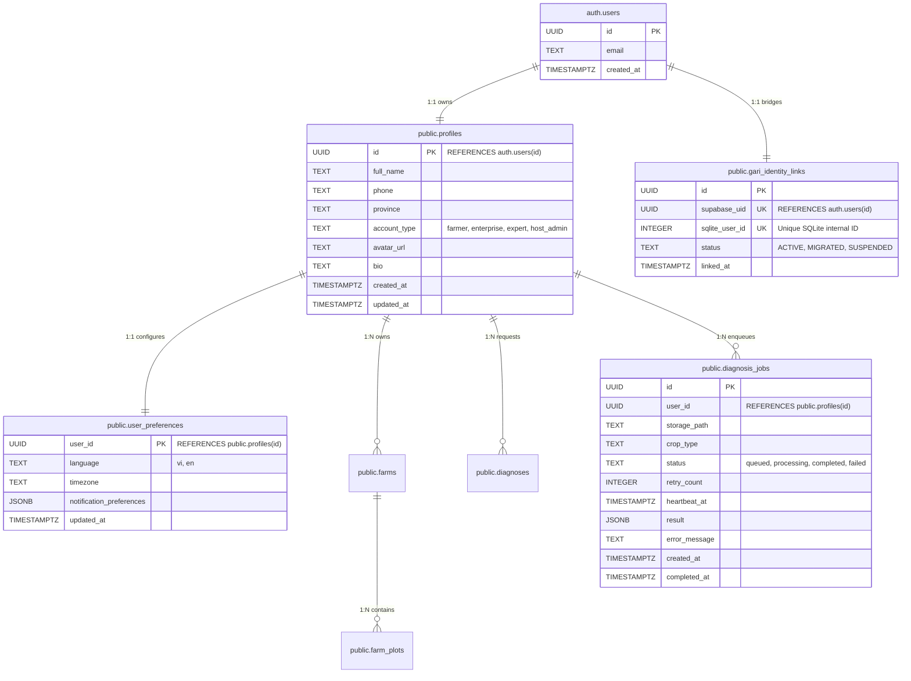

# GARI AgriTech AI Platform — Supabase Auth & PostgreSQL Migration Plan

**Document ID:** GARI-PLAN-SUPABASE-MIGRATION-2026-01  
**Project:** GARI AgriTech AI Platform  
**Target Database:** Supabase Cloud PostgreSQL 15 (`public` & `auth` schemas)  
**Date:** 2026-11-11  
**Status:** DRAFT SPECIFICATION — APPROVED FOR REVIEW  

---

## 1. Migration Overview & Strategic Principles

This migration transitions GARI's identity and operational data from an unmanaged, host-bound SQLite file (`database/disease_detector.db`) to **Supabase Cloud (PostgreSQL 15 + Supabase Auth)**.

### Core Migration Principles:
1. **Zero Data Loss Guarantee:** No records in the existing SQLite database will be truncated, deleted, or reset. SQLite remains fully intact as an archived baseline and operational fallback.
2. **Zero Authentication Bypass:** At no point will an unauthenticated user or synthetic identity bypass credential verification.
3. **Dual-Identity Bridge:** Internal business records that rely on integer keys (`user_id INTEGER`) will be safely mapped to Supabase UUIDs (`auth.users.id UUID`) via the bridge table `public.gari_identity_links`.
4. **Credential Privacy:** Password hashes (`password_hash`) in SQLite are PBKDF2/Argon2 encrypted. Plaintext passwords do not exist and will never be requested, exposed, or logged.

---

## 2. Supabase PostgreSQL Schema Specification



### 2.1 Complete DDL Migration Script (`schema_v1.sql`)

```sql
-- ============================================================================
-- GARI AgriTech AI Platform — Supabase PostgreSQL Database DDL
-- Target: Supabase Cloud PostgreSQL 15
-- ============================================================================

-- 1. Enable Required Extensions
CREATE EXTENSION IF NOT EXISTS "uuid-ossp";
CREATE EXTENSION IF NOT EXISTS "pgcrypto";

-- 2. Timestamp Trigger Function
CREATE OR REPLACE FUNCTION public.handle_updated_at()
RETURNS TRIGGER AS $$
BEGIN
    NEW.updated_at = NOW();
    RETURN NEW;
END;
$$ LANGUAGE plpgsql SECURITY DEFINER;

-- ----------------------------------------------------------------------------
-- 3. Table: public.profiles
-- ----------------------------------------------------------------------------
CREATE TABLE IF NOT EXISTS public.profiles (
    id UUID PRIMARY KEY REFERENCES auth.users(id) ON DELETE CASCADE,
    full_name TEXT NOT NULL,
    phone TEXT,
    province TEXT DEFAULT 'Lâm Đồng',
    account_type TEXT NOT NULL DEFAULT 'farmer' 
        CHECK (account_type IN ('farmer', 'enterprise', 'expert', 'host_admin')),
    avatar_url TEXT,
    bio TEXT,
    created_at TIMESTAMPTZ NOT NULL DEFAULT NOW(),
    updated_at TIMESTAMPTZ NOT NULL DEFAULT NOW()
);

CREATE INDEX IF NOT EXISTS idx_profiles_phone ON public.profiles(phone);
CREATE INDEX IF NOT EXISTS idx_profiles_account_type ON public.profiles(account_type);

CREATE OR REPLACE TRIGGER trg_profiles_updated_at
    BEFORE UPDATE ON public.profiles
    FOR EACH ROW EXECUTE FUNCTION public.handle_updated_at();

-- ----------------------------------------------------------------------------
-- 4. Table: public.user_preferences
-- ----------------------------------------------------------------------------
CREATE TABLE IF NOT EXISTS public.user_preferences (
    user_id UUID PRIMARY KEY REFERENCES public.profiles(id) ON DELETE CASCADE,
    language TEXT NOT NULL DEFAULT 'vi' CHECK (language IN ('vi', 'en')),
    timezone TEXT NOT NULL DEFAULT 'Asia/Ho_Chi_Minh',
    notification_preferences JSONB NOT NULL DEFAULT '{"email": true, "sms": false, "push": true}'::jsonb,
    created_at TIMESTAMPTZ NOT NULL DEFAULT NOW(),
    updated_at TIMESTAMPTZ NOT NULL DEFAULT NOW()
);

CREATE OR REPLACE TRIGGER trg_user_preferences_updated_at
    BEFORE UPDATE ON public.user_preferences
    FOR EACH ROW EXECUTE FUNCTION public.handle_updated_at();

-- ----------------------------------------------------------------------------
-- 5. Table: public.gari_identity_links
-- Bridges Supabase UUID with legacy SQLite integer user_id
-- ----------------------------------------------------------------------------
CREATE TABLE IF NOT EXISTS public.gari_identity_links (
    id UUID PRIMARY KEY DEFAULT gen_random_uuid(),
    supabase_uid UUID UNIQUE NOT NULL REFERENCES auth.users(id) ON DELETE CASCADE,
    sqlite_user_id INTEGER UNIQUE NOT NULL,
    status TEXT NOT NULL DEFAULT 'ACTIVE' CHECK (status IN ('ACTIVE', 'MIGRATED', 'SUSPENDED')),
    linked_at TIMESTAMPTZ NOT NULL DEFAULT NOW(),
    updated_at TIMESTAMPTZ NOT NULL DEFAULT NOW()
);

CREATE INDEX IF NOT EXISTS idx_identity_sqlite_id ON public.gari_identity_links(sqlite_user_id);

-- ----------------------------------------------------------------------------
-- 6. Automated Profile Provisioning Trigger
-- Fires automatically whenever a user signs up via Supabase Auth
-- ----------------------------------------------------------------------------
CREATE OR REPLACE FUNCTION public.handle_new_user()
RETURNS TRIGGER AS $$
DECLARE
    user_full_name TEXT;
    user_account_type TEXT;
BEGIN
    user_full_name := COALESCE(NEW.raw_user_meta_data->>'full_name', NEW.raw_user_meta_data->>'name', split_part(NEW.email, '@', 1));
    user_account_type := COALESCE(NEW.raw_user_meta_data->>'account_type', 'farmer');

    INSERT INTO public.profiles (id, full_name, account_type)
    VALUES (NEW.id, user_full_name, user_account_type)
    ON CONFLICT (id) DO NOTHING;

    INSERT INTO public.user_preferences (user_id)
    VALUES (NEW.id)
    ON CONFLICT (user_id) DO NOTHING;

    RETURN NEW;
END;
$$ LANGUAGE plpgsql SECURITY DEFINER;

CREATE OR REPLACE TRIGGER on_auth_user_created
    AFTER INSERT ON auth.users
    FOR EACH ROW EXECUTE FUNCTION public.handle_new_user();
```

---

## 3. Row Level Security (RLS) Policies

All tables in the `public` schema have Row Level Security enabled. Clients accessing data via the Supabase client or PostgREST are constrained strictly by their cryptographic identity (`auth.uid()`).

| Target Table | Policy Name | Permitted Roles | SQL Command | Policy Using Expression | With Check Expression |
| :--- | :--- | :---: | :---: | :--- | :--- |
| `profiles` | `profiles_read_all` | `authenticated` | `SELECT` | `true` (Public farmer discovery) | N/A |
| `profiles` | `profiles_update_own`| `authenticated` | `UPDATE` | `auth.uid() = id` | `auth.uid() = id` |
| `profiles` | `profiles_service_all`| `service_role` | `ALL` | `true` | `true` |
| `user_preferences`| `prefs_select_own`| `authenticated` | `SELECT` | `auth.uid() = user_id` | N/A |
| `user_preferences`| `prefs_update_own`| `authenticated` | `UPDATE` | `auth.uid() = user_id` | `auth.uid() = user_id` |
| `gari_identity_links`| `links_select_own`| `authenticated` | `SELECT` | `auth.uid() = supabase_uid` | N/A |
| `gari_identity_links`| `links_service_all`| `service_role` | `ALL` | `true` | `true` |
| `farms` | `farms_select_own`| `authenticated` | `SELECT` | `auth.uid() = owner_id` | N/A |
| `farms` | `farms_manage_own`| `authenticated` | `ALL` | `auth.uid() = owner_id` | `auth.uid() = owner_id` |
| `diagnosis_jobs`| `jobs_select_own` | `authenticated` | `SELECT` | `auth.uid() = user_id` | N/A |
| `diagnosis_jobs`| `jobs_insert_own` | `authenticated` | `INSERT` | N/A | `auth.uid() = user_id` |
| `diagnosis_jobs`| `jobs_worker_service`| `service_role` | `ALL` | `true` | `true` |

```sql
-- Enable RLS on all tables
ALTER TABLE public.profiles ENABLE ROW LEVEL SECURITY;
ALTER TABLE public.user_preferences ENABLE ROW LEVEL SECURITY;
ALTER TABLE public.gari_identity_links ENABLE ROW LEVEL SECURITY;

-- Apply Profile Policies
CREATE POLICY profiles_select_all ON public.profiles FOR SELECT TO authenticated USING (true);
CREATE POLICY profiles_update_own ON public.profiles FOR UPDATE TO authenticated USING (auth.uid() = id) WITH CHECK (auth.uid() = id);
CREATE POLICY profiles_service_all ON public.profiles FOR ALL TO service_role USING (true);

-- Apply Preferences Policies
CREATE POLICY prefs_select_own ON public.user_preferences FOR SELECT TO authenticated USING (auth.uid() = user_id);
CREATE POLICY prefs_update_own ON public.user_preferences FOR UPDATE TO authenticated USING (auth.uid() = user_id) WITH CHECK (auth.uid() = user_id);
CREATE POLICY prefs_service_all ON public.user_preferences FOR ALL TO service_role USING (true);

-- Apply Identity Link Policies (Prevent client tampering)
CREATE POLICY links_select_own ON public.gari_identity_links FOR SELECT TO authenticated USING (auth.uid() = supabase_uid);
CREATE POLICY links_service_all ON public.gari_identity_links FOR ALL TO service_role USING (true);
```

---

## 4. Legacy Account Migration Strategy (3,611 Users)

The SQLite database contains 3,611 user records. The migration must preserve account ownership without exposing, cracking, or resetting existing passwords insecurely.

### 4.1 Two-Phase Dual Migration Flow

```
+-------------------------------------------------------------------------------+
|                    PHASE 1: METADATA & SHADOW PROVISIONING                    |
+-------------------------------------------------------------------------------+
| 1. Read SQLite users table (id, email, full_name, phone, province, created_at)|
| 2. Call Supabase Admin API (auth.admin.createUser) with:                      |
|    - email: user's SQLite email                                               |
|    - email_confirm: true (Pre-confirmed)                                       |
|    - user_metadata: { sqlite_user_id, full_name, account_type }               |
| 3. Create mapping in public.gari_identity_links:                              |
|    (supabase_uid <-> sqlite_user_id)                                          |
| 4. Migrate user's farm records, plot history, and diagnostic logs into        |
|    PostgreSQL, re-parented to the generated supabase_uid.                     |
+-------------------------------------------------------------------------------+
                                        │
                                        ▼
+-------------------------------------------------------------------------------+
|                     PHASE 2: FIRST-LOGIN PASSWORD TRANSITION                  |
+-------------------------------------------------------------------------------+
| Option A: Seamless Magic Link / Password Reset Email                          |
|   User clicks "Đăng nhập với Supabase", enters email.                         |
|   Supabase issues a 1-click Magic Link or OTP code. User sets new password.   |
|                                                                               |
| Option B: Dual-Credential Verification Proxy (Temporary Transition Window)    |
|   1. User submits email + password to /api/auth/login.                        |
|   2. System checks Supabase Auth:                                             |
|      - If valid Supabase login -> Issue Supabase JWT. Done.                   |
|      - If Supabase returns 'Invalid login credentials':                       |
|        Fallback: Verify password against SQLite PBKDF2 hash on Windows host.  |
|        If verified: Call Supabase Admin API to update user password in        |
|        Supabase Auth, then issue standard Supabase JWT!                       |
|   3. After transition window (e.g. 30 days), retire the SQLite fallback.      |
+-------------------------------------------------------------------------------+
```

---

## 5. Backend JWT Verification Implementation

Every request reaching Vercel Serverless Functions or the local Windows Worker presents an Authorization header: `Bearer <SUPABASE_JWT>`.

### 5.1 Verification in Vercel Serverless (TypeScript / Node.js)
```typescript
import { createClient } from '@supabase/supabase-js';

const supabaseUrl = process.env.SUPABASE_URL!;
const supabaseAnonKey = process.env.SUPABASE_ANON_KEY!;

export async function verifySupabaseToken(authHeader: string | undefined) {
  if (!authHeader || !authHeader.startsWith('Bearer ')) {
    throw new Error('MISSING_BEARER_TOKEN');
  }
  const token = authHeader.split(' ')[1];
  
  // Create scoped client with user's JWT
  const supabase = createClient(supabaseUrl, supabaseAnonKey, {
    global: { headers: { Authorization: `Bearer ${token}` } }
  });

  const { data: { user }, error } = await supabase.auth.getUser(token);
  if (error || !user) {
    throw new Error('INVALID_JWT_SIGNATURE');
  }

  return { user, supabase };
}
```

### 5.2 Verification in Python Worker (`worker/gari_auth_verifier.py`)
```python
import os
import jwt
from typing import Dict, Any

SUPABASE_JWT_SECRET = os.getenv("SUPABASE_JWT_SECRET")

def verify_jwt(token: str) -> Dict[str, Any]:
    """
    Cryptographically verifies Supabase JWT using symmetric HMAC or JWKS public keys.
    Extracts subject (user UUID), email, and role claims.
    """
    if not SUPABASE_JWT_SECRET:
        raise ValueError("SUPABASE_JWT_SECRET is not configured.")
    
    payload = jwt.decode(
        token,
        SUPABASE_JWT_SECRET,
        algorithms=["HS256"],
        audience="authenticated"
    )
    return {
        "user_id": payload["sub"],
        "email": payload.get("email"),
        "role": payload.get("role", "authenticated")
    }
```

---

## 6. Migration Execution Checklist & Rollback Strategy

### 6.1 Execution Sequence
1. **Stage 0 — Cloud Baseline:** Deploy `schema_v1.sql` and RLS policies on Supabase Cloud.
2. **Stage 1 — Shadow Provisioning:** Run `tools/migrate_sqlite_to_postgres.py` in `--dry-run` mode to validate foreign-key mapping.
3. **Stage 2 — Identity Bridge Population:** Populate `gari_identity_links` for all 3,611 accounts.
4. **Stage 3 — Preview Channel Testing:** Configure Vercel Preview environment variables (`SUPABASE_URL`, `SUPABASE_ANON_KEY`) and run the test suite.
5. **Stage 4 — Production Authorization Cutover:** Switch primary frontend authentication provider from legacy to Supabase Auth.

### 6.2 Rollback Safeguards
- **Zero Schema Overwrite:** The SQLite database is read-only during migration. If Supabase encounters issues, the frontend environment variable `VITE_AUTH_PROVIDER=sqlite` immediately routes traffic back to the Windows FastAPI backend.
- **Audit Logging:** Every migration step is recorded in `logs/migration_audit.log` with before-and-after checksums.

