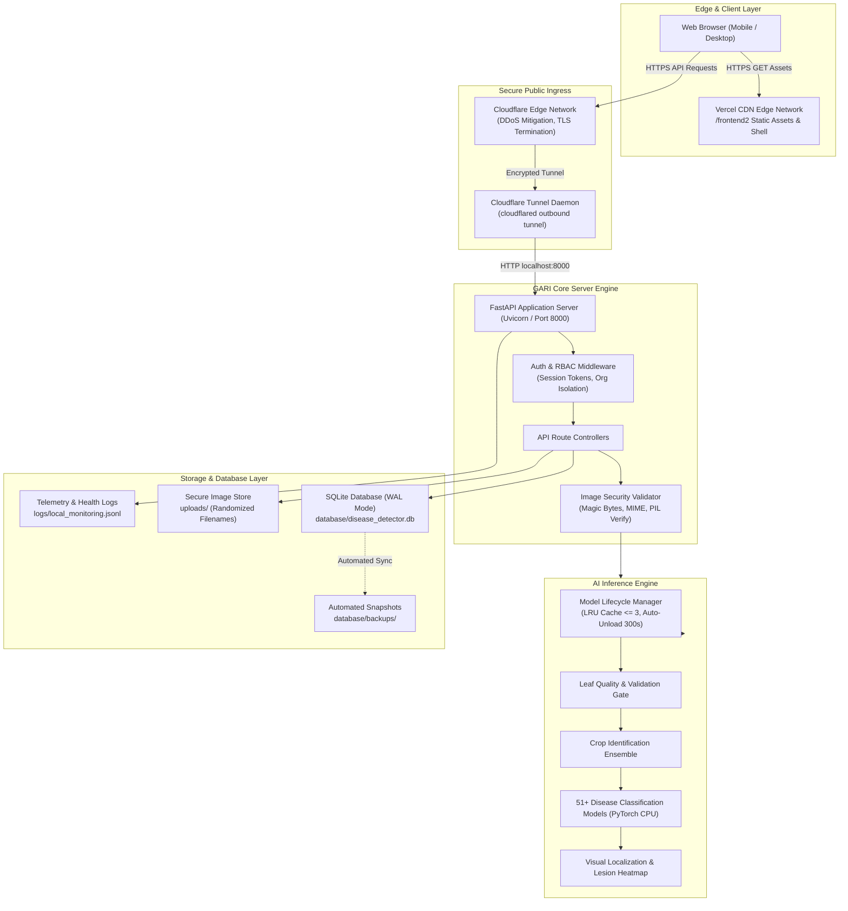
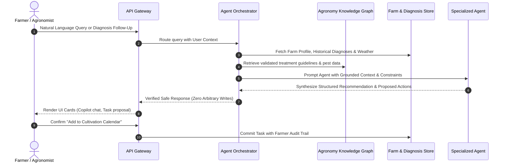
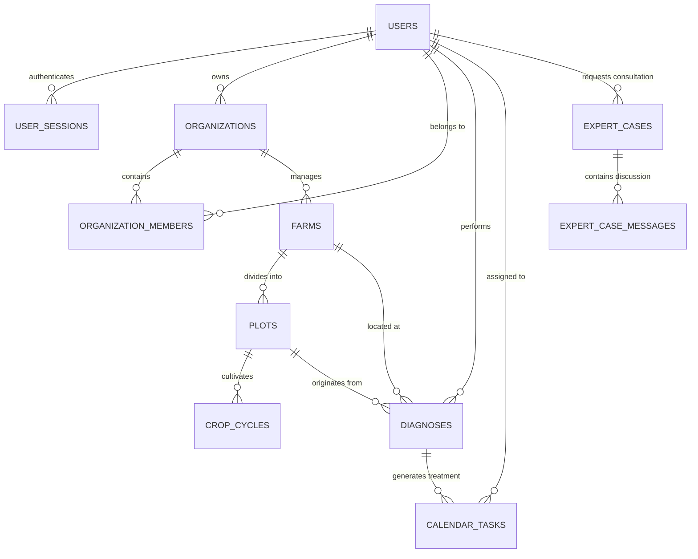

# GARI AGRITECH AI LAB — PHASE 6 ARCHITECTURE SPECIFICATION
**Document Reference:** `docs/PHASE_6_ARCHITECTURE.md`  
**Architecture Version:** 2.0.0  
**Target Runtime:** Hybrid Edge Frontend + Self-Hosted Backend Engine  

---

## 1. END-TO-END SYSTEM TOPOLOGY



---

## 2. SECURITY BOUNDARIES & DATA ENCLAVES

```mermaid
flowchart LR
    subgraph Level1["Layer 1: Edge Perimeter"]
        direction TB
        L1_1["Cloudflare TLS Termination"]
        L1_2["Rate Limiting & Anti-DDoS"]
        L1_3["No Open Inbound Server Ports"]
    end

    subgraph Level2["Layer 2: Transport & Auth"]
        direction TB
        L2_1["FastAPI Bearer Session Tokens"]
        L2_2["Zero Fallback to Default User 1 (SEC-02)"]
        L2_3["Brute-Force Rate Limiting (5 fail / 10 min)"]
    end

    subgraph Level3["Layer 3: Tenancy & Isolation"]
        direction TB
        L3_1["User Level Diagnosis Isolation (SEC-01)"]
        L3_2["Organization Tenancy Boundary (SEC-03)"]
        L3_3["Expert Case Access Control (SEC-04)"]
        L3_4["Strict DB Role Enforcement (SEC-06)"]
    end

    subgraph Level4["Layer 4: Data & Model Sandboxing"]
        direction TB
        L4_1["Strict Magic Bytes Check (SEC-07)"]
        L4_2["Path Traversal Neutralization"]
        L4_3["SQLite WAL Concurrent Locking"]
    end

    Level1 --> Level2
    Level2 --> Level3
    Level3 --> Level4
```



---

## 3. MULTI-AGENT SOCIETY ARCHITECTURE

The Phase 6 Agent Society architecture coordinates 7 specialized micro-agents managed through a centralized **Agent Controller**:



### Agent Roles & Permissions Matrix

| Agent Name | Core Responsibilities | Data Access Permissions | Mutation Authority |
|---|---|---|---|
| **Agronomy Agent** | Cultivation care, soil nutrition, irrigation guidelines | Read: Knowledge Graph, Crop Catalog | Read-Only |
| **Disease Diagnosis Agent** | Synthesizes leaf symptoms, image model findings, weather | Read: Diagnoses, Weather, Crop Pathology | Write: Diagnosis Notes only |
| **Weather Risk Agent** | Analyzes rain/temperature vectors to calculate disease outbreaks | Read: Live Weather APIs, Farm Geolocation | Read-Only |
| **Farm Monitoring Agent** | Audits plot health status, overdue tasks, scouting intervals | Read: Farms, Plots, Tasks, Cycles | Read-Only (Emits alerts) |
| **Expert Assistance Agent** | Pre-formats complex cases for agricultural extension officers | Read: Case History, Images, Farm Profile | Write: Case Summaries |
| **Reporting Agent** | Generates GAP cultivation logs and audit reports | Read: All Farm Historical Telemetry | Read-Only (Generates PDF/CSV) |
| **Task Workflow Agent** | Converts treatment advice into calendar work items | Read: Cultivation Schedules, Diagnoses | Write: Draft Tasks (User confirms) |

---

## 4. TENANCY & DATA RELATIONSHIPS



---

## 5. HARDENED INGESTION & INFERENCE PIPELINE

```mermaid
flowchart TD
    Upload([Uploaded File Stream]) --> SizeCheck{File Size <= 15MB?}
    SizeCheck -- No --> Reject413[HTTP 400: Oversized Image]
    SizeCheck -- Yes --> MagicCheck{Magic Bytes Valid?<br/>JPEG / PNG / WEBP}
    MagicCheck -- No --> RejectMagic[HTTP 400: Invalid Magic Bytes]
    MagicCheck -- Yes --> PILCheck{Pillow Image.verify()}
    PILCheck -- Corrupted --> RejectPIL[HTTP 400: Damaged Image]
    PILCheck -- Valid --> SafeName[Generate secrets.token_hex Filename]
    SafeName --> LeafGate{Leaf Gate Model:<br/>Plant Leaf Present?}
    LeafGate -- Not Plant --> RejectLeaf[HTTP 200: Status 'rejected_invalid_image']
    LeafGate -- Is Plant --> CropGate{Selected Crop or<br/>Auto-Detect Ensemble?}
    CropGate --> ModelRouter[Route to Priority Disease Model]
    ModelRouter --> Heatmap[Generate Grad-CAM Attention Heatmap]
    Heatmap --> RecEngine[Agronomic Care & Recommendation Engine]
    RecEngine --> DBCommit[(SQLite WAL Commit)]
    DBCommit --> Response([HTTP 200: Structured Diagnosis JSON])
```

