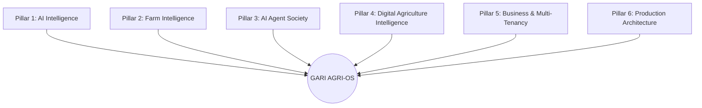
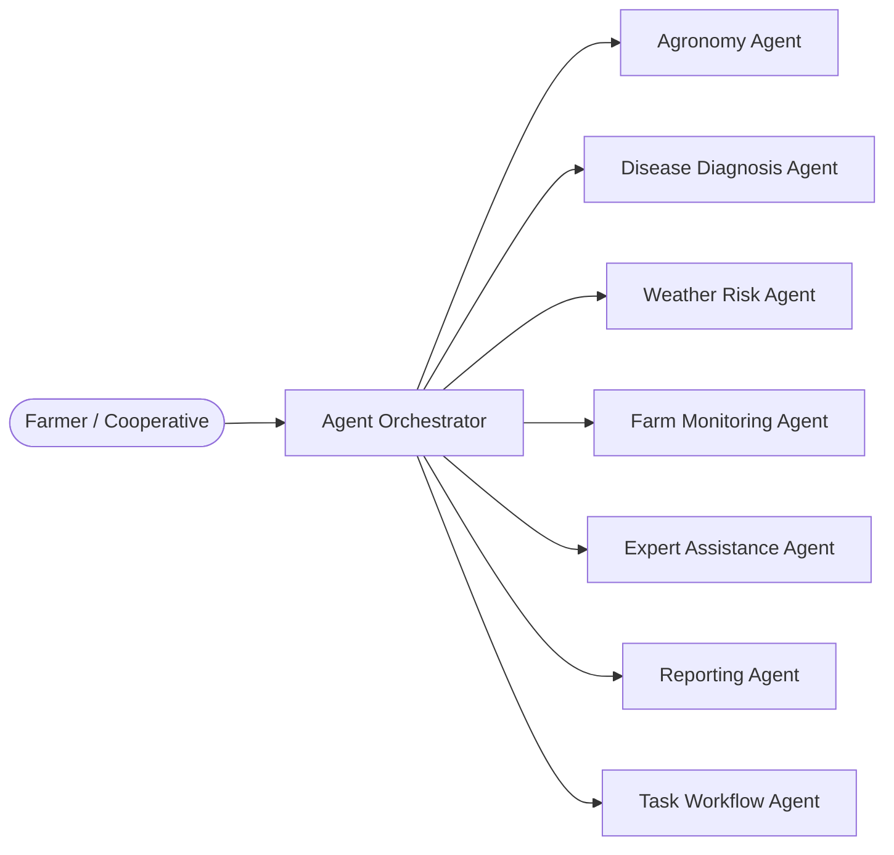

# GARI AGRITECH AI LAB — PHASE 6 MASTER PLAN
## Product Evolution & Operational Excellence

**Document Version:** 1.0.0  
**Effective Date:** November 2026  
**Status:** **APPROVED FOR PLANNING & ARCHITECTURE**  
**Repository:** `D:\leaf-diseases-detector-main`  
**Frontend Deployment:** `https://gari-team.vercel.app/frontend2`  
**Backend Runtime:** FastAPI on Self-Hosted Engine with Cloudflare Tunnel & SQLite WAL

---

## 1. VISION & CORE OBJECTIVES

Phase 6 marks the critical evolution of GARI AgriTech AI Lab from an experimental prototype and security-hardened backend into a **production-ready, full-lifecycle digital agriculture platform**. 

The mission is to empower Vietnamese farmers, agricultural cooperatives, agronomists, and agricultural enterprises with:
1. **Accurate, actionable plant disease intelligence** delivered within seconds directly to smartphones.
2. **Context-aware farm management** tracking crops, plots, cycles, and treatments from seed to harvest.
3. **An Autonomous AI Agent Society** that assists farmers and field workers with specialized, trustworthy, and auditable advice.
4. **Zero-additional-cost sustainable operations** combining self-hosted on-demand CPU inference, SQLite WAL storage, and Cloudflare edge tunneling.

---

## 2. THE SIX CORE PILLARS OF PHASE 6

---

### PILLAR 1: AI INTELLIGENCE & COMPUTER VISION
*Transforming raw visual models into trusted, validated diagnostic outcomes.*

1. **Dual-Gate Verification Pipeline:**
   - **Quality & Leaf Verification Gate:** Rejects non-plant images (surfaces, pests, hands, random objects) or severely blurred photos before inference.
   - **Crop Identification Ensemble:** Accurately determines crop taxonomy (e.g., Robusta coffee, Cavendish banana, Black pepper) prior to routing to disease-specific classifiers.
2. **Confidence Calibration & Uncertainty Estimation:**
   - Rejection of low-confidence predictions (<65%) with automated requests for retakes.
   - Dual top-3 differential diagnosis presented with clear human-understandable certainty indicators.
3. **Visual Pathology Localization:**
   - Retain Grad-CAM and bounding box lesion overlays to explain exactly where the neural network detected symptoms on the leaf.
4. **Contextual Agronomy Copilot:**
   - Natural language interaction grounded in verified Vietnamese agricultural extensions (MARD guidelines, Plant Protection Department bulletins).
   - Tailored organic, biological, and chemical treatment regimens based on crop stage and severity.

---

### PILLAR 2: FARM INTELLIGENCE & FIELD OPERATIONS
*Structured management of farm assets, growth cycles, and treatment logs.*

1. **Hierarchical Spatial Asset Model:**
   - `Organization` → `Farm` → `Zone / Lot` → `Plot / Luống` → `Crop Cycle`.
2. **Treatment Lifecycle Tracking:**
   - Direct connection between leaf diagnosis events and subsequent actionable treatment tasks.
   - Tracking recovery status: *Diagnosed* → *Treatment Applied* → *Follow-Up Scheduled* → *Resolved*.
3. **Cultivation Calendar & Seasonality:**
   - Automated crop schedule generation based on region, weather, and variety.
   - Intelligent task reminders for watering, pruning, fertilization, and prophylactic spraying.
4. **Yield Risk & Health Analytics:**
   - Real-time aggregation of plot-level disease incidence rates.
   - Early warning indicators for potential harvest losses.

---

### PILLAR 3: GARI AI AGENT SOCIETY
*A collaborative team of 7 specialized, bounded, and verifiable autonomous agents.*

All agents adhere to the **Strict Grounding & Bounded Authority Principle**: they operate under read-only access to user data by default, require user confirmation for any state mutations, and base recommendations solely on curated agricultural knowledge.

1. **Agronomy Agent:** Answers crop care queries, fertilizer formulas, and soil conditioning advice.
2. **Disease Diagnosis Agent:** Synthesizes image classification, lesion heatmaps, farmer symptoms, and weather context into a comprehensive pathology report.
3. **Weather Risk Agent:** Evaluates humidity, rainfall, and temperature trends to calculate disease emergence risks (e.g., Phytophthora blight risks during continuous rains).
4. **Farm Monitoring Agent:** Periodically evaluates farm records, identifying lagging tasks or uninspected plots.
5. **Expert Assistance Agent:** Triages difficult or unresolved cases and drafts structured summaries for licensed agronomists.
6. **Reporting Agent:** Generates exportable PDF/Excel cultivation logs, GAP compliance summaries, and farm audit reports.
7. **Task Workflow Agent:** Converts diagnostic findings into step-by-step calendar tasks with assigned dates, equipment, and dosage notes.

---

### PILLAR 4: DIGITAL AGRICULTURE INTELLIGENCE
*Spatial, environmental, and algorithmic twin of real-world farming operations.*

1. **Weather Intelligence Integration:**
   - Microclimate forecasts at district and commune level across Vietnam's key agricultural regions (Central Highlands, Mekong Delta, Red River Delta).
   - Strict rule: Real weather APIs utilized; zero simulated mock data presented as live sensor feeds.
2. **GIS & Farm Mapping:**
   - Interactive GeoJSON polygon mapping for farm plots and zones.
   - Disease heat mapping overlay indicating hotspot plots requiring immediate quarantine.
3. **Agricultural Knowledge Graph:**
   - Ontology linking 51+ plant species, 120+ diseases, active ingredients, organic biological alternatives, and legal MARD quarantine restrictions.
4. **Farm Digital Twin:**
   - Digital representation of current vegetative stage, days since planting, cumulative rainfall, and pest pressure.

---

### PILLAR 5: BUSINESS & MULTI-TENANCY ARCHITECTURE
*Scalable tenancy and operational sustainability.*

1. **Tenancy Hierarchy:**
   - **Platform Host Admins:** System operators with platform-wide observability.
   - **Organization Admins:** Cooperative managers, agribusiness enterprise leads.
   - **Farm Owners & Agronomists:** Field managers with write access to designated farms.
   - **Farm Workers & Field Scouts:** Mobile data contributors with restricted entry rights.
   - **Independent Farmers:** Self-service individual accounts.
2. **Subscription & Metering Engine:**
   - Transparent quotas across Free, Pro, Team, and Enterprise tiers.
   - In-app payment validation with VietQR and automated activation.
3. **Enterprise Audit Trail:**
   - Complete audit logging for all critical record updates, export actions, and membership changes.

---

### PILLAR 6: PRODUCTION ARCHITECTURE & RELIABILITY
*Sustainable, zero-cost high-performance infrastructure.*

1. **Dual-Tier Deployment Strategy:**
   - **Frontend:** Vercel Edge Hosting (`https://gari-team.vercel.app/frontend2`). Clean vanilla JS SaaS shell, zero hydration latency.
   - **Backend:** FastAPI running asynchronously on local host with Cloudflare Tunnel public endpoint.
2. **On-Demand Model Lifecycle:**
   - Memory footprint optimized via lazy on-demand model loading and automated idle unloading after 300 seconds.
   - Strict LRU cache cap of 3 concurrent active PyTorch models.
3. **Storage & Data Protection:**
   - SQLite in Write-Ahead Logging (WAL) mode with immediate checkpointing.
   - Automated point-in-time database snapshots stored in `database/backups/`.
   - Continuous local health monitoring logging to `logs/local_monitoring.jsonl`.

