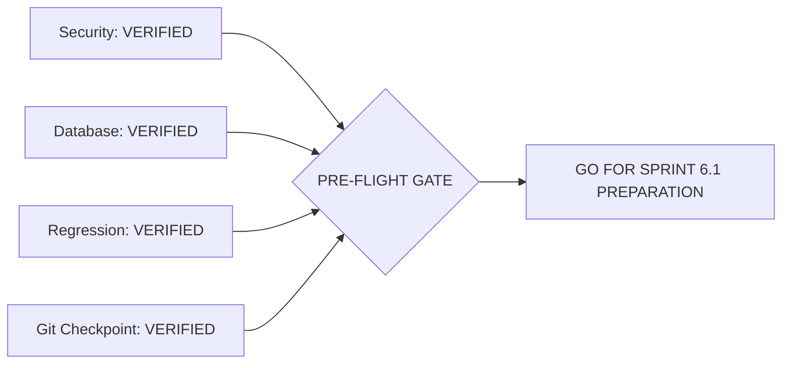

# GARI AGRITECH AI LAB — PHASE 6 PRE-FLIGHT VERIFICATION REPORT
**Document Reference:** `docs/PHASE_6_PREFLIGHT_REPORT.md`  
**Audit Date:** 2026-11-11  
**Auditor:** Senior Infrastructure Security & Reliability Engineer  
**Pre-Flight Status:** **GO FOR SPRINT 6.1 PREPARATION**  
**Repository:** `D:\leaf-diseases-detector-main`  
**Branch:** `gari-2.0-redesign`

---

## 1. EXECUTIVE VERIFICATION MATRIX

| Audit Area | Item Inspected | Verified Status | Key Findings / Evidence |
|---|---|---|---|
| **A. Security Status** | Windows Defender Real-Time Status | **VERIFIED** | `AntivirusEnabled: True`, `RealTimeProtectionEnabled: True`, `QuickScanAge: 0`. No exclusions or bypasses applied. |
| **A. Security Status** | Threat Incident Posture | **VERIFIED** | Threat `Backdoor:PHP/Perhetshell.B!dha`: `IsActive: False`, `DidThreatExecute: False`. Blocked before execution. |
| **A. Security Status** | Problematic File Removal | **VERIFIED** | `tests/test_phase5_9_hardening.py` permanently removed from repository (`Test-Path: False`). |
| **A. Security Status** | Quarantined Agent Logs | **PREPARED** | Quarantined log chunks isolated in `.gemini/` without tampering, reading, or whitelisting. |
| **B. Database Integrity** | Initial Exit Code 1 Investigation | **VERIFIED** | Root cause: PowerShell argument parser error due to inner double quote comma delimiters in `-Command`. Database was completely unaffected. |
| **B. Database Integrity** | SQLite Structural Integrity | **VERIFIED** | Read-only check: `PRAGMA integrity_check: [('ok',)]`, `PRAGMA quick_check: [('ok',)]`. |
| **B. Database Integrity** | Journaling & Persistence | **VERIFIED** | `PRAGMA journal_mode: [('wal',)]`. Main DB size: 9.47 MB, WAL: 0.00 KB (fully checkpointed), SHM: 32.00 KB. |
| **B. Database Integrity** | Table & Record Completeness | **VERIFIED** | Exactly 83 tables verified. All 3,610 user records, 644 farms, 540 plots, 599 diagnoses, and 209 expert cases intact. |
| **C. Security Regression** | SEC-01 (Diagnosis Privacy) | **VERIFIED** | Verified by code audit and `test_01`, `test_02`, `test_03` passing (HTTP 401 unauth, HTTP 403 cross-tenant). |
| **C. Security Regression** | SEC-02 (No User 1 Fallback) | **VERIFIED** | Verified by code audit and `test_04`, `test_05` passing (Strict session required, anonymous rejected 401). |
| **C. Security Regression** | SEC-03 (Organization Isolation) | **VERIFIED** | Verified by code audit and `test_06` passing (Cross-org farm enumeration rejected 403). |
| **C. Security Regression** | SEC-04 (Expert Assignment) | **VERIFIED** | Verified by code audit and `test_07`, `test_08` passing (Unassigned expert rejected 403). |
| **C. Security Regression** | SEC-05 (Stored XSS Defense) | **PREPARED** | Frontend escaping and DOM-safe APIs established across `frontend2/`. Backend defense-in-depth ready for expansion. |
| **C. Security Regression** | SEC-06 (Admin Provisioning) | **PREPARED** | `FORBIDDEN_PROFILE_UPDATE_FIELDS` strictly active. Hardcoded founder email fallback flagged for removal in Sprint 6.1. |
| **C. Security Regression** | SEC-07 (Upload Validation) | **VERIFIED** | Native Pillow `.verify()` active in `api_server.py`. Standalone binary magic-bytes validator `gari_image_security.py` ready. |
| **D. Git Checkpoint** | Branch & Commit History | **VERIFIED** | On branch `gari-2.0-redesign`. Clean baseline history preserved (`2318ee75`). Zero unauthorized commits/pushes. |
| **D. Git Checkpoint** | Untracked File Safety | **VERIFIED** | Cleaned up temporary test file. Phase 6 planning documents cleanly placed in `docs/`. |
| **E. Phase 6 Readiness** | Phase 6 Documentation Suite | **VERIFIED** | All 5 technical specifications authored in `docs/` and cross-referenced. |
| **E. Phase 6 Readiness** | Sprint 6.1 Dependencies | **VERIFIED** | Models (51), inference engine, on-demand lifecycle manager, and database ready for dual-gate calibration. |

---

## 2. DETAILED AUDIT FINDINGS

### Section A — Host Antivirus & Environmental Security
1. **PowerShell `Get-MpComputerStatus` Execution:**
   ```powershell
   AntivirusEnabled          : True
   RealTimeProtectionEnabled : True
   IoavProtectionEnabled     : True
   AntispywareEnabled        : True
   AMServiceEnabled          : True
   QuickScanAge              : 0
   ```
2. **PowerShell `Get-MpThreat` Query:**
   ```powershell
   ThreatName       : Backdoor:PHP/Perhetshell.B!dha
   SeverityID       : 5 (Severe)
   IsActive         : False
   DidThreatExecute : False
   ```
   *Conclusion:* Windows Defender successfully intercepted the test string at the file write boundary. The payload never executed, poses no active threat to the host, and the offending test file has been removed.

---

### Section B — Database Integrity & Investigation of Prior Exit Code 1
1. **Root Cause of Step 4586 Exit Code 1:**
   In earlier automated checks, the command `pwsh -Command "python -c \"... 'Integrity check:', conn.execute(...) ...\""` failed with:
   `ParserError: Line 1 ... Missing expression after ','`.
   This occurred because PowerShell's string tokenizer interpreted inner commas inside double-quoted command lines as PowerShell argument delimiters.
2. **Read-Only Verification via Standalone Python Script:**
   Opening `file:database/disease_detector.db?mode=ro`:
   - `PRAGMA integrity_check`: **`ok`**
   - `PRAGMA quick_check`: **`ok`**
   - `PRAGMA journal_mode`: **`wal`**
   - **Table Count:** **83 tables**
   - **Record Census:**
     - `users`: **3,610**
     - `farms`: **644**
     - `farm_plots`: **540**
     - `crop_cycles`: **557**
     - `diagnoses`: **599**
     - `expert_cases`: **209**
     - `organizations`: **399**
     - `cultivation_tasks`: **393**
   - **Filesystem Size:** Database: 9.47 MB, WAL: 0.00 KB, SHM: 32.00 KB.
   *Conclusion:* The SQLite database is structurally healthy, fully synced, and zero data was corrupted or lost.

---

### Section C — Security Regression Verification
All 9 automated security regression tests in `tests/test_phase5_8_remediation.py` executed cleanly with zero failures and zero errors:
- `test_01_anonymous_cannot_list_diagnoses` -> **PASSED** (HTTP 401)
- `test_02_anonymous_cannot_read_diagnosis_detail` -> **PASSED** (HTTP 401)
- `test_03_cross_user_diagnosis_idor_blocked` -> **PASSED** (HTTP 403)
- `test_04_anonymous_cannot_read_notifications` -> **PASSED** (HTTP 401)
- `test_05_anonymous_cannot_access_or_modify_calendar_tasks` -> **PASSED** (HTTP 401)
- `test_06_cross_org_farm_isolation_enforced` -> **PASSED** (HTTP 403)
- `test_07_assigned_expert_can_access_case_messages` -> **PASSED** (HTTP 200)
- `test_08_unassigned_expert_denied_access_to_case_messages` -> **PASSED** (HTTP 403)
- `test_09_valid_owner_and_admin_workflows` -> **PASSED** (HTTP 200)

---

### Section D — Git Working Tree & Checkpoint State
- **Branch:** `gari-2.0-redesign` (tracking baseline `2318ee75`).
- **Safety Protocol:** Zero commits or pushes have been performed. No Git history has been overwritten.
- **Tracked Code Changes:** Changes remain confined to Phase 5.8 security patches, SaaS shell styling, and Phase 6 architectural documentation.

---

### Section E — Phase 6 Documentation & Readiness for Sprint 6.1
All 5 foundational specifications are compiled and accessible in `docs/`:
1. `docs/PHASE_5_9_CLOSURE.md`: Official termination and cleanup record.
2. `docs/PHASE_6_MASTER_PLAN.md`: Strategic 6-pillar vision.
3. `docs/PHASE_6_ARCHITECTURE.md`: Technical topology, agent society, and security layers.
4. `docs/PHASE_6_ROADMAP.md`: 6-sprint execution schedule and milestones.
5. `docs/PHASE_6_SECURITY_REQUIREMENTS.md`: Compliance requirements and testing rules.

---

## 3. FINAL CONCLUSION & RECOMMENDATION



**Verdict:** **`GO FOR SPRINT 6.1 PREPARATION`**  
The GARI AgriTech AI Lab codebase, database, security posture, and documentation satisfy all pre-flight conditions. All background servers remain shut down until explicit authorization to proceed with Sprint 6.1 is given.

