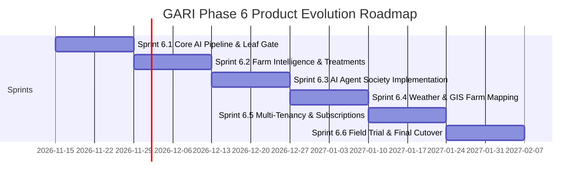

# GARI AGRITECH AI LAB — PHASE 6 ROADMAP
## Sprint-Based Product Evolution Schedule

**Document Reference:** `docs/PHASE_6_ROADMAP.md`  
**Planning Horizon:** Phase 6 (Sprints 6.1 through 6.6)  
**Execution Paradigm:** Agile Iterative Delivery with Strict Production Verification  

---

## ROADMAP OVERVIEW

---

## DETAILED SPRINT BREAKDOWN

### SPRINT 6.1: Core AI Pipeline Hardening & Dual-Gate Verification
*Theme: Maximizing diagnostic precision, confidence scoring, and non-plant rejection.*

- **Objectives:**
  1. Calibrate the Leaf Gate filter to prevent false positive classifications on soil, machinery, hands, or non-foliar surfaces.
  2. Implement confidence thresholds with automated differential diagnosis (top-3 candidates).
  3. Refactor model loading to ensure zero RAM leak across 51 models under sustained CPU inference.
- **Deliverables:**
  - Enhanced `evaluate_crop_validation_gate` with calibrated quality metrics.
  - Unit & Integration benchmarks for all 51 models measuring cold/warm latency and peak RAM.
  - Automated test suite validating rejection of 20+ non-plant edge case images.
- **Dependencies:** `models/`, `gari_inference_engine.py`.
- **Acceptance Criteria:**
  - Non-plant images rejected with `can_proceed_to_disease = false` and human-friendly guidance.
  - Average single-request CPU inference time under 1.8 seconds.
  - RAM peak remains under 2.2GB with 3 cached models.

---

### SPRINT 6.2: Farm Intelligence & Treatment Lifecycle
*Theme: Bridging diagnosis to actionable field treatment and crop tracking.*

- **Objectives:**
  1. Implement complete hierarchical modeling: Org → Farm → Zone → Plot → Crop Cycle.
  2. Implement treatment lifecycle tracking: linking diagnosis ID to treatment tasks.
  3. Create plot-level health timeline and recurrence analysis.
- **Deliverables:**
  - Database schema migrations for treatment workflows and cycle milestones.
  - Frontend UI upgrades in `frontend2/farms.html` and `frontend2/predict.html`.
  - Automated reminders for post-treatment follow-up inspections (3, 7, and 14 days).
- **Dependencies:** Sprint 6.1 completion, `database/disease_detector.db`.
- **Acceptance Criteria:**
  - Creating a treatment task preserves foreign key association to diagnosis.
  - Farmers can view historical plot disease rates on interactive timeline.
  - Zero cross-tenant data leakage between distinct farms or organizations.

---

### SPRINT 6.3: GARI AI Agent Society Implementation
*Theme: Collaborative, auditable multi-agent agronomy assistance.*

- **Objectives:**
  1. Author the 7 specialized agents: Agronomy, Disease Diagnosis, Weather Risk, Farm Monitoring, Expert Assistance, Reporting, Task Workflow.
  2. Enforce strict data isolation and the **Bounded Authority Principle** (agents propose, farmers confirm).
  3. Connect agents with the curated Vietnamese agricultural knowledge base.
- **Deliverables:**
  - `gari_agent_society/` module with orchestrator and tool adapters.
  - Copilot UI integration in `frontend2/app.js` and `frontend2/predict.html`.
  - Comprehensive agent eval suite testing accuracy and refusal of non-agronomic queries.
- **Dependencies:** Sprint 6.2 completion, `gari_knowledge.py`.
- **Acceptance Criteria:**
  - Agents strictly cite authoritative guidelines and refuse prompt injections.
  - Zero arbitrary database mutations without explicit user button clicks.
  - Agent response latency under 3.5 seconds.

---

### SPRINT 6.4: Digital Agriculture, Weather & Geospatial Mapping
*Theme: Microclimate intelligence and interactive farm GIS boundaries.*

- **Objectives:**
  1. Integrate live commune/district level weather forecast APIs.
  2. Implement interactive GeoJSON plot boundary mapping on Leaflet/MapLibre.
  3. Correlate humidity and precipitation with disease outbreak risk indices.
- **Deliverables:**
  - Microclimate ingestion worker with local caching (hourly refresh).
  - Disease risk overlay rendering on `frontend2/risk.html` and `frontend2/farms.html`.
  - Zero simulated mock data presented as live telemetry.
- **Dependencies:** Sprint 6.2 completion, GeoJSON schemas.
- **Acceptance Criteria:**
  - Weather alerts trigger when temperature/humidity match pathogen growth criteria.
  - Plot polygon boundaries render accurately on mobile viewports.
  - Graceful degradation when external weather APIs are unreachable.

---

### SPRINT 6.5: Multi-Tenant Business & Subscription Management
*Theme: Sustainable economics, role-based governance, and usage metering.*

- **Objectives:**
  1. Enforce strict RBAC for Farm Owner, Farm Member, Org Admin, Expert, and Public Guest.
  2. Automate subscription quota enforcement across Free, Pro, Team, and Enterprise plans.
  3. Complete VietQR automated payment reconciliation and receipt logging.
- **Deliverables:**
  - `gari_plans.py` and `gari_b2b.py` quota enforcement validation.
  - Organization member invitation and role management UI in `frontend2/organization.html`.
  - Comprehensive billing audit log and usage dashboard.
- **Dependencies:** Sprint 6.3 completion, `gari_payment.py`.
- **Acceptance Criteria:**
  - Reaching quota limit returns HTTP 429 with clear reset countdown.
  - Org Admin can invite members with granular plot-level permissions.
  - Payments automatically update organization tier upon verified webhook.

---

### SPRINT 6.6: End-to-End Field Trial & Production Verification
*Theme: Real-world pilot verification with cooperatives and agronomists.*

- **Objectives:**
  1. Execute field pilot with 3 pilot agricultural cooperatives in Đắk Lắk and Lâm Đồng.
  2. Conduct stress tests with 100 concurrent requests across Cloudflare tunnel.
  3. Validate database backup/restore drills and high-availability health checks.
- **Deliverables:**
  - `docs/PHASE_6_FIELD_TRIAL_REPORT.md`.
  - End-to-end Playwright mobile and desktop automated verification suites.
  - Final Production Readiness Sign-Off.
- **Dependencies:** Sprints 6.1 through 6.5 completed.
- **Acceptance Criteria:**
  - 99.5% uptime across 14-day field trial.
  - Zero database corruption incidents; clean backup verification.
  - 100% adherence to Phase 5.8 security requirements.

