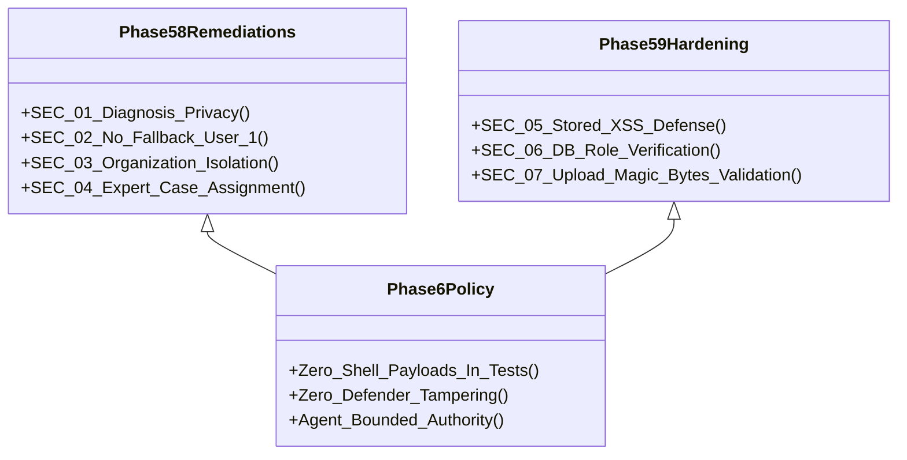

# GARI AGRITECH AI LAB — PHASE 6 SECURITY REQUIREMENTS SPECIFICATION
**Document Reference:** `docs/PHASE_6_SECURITY_REQUIREMENTS.md`  
**Security Standard:** GARI Production Security Standard v2.0  
**Compliance Target:** ISO 27001 / OWASP Top 10 API Security  

---

## 1. PRESERVATION OF PHASE 5.8 REMEDIATIONS

Phase 6 development must continuously preserve all security fixes implemented during Phase 5.8 without regression:

### 1.1 SEC-01: Diagnosis Privacy Enforcement
- **Requirement:** `GET /api/diagnoses` and `GET /api/diagnoses/{id}` must strictly require a valid user authentication session.
- **Rule:** Unauthenticated requests must always receive `HTTP 401 Unauthorized`.
- **Tenancy Boundary:** A user may only view diagnoses they created or those belonging to an organization in which they possess authorized membership. Cross-user access attempts must return `HTTP 403 Forbidden` or `HTTP 404 Not Found`.

### 1.2 SEC-02: Elimination of Default User 1 Fallback
- **Requirement:** `GET /api/notifications` and `GET /api/calendar/tasks` must never fall back to `user_id = 1` for anonymous callers.
- **Rule:** Every private resource endpoint must validate session identity. Anonymous callers must immediately receive `HTTP 401 Unauthorized`.

### 1.3 SEC-03: Cross-Tenant Organization Isolation
- **Requirement:** `GET /api/farms` and all farm/plot sub-endpoints must verify that the requesting user is a registered member of the target `org_id`.
- **Rule:** Accessing farms of another organization must return `HTTP 403 Forbidden`.

### 1.4 SEC-04: Expert Case Assignment Integrity
- **Requirement:** Access to expert case messages (`/api/expert/cases/{id}/messages`) is restricted strictly to:
  1. The farmer who opened the case.
  2. The specifically assigned agronomist (`assigned_expert_id`).
  3. Platform host administrators (`is_host_admin = 1`).
- **Rule:** Unassigned experts must be rejected with `HTTP 403 Forbidden`.

---

## 2. PRESERVATION OF PHASE 5.9 HARDENING CONTROLS

### 2.1 SEC-05: Stored XSS Prevention
- All user-controlled fields (`title`, `description`, `notes`, `symptoms`, `crop_name`, `farm_name`, `messages`) must be HTML-escaped using Python's `html.escape` before persistence.
- In `frontend2/`:
  - Plain text fields must be rendered using `textContent` or `escapeHtml()`.
  - Dynamic user strings injected into HTML templates must pass through `escapeHtml()` or `sanitizeHtml()`.

### 2.2 SEC-06: Database-Driven Role & Privilege Verification
- Administrative endpoints must enforce `is_admin = 1` or `is_host_admin = 1` retrieved directly from verified database records.
- **Strict Rule:** Hardcoded email checks (e.g., `email in ('danhuynh@gari.vn', 'admin@gari.vn')`) are permanently banned.
- Profile update APIs (`/api/auth/profile`) must reject attempts by standard users to modify `is_admin`, `is_host_admin`, `is_expert`, `account_type`, or `role` with `HTTP 400 Bad Request`.

### 2.3 SEC-07: File Upload & Binary Validation
- All image upload endpoints (`/api/predict`, `/api/v1/diagnose`, `/api/validate-image`, `/api/plant/analyze-regions`, `/api/field/upload`) must utilize `gari_image_security.py`:
  1. **Size Limit:** Max 15 MB.
  2. **Magic Bytes Verification:** Binary headers strictly checked for JPEG (`\xff\xd8\xff`), PNG (`\x89PNG\r\n\x1a\n`), or WebP (`RIFF....WEBP`).
  3. **Pillow Structural Verification:** `Image.open()` and `.verify()` executed to detect corrupt or truncated image streams.
  4. **Filename Randomization:** Storage filenames generated via `secrets.token_hex(16)` with canonical extension.
  5. **Directory Traversal Elimination:** Path components stripped and normalized; no user-supplied paths passed to disk writes.

---

## 3. PHASE 6 OPERATIONAL SECURITY POLICIES

### 3.1 Testing Security & Antivirus Policy
- **Prohibition of Real or Simulated Shell Code in Tests:** Test suites must never include webshell strings, PHP execution tags (`<?php ... ?>`), or executable binaries.
- All negative test cases must utilize **benign synthetic tokens** (e.g., `b"BENIGN_TEST_NON_IMAGE_DATA"`).
- **Zero Antivirus Tampering:** Under no circumstances shall Windows Defender or host security agents be disabled, modified, or bypassed via directory exclusion rules.
- **Quarantined File Handling:** Quarantined objects remain strictly untouched.

### 3.2 AI Agent Society Security & Bounded Authority
- **Least Privilege:** AI agents operate with read-only database connections by default.
- **Bounded Mutation Authority:** AI agents cannot directly alter farm records, delete diagnoses, or execute financial transactions. Every state-changing recommendation must be presented as a draft action requiring explicit human confirmation.
- **Prompt Injection Defense:** User inputs passed to LLM agents must be sanitized and separated from system instructions via clear delimiter framing.

### 3.3 Database Protection & Backup Policy
- The production database must maintain SQLite Write-Ahead Logging (`PRAGMA journal_mode=WAL;`).
- Automated point-in-time snapshots must be executed before every code deployment or schema migration using `scripts/backup_database.ps1`.
- Backups must be verified for SQLite integrity (`PRAGMA integrity_check;`) before archiving.

