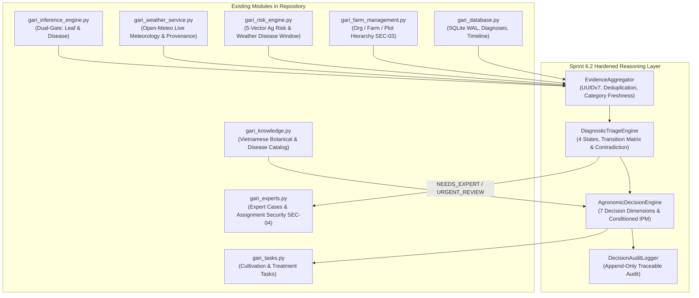
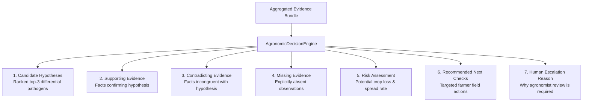
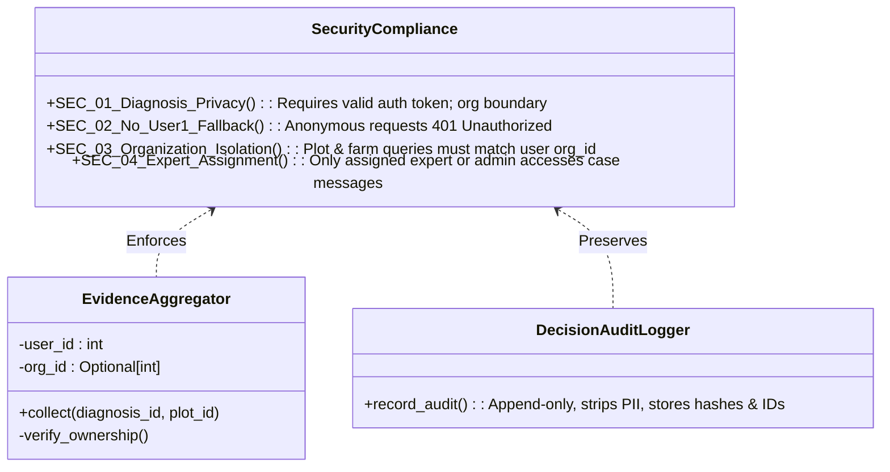

# GARI AGRITECH AI LAB — SPRINT 6.2 ARCHITECTURE
## Autonomous Diagnostic Triaging & Traceable Agronomic Decision Engine

**Document Reference:** `docs/SPRINT_6_2_ARCHITECTURE.md`  
**Phase:** Phase 6 — Product Evolution  
**Sprint:** 6.2 — Final Design Gate Hardening  
**Baseline Git Commit:** `2318ee75`  
**Branch:** `gari-2.0-redesign`  
**Status:** FINAL DESIGN GATE COMPLIANT (Pre-Implementation)  

---

## 1. System Vision & Objectives

Sprint 6.2 establishes the reasoning and decision layer of the GARI AgriTech AI Lab platform. While Sprint 6.1 hardened the computer vision pipeline (Dual-Gate: Leaf & Disease verification), neural network pattern recognition in isolation is insufficient for agricultural diagnostics.

The hardened architecture of Sprint 6.2 guarantees:
1. **Multi-Source Evidence Aggregation:** Normalizing computer vision features, farmer observations, plot-level crop cycle metadata, verified meteorological observations, and historical diagnostic records into a unified evidence graph using RFC 9562 **UUIDv7** evidence identifiers and cryptographic deduplication.
2. **Decoupled Reliability Architecture:** Separating institutional source reliability, technical measurement quality, model confidence, and formal verification status, refusing ad-hoc aggregate score formulas.
3. **Category-Specific Freshness Policy:** Granular validity windows reflecting physical decay: weather (3h), imagery (2h), user observation (24h), IoT sensors (1h), crop metadata (120d), and historical records (21d).
4. **Privacy-Safe Provenance:** Strict data minimization principles—eliminating raw and hashed IP logging, normalizing client user-agents, and enforcing a 90-day/24-month retention schedule.
5. **Seven Structured Decision Dimensions:** Producing auditable decision payloads with Candidate Hypotheses, Supporting Evidence, Contradicting Evidence, Missing Evidence, Risk Assessment, Recommended Next Checks, and Human Escalation Reason.
6. **Conditioned Agronomic Safety:** Eliminating blanket cultural directives in favor of conditioned, justified guidance, and enforcing an absolute prohibition on autonomous chemical dosage prescriptions or wide-area quarantine declarations.
7. **Dual-Mode Rollback & Migration Safety:** Clear separation of zero-data Schema Rollback and production Data-Preserving Rollback via feature flag gating and archival workflows.

---

## 2. Reusable System Components Inventory

To maintain architectural integrity and zero code bloat, Sprint 6.2 integrates verified existing modules:

### 2.1 Reused Components & Exact Integration Points

| Component | Source File | Existing Capabilities Reused in Sprint 6.2 |
| :--- | :--- | :--- |
| **Dual-Gate Vision** | `gari_inference_engine.py` | `validate_leaf_gate()` (Gate 1), `predict()` (Gate 2), top-3 candidate predictions, model architecture and confidence scores. |
| **Agricultural Knowledge** | `gari_knowledge.py` | Curated Vietnamese pest/disease taxonomy, scientific names, biological treatments, cultural prevention practices. |
| **Meteorological Service** | `gari_weather_service.py` | Real-time weather via Open-Meteo, temperature, relative humidity, precipitation, `is_real_data` flag, `fetched_at` timestamp. |
| **Agricultural Risk Engine** | `gari_risk_engine.py` | Fungal incubation conditions (prolonged humidity $> 85\%$, incubation temperature bounds), honest `insufficient_data` state handling. |
| **Expert Network** | `gari_experts.py` | `create_consultation_case()`, `assign_case()`, `expert_case_messages`, `expert_case_activities`, server-side authorization (SEC-04). |
| **Farm Management** | `gari_farm_management.py` | Multi-tenant Org $\rightarrow$ Farm $\rightarrow$ Plot $\rightarrow$ Crop hierarchy, latitude/longitude centroids, variety tracking (SEC-03). |
| **Cultivation Tasks** | `gari_tasks.py` | Follow-up inspection scheduling, task creation linked to diagnosis ID, priority assignment. |
| **Database & Timeline** | `gari_database.py` | `diagnoses` table, `plot_timeline_events`, Write-Ahead Logging (`WAL`), connection pooling. |

---

## 3. Seven Mandatory Dimensions of Agronomic Decisions

Every decision generated by the `AgronomicDecisionEngine` must produce a validated data structure containing all seven dimensions:

1. **Candidate Hypotheses:** Ordered differential diagnosis list with raw model confidence and decoupled reliability metrics.
2. **Supporting Evidence:** Explicit list of facts that corroborate the hypothesis (e.g., matching lesion geometry, leaf position, permissive incubation temperatures).
3. **Contradicting Evidence:** Explicit list of observed facts that challenge the hypothesis (e.g., dry weather during suspected downy mildew, mismatching crop growth stage).
4. **Missing Evidence:** Explicit enumeration of absent data points (e.g., unrecorded soil moisture, missing plot variety, unavailable weather telemetry).
5. **Risk Assessment:** Agronomic evaluation of pathogen virulence, potential yield impact, and spread dynamics under current plot conditions.
6. **Recommended Next Checks:** Concrete, non-destructive field inspection tasks for the farmer (e.g., inspect underside of leaves for sporulation, check root collar for girdling).
7. **Human Escalation Reason:** Explicit documentation of why an agronomist was or was not summoned (e.g., "Candidate divergence $< 0.10$", "High-impact pathogen suspected").

---

## 4. Multi-Tenant Security & Audit Integrity

Sprint 6.2 strictly embeds the security controls established in Phase 5.8:

### 4.1 Security Specifications (SEC-01 through SEC-04)
1. **Diagnosis Privacy (SEC-01):** Diagnostic triage records (`/api/v1/diagnoses/{id}/triage`) require valid user authentication. A user cannot query triage records belonging to another farmer or foreign organization.
2. **Elimination of User 1 Fallback (SEC-02):** If a triage or evidence query is made without an active session token, the API immediately responds with `HTTP 401 Unauthorized`. Anonymous fallback to `user_id = 1` is banned.
3. **Organization Isolation (SEC-03):** Before aggregating plot metadata or weather history, the engine validates that `requesting_user.org_id == plot.organization_id`. Cross-tenant queries return `HTTP 403 Forbidden`.
4. **Expert Case Assignment Integrity (SEC-04):** Cases escalated from `NEEDS_EXPERT` or `URGENT_REVIEW` into `expert_cases` are accessible only to the farmer who owns the plot, the assigned agronomist (`assigned_expert_id`), and platform host admins (`is_host_admin = 1`).

### 4.2 Append-Only Audit Behavior & Idempotency
- **Append-Only Auditing:** `decision_audit_logs` records cannot be updated or deleted by application users. Updates are restricted strictly to agronomist review outcomes (`human_review_status`, `human_review_notes`, `reviewed_at`).
- **Idempotency:** Re-evaluating the same `diagnosis_id` without new evidence updates the existing `diagnostic_triage_records` row and appends a revision entry in `decision_audit_logs`, preventing duplicate state pollution.
- **Timestamp Consistency:** All timestamps in evidence, triage, and audit records are strictly stored in UTC using standard ISO-8601 formatting (`YYYY-MM-DDTHH:MM:SS.fZ`).
- **Model Version Tracking:** Every triage and audit record logs the exact model name, architecture, and version string (e.g., `Tomato/convnext_small:v2026.1`).

---

## 5. Conditioned Agronomic Safety & Chemical Policy

To eliminate legal liability and protect crop health, the decision engine enforces the following mandatory rules:

1. **Absolute Ban on Volumetric/Weight Chemical Prescriptions:** The system will never output exact chemical mixing dosages (e.g., "phun 50ml/bình 16 lít", "dùng 2kg/ha"). Dosages vary by commercial product concentration, spray equipment, and weather conditions.
2. **Generic Active Ingredients Only:** When chemical intervention is scientifically indicated for high-threat pathogens, the engine references only approved active ingredients (e.g., *Mancozeb*, *Metalaxyl*, *Copper Hydroxide*) and instructs the farmer to follow the commercial label.
3. **Mandatory IPM Hierarchy:**
   - Step 1: Cultural & Sanitation (pruning, air circulation, destruction of infected leaves).
   - Step 2: Biological Control (antagonistic fungi, organic bio-fungicides).
   - Step 3: Chemical Safety (protective spraying, Pre-Harvest Interval compliance).
4. **Pre-Harvest Interval (PHI) Warnings:** Every mention of chemical active ingredients includes a prominent warning regarding days to harvest before consumption.
5. **Conditioned Recommendations:** Every cultural or preventative action must explicitly state application conditions, contraindications, and biological rationale. No blanket irrigation shutdowns are permitted.
