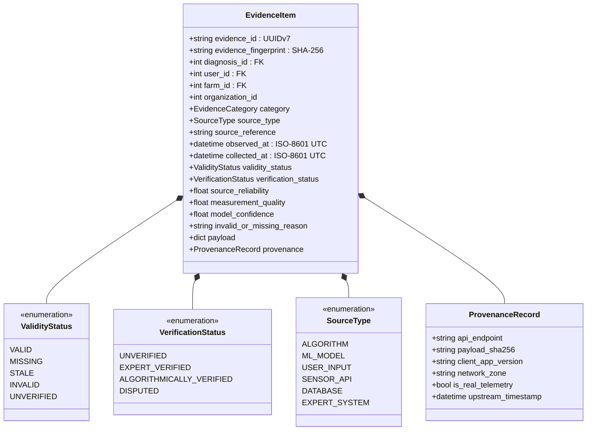
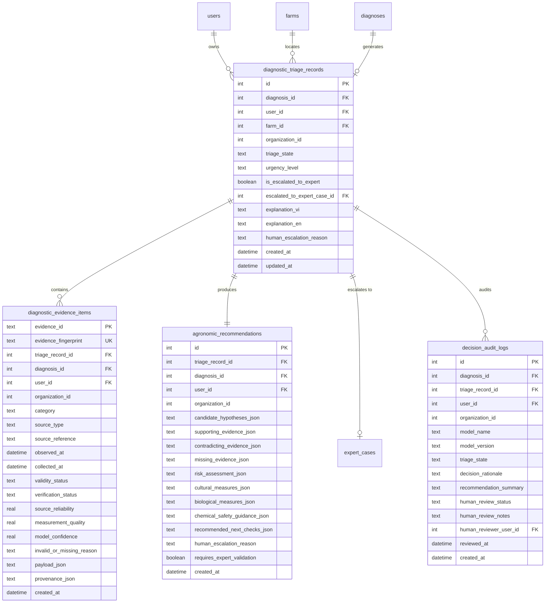
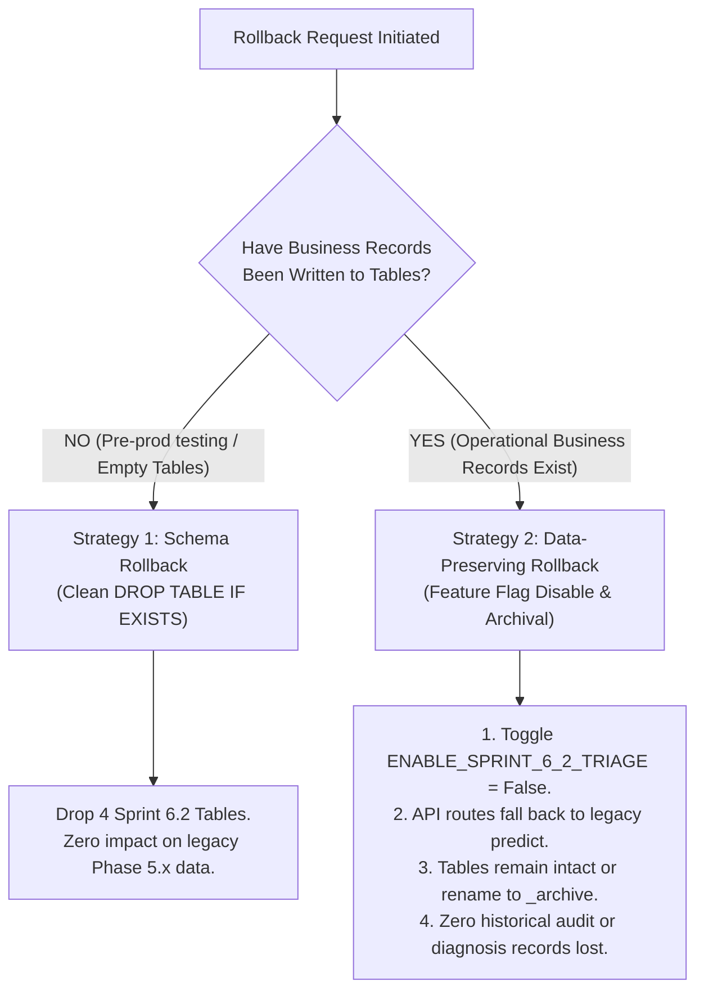

# GARI AGRITECH AI LAB — SPRINT 6.2 DATA SCHEMA SPECIFICATION
## Standardized Evidence Schema, Triage Records, Privacy-Safe Provenance & Migration Readiness

**Document Reference:** `docs/SPRINT_6_2_DATA_SCHEMA.md`  
**Phase:** Phase 6 — Product Evolution  
**Sprint:** 6.2 — Final Design Gate Hardening  
**Baseline Git Commit:** `2318ee75`  
**Target Storage Engine:** SQLite 3 with Write-Ahead Logging (`WAL`)  
**Status:** FINAL DESIGN GATE COMPLIANT (Pre-Implementation)  

---

## 1. Executive Summary

This document establishes the production-grade data schema and persistence architecture for Sprint 6.2, hardened against all Final Design Gate requirements:
1. **Standardized Time-Ordered UUIDv7 Evidence ID:** Migration from custom prefixes to RFC 9562 UUIDv7, guaranteeing cryptographic uniqueness, time-ordered B-Tree index locality, and strict database uniqueness constraints.
2. **Decoupled Epistemic Reliability Metrics:** Complete separation of `source_reliability`, `measurement_quality`, `model_confidence`, and `verification_status`, eliminating uncalibrated ad-hoc aggregate certainty scoring.
3. **Category-Specific Freshness Policy:** Granular validity lifetimes tailored to the physical and biological characteristics of weather, imagery, user observations, IoT sensors, crop metadata, and historical records.
4. **Privacy-Safe Provenance:** Strict data minimization principles—elimination of raw or hashed IP storage in favor of coarse network zones and normalized client headers, accompanied by a 90-day/2-year retention policy.
5. **Safe Migration & Dual-Mode Rollback:** Clear distinction between zero-data Schema Rollback and production Data-Preserving Rollback, backed by staging verification and integrity check protocols.

---

## 2. Standardized Evidence Schema

Every diagnostic evaluation in Sprint 6.2 ingests, validates, and records structured `EvidenceItem` objects.



### 2.1 Standardized Field Definitions & Database Constraints

| Field Name | Type | Constraint | Definition & Calibration Basis |
| :--- | :--- | :--- | :--- |
| `evidence_id` | `TEXT` | `PRIMARY KEY` | Standard RFC 9562 **UUIDv7** string (e.g. `018f6c38-71e2-7901-b541-698e6c46a6f1`). Time-ordered 48-bit UNIX millisecond timestamp prefix prevents index fragmentation. |
| `evidence_fingerprint` | `TEXT` | `NOT NULL` | Cryptographic SHA-256 natural key hash: `SHA256(diagnosis_id \|\| category \|\| source_reference \|\| observed_at \|\| canonical_payload)`. |
| `diagnosis_id` | `INTEGER` | `NOT NULL, FK` | Links to parent diagnostic session in `diagnoses(id)`. |
| `user_id` | `INTEGER` | `NOT NULL, FK` | Authenticated creator; enforces SEC-01 and SEC-02. |
| `farm_id` | `INTEGER` | `FK, NULLABLE` | Farm entity scoping; enforces SEC-03. |
| `organization_id` | `INTEGER` | `NULLABLE` | Multi-tenant organization boundary. |
| `category` | `TEXT` | `NOT NULL, CHECK` | One of: `WEATHER_CONTEXT`, `IMAGE_LEAF_GATE`, `USER_OBSERVATION`, `SENSOR_TELEMETRY`, `FARM_METADATA`, `HISTORICAL_DIAGNOSES`, `MODEL_PREDICTION`. |
| `source_type` | `TEXT` | `NOT NULL, CHECK` | One of: `ALGORITHM`, `ML_MODEL`, `USER_INPUT`, `SENSOR_API`, `DATABASE`, `EXPERT_SYSTEM`. |
| `source_reference` | `TEXT` | `NOT NULL` | Sanitized canonical reference (e.g., `models/Tomato/convnext_small:v2026.1`, `https://api.open-meteo.com/v1/forecast`, `user:1042`). External secret tokens stripped. |
| `observed_at` | `DATETIME` | `NOT NULL` | UTC ISO-8601 timestamp when the physical phenomenon occurred. |
| `collected_at` | `DATETIME` | `NOT NULL` | UTC ISO-8601 timestamp when GARI ingested the evidence. |
| `validity_status` | `TEXT` | `NOT NULL, CHECK` | One of: `VALID`, `MISSING`, `STALE`, `INVALID`, `UNVERIFIED`. |
| `verification_status`| `TEXT` | `NOT NULL, CHECK` | One of: `UNVERIFIED`, `EXPERT_VERIFIED`, `ALGORITHMICALLY_VERIFIED`, `DISPUTED`. |
| `source_reliability` | `REAL` | `NOT NULL, CHECK(0.0-1.0)` | **Decoupled Metric 1:** Inherent reliability of the source channel based on documented SLA. |
| `measurement_quality`| `REAL` | `NOT NULL, CHECK(0.0-1.0)` | **Decoupled Metric 2:** Signal-to-noise or technical fidelity of the specific reading. |
| `model_confidence` | `REAL` | `CHECK(0.0-1.0), NULLABLE` | **Decoupled Metric 3:** In-silico Softmax probability output. NULL for non-model evidence. |
| `invalid_or_missing_reason` | `TEXT` | `NULLABLE` | Explicit documentation of why data was rejected, missing, or stale. |
| `payload_json` | `TEXT` | `NOT NULL DEFAULT '{}'` | Structured category-specific key-value metrics. |
| `provenance_json` | `TEXT` | `NOT NULL DEFAULT '{}'` | Privacy-safe audit metadata (payload hash, client version, network zone). |

### 2.2 Deduplication & Concurrency Strategy
- **Unique Natural Key Constraint:** 
  ```sql
  CONSTRAINT uq_evidence_fingerprint UNIQUE (diagnosis_id, evidence_fingerprint)
  ```
- **Duplicate Ingestion Handling:**
  - If an identical evidence payload is submitted for the same diagnosis (`evidence_fingerprint` match):
    1. If `verification_status` has changed (e.g., updated by an expert), the record is updated idempotently.
    2. If the payload is completely unchanged, the ingestion engine performs an idempotent no-op, returning the existing `evidence_id`. Zero redundant rows are created.

---

## 3. Decoupled Evidence Reliability Framework

In compliance with the Final Design Gate, GARI eliminates ad-hoc certainty scoring and cleanly decouples evidence assessment into four orthogonal dimensions:

```text
+------------------------+------------------------------------+------------------------------------------------+
| Decoupled Dimension    | Operational Scope                  | Measurement & Calibration Methodology          |
+------------------------+------------------------------------+------------------------------------------------+
| source_reliability     | Institutional & channel trust      | Sensor/API SLA: Calibrated weather station     |
|                        |                                    | = 0.90; Certified Ag Lab = 1.0; Model = 0.70;  |
|                        |                                    | Unverified user input = 0.40.                  |
+------------------------+------------------------------------+------------------------------------------------+
| measurement_quality    | Technical signal fidelity          | Images: Normalized Laplacian variance &        |
|                        |                                    | exposure bounds. Weather: Distance to station  |
|                        |                                    | (< 10km = 1.0, 10-30km = 0.7, > 30km = 0.4).   |
+------------------------+------------------------------------+------------------------------------------------+
| model_confidence       | In-silico pattern correlation      | Neural network Softmax output for the top-1    |
|                        |                                    | predicted class. NULL for non-ML evidence.     |
+------------------------+------------------------------------+------------------------------------------------+
| verification_status    | Human / formal verification state  | Enum indicating whether an agronomist or       |
|                        |                                    | verification algorithm confirmed the evidence. |
+------------------------+------------------------------------+------------------------------------------------+
```

> **Mandatory Policy:** These decoupled metrics MUST NOT be multiplied or aggregated into a single "Agronomic Certainty" percentage. They must be presented side-by-side in decision outputs until an empirical calibration methodology is formally validated against field ground-truth trial data.

---

## 4. Category-Specific Freshness Policy

Evidence freshness is governed by physical and biological decay rates rather than an arbitrary global 24-hour window:

| Evidence Category | Maximum Freshness Lifetime ($T_{\max}$) | Biological & Physical Rationale | Stale Transition Action |
| :--- | :--- | :--- | :--- |
| **`WEATHER_CONTEXT`** | **3.0 Hours** | Relative humidity, leaf wetness, and rainfall events fluctuate rapidly in tropical agricultural zones. Readings older than 3 hours fail to capture active spore germination windows. | Mark `validity_status = STALE`. Discount `measurement_quality` to 0.10. Prohibit triggering microclimate infection alerts. |
| **`IMAGE_LEAF_GATE`** | **2.0 Hours** | Excised or sampled leaves wilt, desiccate, and change cellular color rapidly under field solar radiation, creating artificial necrosis patterns. | Reject for new triage if $> 2\text{ h}$ post-capture. Require fresh in-situ photograph. |
| **`USER_OBSERVATION`** | **24.0 Hours** | Farmer symptom descriptions (leaf spot progression, wilting percentage) change over 1–2 day cycles. | Mark `validity_status = STALE`. Require farmer to confirm whether symptoms have evolved. |
| **`SENSOR_TELEMETRY`** | **1.0 Hour** | Soil moisture tensiometer and canopy temperature change across diurnal transpiration and irrigation cycles. | Mark `validity_status = STALE`. Retain last known value as historical reference only. |
| **`FARM_METADATA`** | **Crop Cycle (120 Days)** | Crop variety, planting date, and soil texture are seasonal invariants. | Valid throughout the declared crop cycle. Stale only upon cycle harvest or crop rotation. |
| **`HISTORICAL_DIAGNOSES`**| **21.0 Days** | Primary spore incubation, secondary infection cycles, and systemic latent periods in Solanaceae/Poaceae typically operate within a 14–21 day window. | Archive to long-term epidemiological history; exclude from immediate primary recurrence weighting. |

---

## 5. Provenance Privacy & Data Minimization

To ensure compliance with global privacy regulations (GDPR, ISO 27701) and prevent surveillance risks:

### 5.1 Banned & Restricted Attributes
1. **Raw IP Addresses:** Strictly banned from persistence.
2. **Hashed IP Addresses:** Acknowledged as pseudonymous data vulnerable to rainbow table attacks on IPv4 address spaces ($2^{32}$ combinations). Therefore:
   - Storing hashed IP addresses is **permanently eliminated**.
   - Replaced by coarse network classification: `network_zone` (`"internal_lan"`, `"cellular_carrier"`, `"public_broadband"`).
3. **User Agent Sanitization:** Raw browser user-agent strings containing hardware fingerprints are normalized to standard application client identifiers:
   - `client_app_version`: e.g. `"GARI-Mobile/v2.1 (Android; ARM64)"` or `"GARI-Web/v2.0"`. Hardware identifiers, screen resolutions, and extension tokens are stripped before persistence.
4. **External API URIs:** API tokens, secret keys, or farmer coordinates embedded in upstream request URLs are sanitized:
   - Example: `https://api.open-meteo.com/v1/forecast?latitude=11.94&longitude=108.45` is recorded without user IDs or internal proxy credentials.

### 5.2 Data Retention & Access Control Policy

```text
+------------------------------------+--------------------+---------------------------------------+
| Data Entity                        | Retention Period   | Access Control Boundary               |
+------------------------------------+--------------------+---------------------------------------+
| Diagnostic Evidence Items          | 90 Days post-cycle | Owning Farmer, Assigned Expert, Host  |
| Decision Audit Logs (Append-Only)  | 24 Months          | Host Admin, Compliance Auditor Only   |
| Diagnostic Triage Records          | Active Cycle + 1Yr | Owning Farmer, Organization Agronomist|
+------------------------------------+--------------------+---------------------------------------+
```

---

## 6. Relational Database Schema Design (SQLite 3 WAL)



### 6.1 DDL Specification

```sql
-- ============================================================================
-- SPRINT 6.2 DDL SPECIFICATION (FINAL DESIGN GATE - DO NOT EXECUTE ON PROD YET)
-- ============================================================================

-- Table 1: Diagnostic Triage Records
CREATE TABLE IF NOT EXISTS diagnostic_triage_records (
    id INTEGER PRIMARY KEY AUTOINCREMENT,
    diagnosis_id INTEGER NOT NULL UNIQUE,
    user_id INTEGER NOT NULL,
    farm_id INTEGER,
    organization_id INTEGER,
    triage_state TEXT NOT NULL CHECK(triage_state IN ('NORMAL', 'SUSPECTED', 'NEEDS_EXPERT', 'URGENT_REVIEW')),
    urgency_level TEXT NOT NULL DEFAULT 'low' CHECK(urgency_level IN ('low', 'medium', 'high', 'urgent')),
    is_escalated_to_expert BOOLEAN NOT NULL DEFAULT 0,
    escalated_to_expert_case_id INTEGER,
    explanation_vi TEXT NOT NULL,
    explanation_en TEXT NOT NULL,
    human_escalation_reason TEXT,
    created_at DATETIME DEFAULT CURRENT_TIMESTAMP,
    updated_at DATETIME DEFAULT CURRENT_TIMESTAMP,
    FOREIGN KEY (diagnosis_id) REFERENCES diagnoses(id) ON DELETE CASCADE,
    FOREIGN KEY (user_id) REFERENCES users(id) ON DELETE CASCADE,
    FOREIGN KEY (farm_id) REFERENCES farms(id) ON DELETE SET NULL,
    FOREIGN KEY (escalated_to_expert_case_id) REFERENCES expert_cases(id) ON DELETE SET NULL
);

CREATE INDEX IF NOT EXISTS idx_triage_diagnosis_id ON diagnostic_triage_records(diagnosis_id);
CREATE INDEX IF NOT EXISTS idx_triage_user_org ON diagnostic_triage_records(user_id, organization_id);
CREATE INDEX IF NOT EXISTS idx_triage_state ON diagnostic_triage_records(triage_state);
CREATE INDEX IF NOT EXISTS idx_triage_created_at ON diagnostic_triage_records(created_at);

-- Table 2: Diagnostic Evidence Items (UUIDv7 Primary Key)
CREATE TABLE IF NOT EXISTS diagnostic_evidence_items (
    evidence_id TEXT PRIMARY KEY,
    evidence_fingerprint TEXT NOT NULL,
    triage_record_id INTEGER NOT NULL,
    diagnosis_id INTEGER NOT NULL,
    user_id INTEGER NOT NULL,
    organization_id INTEGER,
    category TEXT NOT NULL CHECK(category IN (
        'WEATHER_CONTEXT', 'IMAGE_LEAF_GATE', 'USER_OBSERVATION',
        'SENSOR_TELEMETRY', 'FARM_METADATA', 'HISTORICAL_DIAGNOSES', 'MODEL_PREDICTION'
    )),
    source_type TEXT NOT NULL CHECK(source_type IN (
        'ALGORITHM', 'ML_MODEL', 'USER_INPUT', 'SENSOR_API', 'DATABASE', 'EXPERT_SYSTEM'
    )),
    source_reference TEXT NOT NULL,
    observed_at DATETIME NOT NULL,
    collected_at DATETIME NOT NULL,
    validity_status TEXT NOT NULL CHECK(validity_status IN (
        'VALID', 'MISSING', 'STALE', 'INVALID', 'UNVERIFIED'
    )),
    verification_status TEXT NOT NULL DEFAULT 'UNVERIFIED' CHECK(verification_status IN (
        'UNVERIFIED', 'EXPERT_VERIFIED', 'ALGORITHMICALLY_VERIFIED', 'DISPUTED'
    )),
    source_reliability REAL NOT NULL CHECK(source_reliability >= 0.0 AND source_reliability <= 1.0),
    measurement_quality REAL NOT NULL CHECK(measurement_quality >= 0.0 AND measurement_quality <= 1.0),
    model_confidence REAL CHECK(model_confidence IS NULL OR (model_confidence >= 0.0 AND model_confidence <= 1.0)),
    invalid_or_missing_reason TEXT,
    payload_json TEXT NOT NULL DEFAULT '{}',
    provenance_json TEXT NOT NULL DEFAULT '{}',
    created_at DATETIME DEFAULT CURRENT_TIMESTAMP,
    CONSTRAINT uq_evidence_fingerprint UNIQUE (diagnosis_id, evidence_fingerprint),
    FOREIGN KEY (triage_record_id) REFERENCES diagnostic_triage_records(id) ON DELETE CASCADE,
    FOREIGN KEY (diagnosis_id) REFERENCES diagnoses(id) ON DELETE CASCADE,
    FOREIGN KEY (user_id) REFERENCES users(id) ON DELETE CASCADE
);

CREATE INDEX IF NOT EXISTS idx_evidence_triage_id ON diagnostic_evidence_items(triage_record_id);
CREATE INDEX IF NOT EXISTS idx_evidence_diagnosis_id ON diagnostic_evidence_items(diagnosis_id);
CREATE INDEX IF NOT EXISTS idx_evidence_category ON diagnostic_evidence_items(category);
CREATE INDEX IF NOT EXISTS idx_evidence_validity ON diagnostic_evidence_items(validity_status);

-- Table 3: Agronomic Recommendations (7 Structured Dimensions)
CREATE TABLE IF NOT EXISTS agronomic_recommendations (
    id INTEGER PRIMARY KEY AUTOINCREMENT,
    triage_record_id INTEGER NOT NULL UNIQUE,
    diagnosis_id INTEGER NOT NULL,
    user_id INTEGER NOT NULL,
    organization_id INTEGER,
    candidate_hypotheses_json TEXT NOT NULL DEFAULT '[]',
    supporting_evidence_json TEXT NOT NULL DEFAULT '[]',
    contradicting_evidence_json TEXT NOT NULL DEFAULT '[]',
    missing_evidence_json TEXT NOT NULL DEFAULT '[]',
    risk_assessment_json TEXT NOT NULL DEFAULT '{}',
    cultural_measures_json TEXT NOT NULL DEFAULT '[]',
    biological_measures_json TEXT NOT NULL DEFAULT '[]',
    chemical_safety_guidance_json TEXT NOT NULL DEFAULT '[]',
    recommended_next_checks_json TEXT NOT NULL DEFAULT '[]',
    human_escalation_reason TEXT,
    requires_expert_validation BOOLEAN NOT NULL DEFAULT 0,
    created_at DATETIME DEFAULT CURRENT_TIMESTAMP,
    FOREIGN KEY (triage_record_id) REFERENCES diagnostic_triage_records(id) ON DELETE CASCADE,
    FOREIGN KEY (diagnosis_id) REFERENCES diagnoses(id) ON DELETE CASCADE,
    FOREIGN KEY (user_id) REFERENCES users(id) ON DELETE CASCADE
);

CREATE INDEX IF NOT EXISTS idx_recommendations_triage_id ON agronomic_recommendations(triage_record_id);
CREATE INDEX IF NOT EXISTS idx_recommendations_diagnosis_id ON agronomic_recommendations(diagnosis_id);
CREATE INDEX IF NOT EXISTS idx_recommendations_user_org ON agronomic_recommendations(user_id, organization_id);

-- Table 4: Decision Audit Logs (Append-Only)
CREATE TABLE IF NOT EXISTS decision_audit_logs (
    id INTEGER PRIMARY KEY AUTOINCREMENT,
    diagnosis_id INTEGER NOT NULL,
    triage_record_id INTEGER NOT NULL,
    user_id INTEGER NOT NULL,
    organization_id INTEGER,
    model_name TEXT NOT NULL,
    model_version TEXT NOT NULL,
    triage_state TEXT NOT NULL,
    decision_rationale TEXT NOT NULL,
    recommendation_summary TEXT NOT NULL,
    human_review_status TEXT NOT NULL DEFAULT 'pending' CHECK(human_review_status IN (
        'pending', 'confirmed', 'overridden', 'rejected'
    )),
    human_review_notes TEXT,
    human_reviewer_user_id INTEGER,
    reviewed_at DATETIME,
    created_at DATETIME DEFAULT CURRENT_TIMESTAMP,
    FOREIGN KEY (diagnosis_id) REFERENCES diagnoses(id) ON DELETE CASCADE,
    FOREIGN KEY (triage_record_id) REFERENCES diagnostic_triage_records(id) ON DELETE CASCADE,
    FOREIGN KEY (user_id) REFERENCES users(id) ON DELETE CASCADE,
    FOREIGN KEY (human_reviewer_user_id) REFERENCES users(id) ON DELETE SET NULL
);

CREATE INDEX IF NOT EXISTS idx_audit_diagnosis_id ON decision_audit_logs(diagnosis_id);
CREATE INDEX IF NOT EXISTS idx_audit_triage_id ON decision_audit_logs(triage_record_id);
CREATE INDEX IF NOT EXISTS idx_audit_user_id ON decision_audit_logs(user_id);
CREATE INDEX IF NOT EXISTS idx_audit_review_status ON decision_audit_logs(human_review_status);
```

---

## 7. Migration Safety & Dual-Mode Rollback Protocol

### 7.1 Separation of Rollback Strategies



### 7.2 Staging Migration & Integrity Verification Drill
Before any DDL is applied to `database/disease_detector.db`, the following five-step verification drill is mandated:
1. **Full Database Snapshot:** Execute `scripts/backup_database.ps1` to produce a timestamped `.bak` file.
2. **Staging Database Creation:** Copy snapshot to `database/staging_disease_detector.db`.
3. **Staging DDL Execution:** Run the DDL script against the staging database within an atomic transaction.
4. **Foreign Key & Integrity Verification:**
   ```sql
   PRAGMA foreign_key_check;
   PRAGMA integrity_check;
   ```
   Both queries must return zero errors (`ok`).
5. **Rollback Drill Execution:** Run both the schema rollback and feature flag deactivation on staging to prove zero regression on legacy tables.
