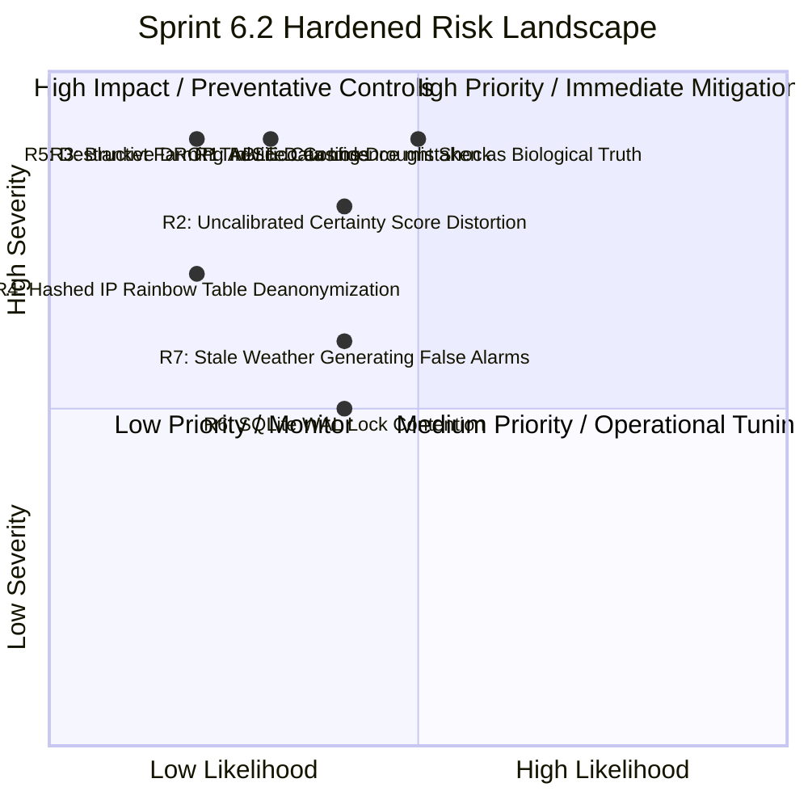

# GARI AGRITECH AI LAB — SPRINT 6.2 RISK REGISTER
## Hardened Technical, Agronomic, Operational & Security Risk Analysis

**Document Reference:** `docs/SPRINT_6_2_RISK_REGISTER.md`  
**Phase:** Phase 6 — Product Evolution  
**Sprint:** 6.2 — Final Design Gate Hardening  
**Baseline Git Commit:** `2318ee75`  
**Status:** FINAL DESIGN GATE COMPLIANT (Pre-Implementation)  

---

## 1. Hardened Risk Matrix

Risks are evaluated using a standard $5 \times 5$ severity and likelihood matrix:
- **Severity (S):** 1 (Negligible), 2 (Minor), 3 (Moderate), 4 (Major), 5 (Catastrophic)
- **Likelihood (L):** 1 (Rare), 2 (Unlikely), 3 (Possible), 4 (Likely), 5 (Almost Certain)
- **Risk Score ($R = S \times L$):** Low (1–5), Medium (6–12), High (15–25)

---

## 2. Identified Risks & Hardened Mitigation Strategies

### 2.1 Detailed Risk Register

| Risk ID | Category | Description | S | L | Inherent Risk | Hardened Mitigation Strategy | Monitoring Trigger & Metric | Residual Risk |
| :--- | :--- | :--- | :---: | :---: | :---: | :--- | :--- | :---: |
| **R1** | **Agronomic** | **Model Confidence Mistaken as Biological Truth:** In-silico Softmax score ($C_{\text{model}}$) treated as ground truth, leading to misdiagnosis of abiotic stress as fungus. | 5 | 3 | **15 (High)** | Epistemic decoupling: $C_{\text{model}}$ is strictly a hypothesis generator. Multi-factor corroboration required. Max uncorroborated status: `SUSPECTED`. | Monitor expert override rate; flag if agronomist overrides $> 15\%$ of model predictions. | Low (4) |
| **R2** | **Agronomic** | **Uncalibrated Aggregate Certainty Distortion:** Ad-hoc mathematical formulas producing misleading "90% certainty" claims without empirical trial calibration. | 4 | 3 | **12 (Med-High)** | Disentangle reliability into 4 orthogonal metrics: `source_reliability`, `measurement_quality`, `model_confidence`, `verification_status`. Refuse aggregate percentages until empirically calibrated. | Automated test asserting zero single "certainty percentage" fields in client response. | Low (3) |
| **R3** | **Agronomic Safety** | **Blanket Farming Advice Causing Crop Shock:** Unconditioned advice (e.g. "stop overhead watering") applied to soil-borne wilt or virus, causing drought wilting under heat. | 5 | 2 | **10 (Med-High)** | Conditioned recommendations: Every guidance item must state application conditions, contraindications, and biological rationale. Prioritize physical inspection over automated action. | Automated test asserting every recommendation includes `conditions`, `contraindications`, and `rationale`. | Very Low (2) |
| **R4** | **Privacy / Legal** | **Hashed IP Rainbow Table Deanonymization:** Storing SHA-256 hashes of IPv4 addresses allowing brute-force deanonymization of farmer field locations. | 4 | 2 | **8 (Medium)** | Data minimization: Completely eliminate IP hashing. Store coarse `network_zone` (`"internal_lan"`, `"cellular_carrier"`, `"public_broadband"`) and normalized client versions only. | Code audit ensuring `request.client.host` is never hashed or stored in database tables. | Very Low (1) |
| **R5** | **Data Integrity** | **Destructive DROP TABLE Data Loss during Rollback:** Using destructive `DROP TABLE` scripts on production databases containing operational business records. | 5 | 1 | **5 (Low-Med)** | Dual-mode rollback: Schema rollback restricted to empty pre-prod tables. Production rollback uses feature flag deactivation (`ENABLE_SPRINT_6_2_TRIAGE = False`) preserving all records. | CI deployment checklist requiring verification of table row counts before executing any rollback script. | Very Low (1) |
| **R6** | **Technical** | **SQLite WAL Lock Contention:** Concurrent writes to triage, evidence, and audit tables causing database locked errors. | 3 | 2 | **6 (Medium)** | SQLite WAL mode (`PRAGMA journal_mode = WAL`), `busy_timeout = 5000ms`, scoped short-lived transactions, separate read-only queries. | Track `sqlite3.OperationalError` frequency in `logs/local_monitoring.jsonl`. | Low (2) |
| **R7** | **Technical** | **Stale Weather Generating False Alarms:** Outdated meteorological telemetry ($> 3\text{ h}$) triggering false fungal incubation warnings during drought. | 3 | 3 | **9 (Medium)** | Category freshness policy: Weather expires at 3.0 hours. Stale readings are discounted to 0.10 quality and prohibited from triggering infection warnings. | Monitor `validity_status = STALE` frequency in weather evidence; alert if API dropout $> 5\%$. | Low (2) |

---

## 3. Unverified Assumptions & Dependencies Inventory

### 3.1 Unverified Assumptions
1. **Microclimate Station Distance:** Regional weather data from Open-Meteo may deviate from localized canopy conditions in enclosed greenhouses or deep valleys.  
   *Mitigation:* Weather evidence records station coordinates and serves as an advisory modifier, never a standalone proof.
2. **Agronomist Availability SLA:** Assumed that in commercial farming enterprises, assigned agronomists can respond to `URGENT_REVIEW` tickets within 12–24 hours.  
   *Mitigation:* If no agronomist responds within 12 hours, the system automatically escalates alerts to organization farm managers.
3. **IoT Sensor Ingestion Frequency:** Assumed future IoT field sensors will push data at 15–60 minute intervals.  
   *Mitigation:* The 1.0-hour freshness policy accommodates standard telemetry intervals while flagging dropouts cleanly.

### 3.2 Pre-Implementation Conditions
Before executing the DDL migration and business logic in the implementation phase:
1. Production SQLite database backup must be created via `scripts/backup_database.ps1`.
2. Staging verification drill must be executed on `staging_disease_detector.db` (DDL migration, `foreign_key_check`, `integrity_check`, and simulated rollback).
3. The 10/10 test suite from Sprint 6.1 (`tests/test_sprint6_1_dual_gate.py`) and Phase 5.8 security suite (`tests/test_phase5_8_remediation.py`) must pass with 100% green status.
