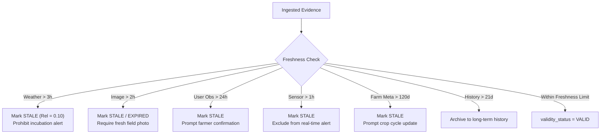
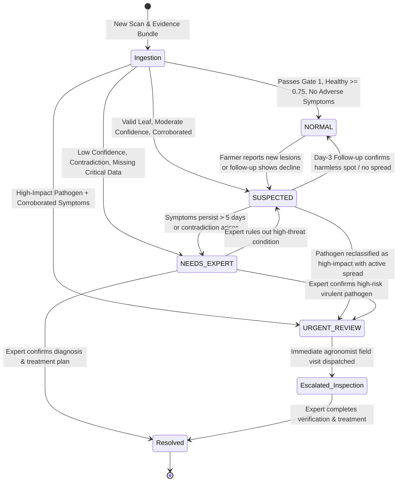

# GARI AGRITECH AI LAB — SPRINT 6.2 TRIAGE RULES SPECIFICATION
## Diagnostic Triage States, Category Freshness, Agronomic Safety & Transition Logic

**Document Reference:** `docs/SPRINT_6_2_TRIAGE_RULES.md`  
**Phase:** Phase 6 — Product Evolution  
**Sprint:** 6.2 — Final Design Gate Hardening  
**Baseline Git Commit:** `2318ee75`  
**Status:** FINAL DESIGN GATE COMPLIANT (Pre-Implementation)  

---

## 1. Foundational Agronomic & Epistemic Principles

### 1.1 In-Silico Confidence $\ne$ Biological Ground Truth
A deep learning model's output ($C_{\text{model}} \in [0.0, 1.0]$) represents a mathematical posterior over learned pixel textures in a fixed training set. It does **NOT** measure:
- Biological presence of viable pathogens.
- Cellular-level pathogenicity or active infection.
- Agronomic certainty in open-field environments.

Abiotic stressors (sun scald, salt accumulation, fertilizer burn, mechanical friction, dust) frequently produce visual patterns nearly indistinguishable from fungal or viral lesions on standard camera sensors. Therefore:
> **Core Principle 1:** Model confidence is strictly an in-silico hypothesis generator. An uncorroborated prediction must never be presented to a farmer as a confirmed diagnosis. Uncorroborated model confidence cannot elevate a triage state beyond `SUSPECTED`, regardless of whether $C_{\text{model}} = 0.99$.

### 1.2 Microclimate Permissiveness $\ne$ Active Pathogen Outbreak
Prolonged relative humidity $> 85\%$ or rain events indicate an *abiotic permissive microclimate* (an environmental condition where certain fungi can incubate if spores exist). They do **NOT** constitute proof of pathogen presence or active epidemic:
- Without viable inoculum, spores, and host vulnerability, 100% humidity causes zero disease.
- Weather data from regional stations (e.g., Open-Meteo) may differ significantly from localized microclimates inside protected greenhouses or dense canopies.
> **Core Principle 2:** Relative humidity $> 85\%$ must never be used as an independent or stand-alone trigger to declare disease presence or epidemic risk. It serves only as a risk amplifier when biological symptoms are independently verified.

### 1.3 Strict Boundary: `URGENT_REVIEW` vs `CONFIRMED_OUTBREAK`
- **`URGENT_REVIEW`:** An **internal operational prioritization state**. It indicates that a combination of visual symptoms, model hypotheses, and environmental factors warrants *immediate physical inspection by a qualified human agronomist*.
- **`CONFIRMED_OUTBREAK`:** An **official epidemiological declaration**. It can **ONLY** be declared by an authorized human agronomist, certified plant pathology laboratory, or official agricultural authority after field sampling.
> **Core Principle 3:** The autonomous AI system is strictly forbidden from declaring a "Confirmed Outbreak" or issuing wide-area farm quarantine / chemical spraying orders. The maximum operational state the AI can emit is `URGENT_REVIEW`.

---

## 2. Conditioned Agronomic Safety in `URGENT_REVIEW`

To prevent crop injury, yield loss, and liability, the autonomous decision engine enforces strict safety boundaries on all recommendations:

### 2.1 Prohibition of Blanket Cultural & Irrigation Prescriptions
A blanket instruction such as *"ngừng tưới phun mưa"* (halt overhead irrigation) is catastrophic if applied indiscriminately:
- For vascular wilts (*Ralstonia solanacearum*, *Fusarium oxysporum*) or root rot, foliage is uninfected; halting scheduled irrigation during high heat causes lethal water stress.
- For viral infections transmitted by vectors (e.g., Whiteflies transmitting TYLCV), irrigation practices have zero direct effect on transmission, while shutting down overhead sprinklers may actually elevate canopy temperatures and accelerate vector reproduction.

### 2.2 Mandatory Recommendation Structure
Every agronomic recommendation emitted by GARI must explicitly declare three sections:
1. **Application Conditions:** Exact circumstances under which the action is biologically valid (e.g., "Applicable only to foliar fungal pathogens with water-splash dissemination").
2. **Limitations & Contraindications:** Explicit warnings where the action MUST NOT be applied (e.g., "Do not restrict irrigation if plants exhibit midday drought wilting; ensure root zone moisture is maintained").
3. **Biological Rationale:** The physiological and epidemiological justification for the action.

### 2.3 Priority of Field Verification Over Autonomous Directives
When evidence is incomplete, unverified, or conflicting:
> **Core Principle 4:** In the presence of missing or uncorroborated evidence, prioritize physical field inspection and qualified agronomist review over automated farming directives.

---

## 3. Category-Specific Freshness & Validity Framework

Every piece of evidence is evaluated against category-specific physical decay thresholds:

---

## 4. The Four Diagnostic Triage States: Entry, Exit & Actions

### 4.1 State: `NORMAL` (Cây khỏe mạnh / Bình thường)
- **Operational Meaning:** Foliar tissue displays standard botanical health; no actionable pathogen detected.
- **Entry Criteria (ALL must be met):**
  1. Gate 1 passes with $F_{\text{bot}} \ge 0.35$, Laplacian variance $\ge 35.0$.
  2. Gate 2 model predicts `"Healthy"` with confidence $C_{\text{model}} \ge 0.75$.
  3. No adverse visual symptoms reported by user.
  4. No unresolved active disease incidents on the same plot within the last 14 days.
- **Exit Criteria:**
  - Farmer submits follow-up report of emerging lesions $\rightarrow$ Exit to `SUSPECTED`.
- **Allowed Transitions:** $\rightarrow$ `SUSPECTED`.
- **Actions:** Standard routine cultural guidance. Prohibit any pesticide recommendations.

---

### 4.2 State: `SUSPECTED` (Nghi ngờ nhiễm bệnh / Cần theo dõi)
- **Operational Meaning:** Early-stage foliar irregularities detected that require structured follow-up monitoring before any chemical intervention.
- **Entry Criteria (ANY of the following):**
  1. Gate 1 passes (`LEAF_VALID`), model predicts a recognized non-quarantine disease with confidence $0.45 \le C < 0.75$.
  2. Model predicts disease with $C \ge 0.75$, but environmental or symptom corroboration is unverified or missing.
  3. Minor localized foliar spotting reported, but $< 5\%$ plot area affected.
  4. Gate 1 passed, model predicted Healthy, but farmer reported unverified initial spotting.
- **Exit Criteria:**
  - Follow-up check at Day 3 shows resolution of spots $\rightarrow$ Exit to `NORMAL`.
  - Lesions spread or persist $> 5\text{ days}$ without diagnosis $\rightarrow$ Exit to `NEEDS_EXPERT`.
  - Pathogen identified as high-threat with rapid progression $\rightarrow$ Exit to `URGENT_REVIEW`.
- **Allowed Transitions:** $\rightarrow$ `NORMAL`, $\rightarrow$ `NEEDS_EXPERT`, $\rightarrow$ `URGENT_REVIEW`.
- **Actions:** Automated follow-up task scheduled in `cultivation_tasks` for Day 3. Localized sanitation guidance (clean pruning shears).

---

### 4.3 State: `NEEDS_EXPERT` (Cần chuyên gia thẩm định)
- **Operational Meaning:** Diagnostic ambiguity, conflicting evidence, or lack of verified context preventing autonomous determination.
- **Entry Criteria (ANY of the following):**
  1. **Low Confidence:** Model top prediction confidence $< 0.45$ on a valid leaf.
  2. **Candidate Divergence:** Top-1 and Top-2 model candidate scores differ by $< 0.10$.
  3. **Evidence Contradiction:** Detected contradiction between model hypothesis, weather conditions, or phenological stage.
  4. **Crop Ambiguity:** Input crop differs from plot registration, or leaf species cannot be confirmed.
  5. **Critical Data Stale/Missing:** Missing historical plot data on a recurring ambiguous lesion.
  6. **Farmer Dispute:** Farmer flags that initial AI suggestion contradicts observed reality.
- **Exit Criteria:**
  - Assigned agronomist reviews case and determines benign nature $\rightarrow$ Exit to `SUSPECTED` or `NORMAL`.
  - Assigned agronomist confirms virulent infection $\rightarrow$ Exit to `URGENT_REVIEW` or `Resolved`.
- **Allowed Transitions:** $\rightarrow$ `SUSPECTED`, $\rightarrow$ `URGENT_REVIEW`, $\rightarrow$ `Resolved`.
- **Actions:** Automatic creation of consultation case in `expert_cases` (Module 07). Notification to assigned agronomist under SEC-04 isolation.

---

### 4.4 State: `URGENT_REVIEW` (Khẩn cấp / Yêu cầu kiểm tra ưu tiên)
- **Operational Meaning:** High-severity, quarantine-grade, or rapidly spreading pathogen suspected under permissive conditions, posing substantial threat to the crop cycle.
- **Entry Criteria (ALL of the following must be satisfied):**
  1. Gate 1 passes (`LEAF_VALID`).
  2. Model predicts a pathogen on the **High-Impact Pathogen Roster** (Late Blight, TYLCV, Citrus Greening, Rice Blast, Bacterial Blight) with $C_{\text{model}} \ge 0.70$.
  3. **Corroborating Evidence Present:** Either farmer reports rapid onset ($< 48\text{ h}$ affecting $> 15\%$ plants) OR live weather telemetry ($< 3\text{ h}$ fresh) confirms active incubation conditions.
  4. No severe contradictory evidence that invalidates the biological hypothesis.
- **Exit Criteria (ONLY human-driven exit):**
  - Assigned agronomist conducts field verification and confirms management protocol $\rightarrow$ Exit to `Resolved`.
  - Agronomist determines misclassification $\rightarrow$ Exit to `SUSPECTED` or `NEEDS_EXPERT`.
- **Allowed Transitions:** $\rightarrow$ `Escalated_Inspection`, $\rightarrow$ `Resolved`.
- **Conditioned Permitted Actions:**
  1. Priority-1 notification dispatched to farm manager and agronomist.
  2. Automated urgent task created in `cultivation_tasks`: "Kiểm tra thực địa ưu tiên cho thửa đất".
  3. **Conditioned Cultural Guidance:**
     - *If foliar fungal pathogen with splash dispersal (e.g. Late Blight):* Advise temporary suspension of overhead sprinkler irrigation on affected row while maintaining drip irrigation to prevent drought shock.
     - *If vector-borne pathogen (e.g. TYLCV):* Recommend inspecting for whitefly populations on undersides of leaves; do NOT alter irrigation.
     - *If vascular soil-borne wilt:* Maintain scheduled drip irrigation; isolate sample plant root zone from neighboring beds.
- **Prohibited Autonomous Actions:** Zero wide-area quarantine declarations. Zero automated chemical dosage prescriptions.

---

## 5. Summary State Transition Matrix

| From State | Trigger Event | Target State | Permitted Actions | Prohibited Actions |
| :--- | :--- | :--- | :--- | :--- |
| `Ingestion` | Healthy $\ge 0.75$, no symptoms | `NORMAL` | Log audit record. Standard cultural guidance. | Any pesticide recommendation. |
| `Ingestion` | Disease $0.45 \le C < 0.75$, non-high-impact | `SUSPECTED` | Schedule Day-3 follow-up task. Sanitation tips. | Declaring disease confirmed. |
| `Ingestion` | Disease $C < 0.45$ OR Contradiction | `NEEDS_EXPERT` | Dispatch case to `expert_cases`. In-app notification. | Autonomous pesticide advice. |
| `Ingestion` | High-Impact Pathogen $+ C \ge 0.70 +$ Corroboration | `URGENT_REVIEW` | High-priority ticket. Conditioned cultural guidance. | Wide-area quarantine, chemical dosages. |
| `NORMAL` | Farmer submits new lesion report | `SUSPECTED` | Schedule inspection task. Update plot timeline. | Immediate chemical prescription. |
| `SUSPECTED` | Symptoms persist $> 5$ days | `NEEDS_EXPERT` | Escalate to agronomist pool via SEC-04. | Unilateral diagnosis confirmation. |
| `NEEDS_EXPERT`| Agronomist confirms diagnosis | `Resolved` | Update `expert_cases` status; record treatment plan. | Overriding expert sign-off. |
| `URGENT_REVIEW`| Agronomist verifies field protocol | `Resolved` | Log full resolution in `decision_audit_logs`. | Closing ticket without expert review. |
