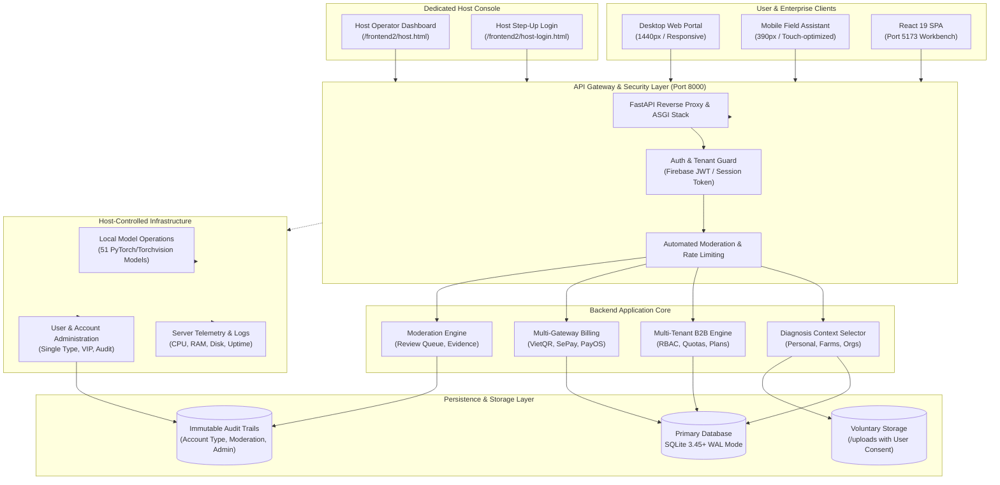
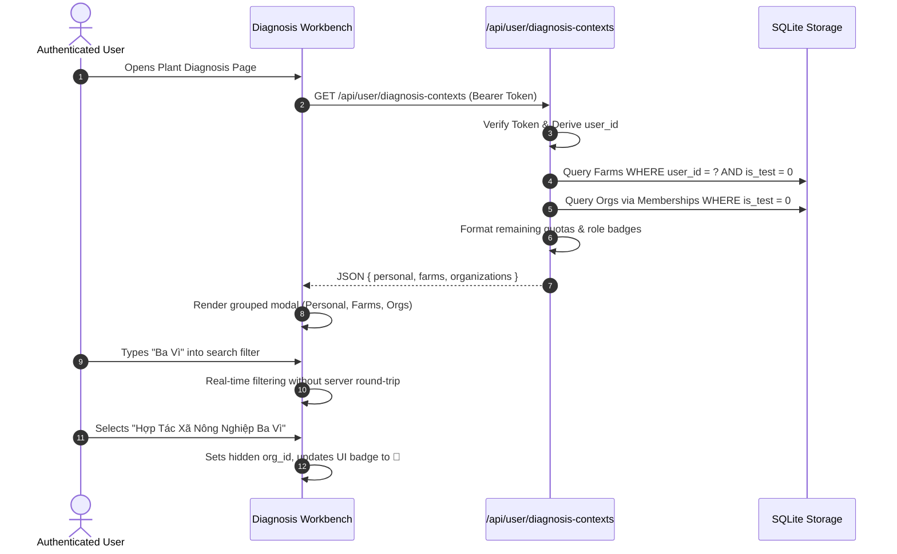

# GARI 2.0 — System Architecture Specification

**Product**: GARI AgriTech Platform (GARI AI Lab 2.0)  
**Classification**: Enterprise Agricultural AI & Cooperative Management Platform  
**Target Architecture**: Hybrid Local-Inference Backend with Cloud Identity & Host Infrastructure  

---

## 1. High-Level Architecture Diagram

---

## 2. Component Specifications

### 2.1 Identity, Authentication & Single Active Account Type

1. **Authentication Providers**:
   - Primary: Session tokens generated via cryptographically secure random bytes (`secrets.token_urlsafe(32)`) persisted in the `sessions` table.
   - Dual Integration: Firebase Authentication (ID Token verification via Firebase Admin SDK) allowing social sign-in (Google) and SMS phone authentication for rural farmers.
2. **Account Type Invariant**:
   - Each authenticated UID is mapped to exactly ONE active account type:
     - `farmer` (Nông Hộ Cá Thể)
     - `cooperative` (Hợp Tác Xã)
     - `expert` (Chuyên Gia BVTV)
     - `enterprise` (Doanh Nghiệp Nông Nghiệp)
   - Transitions require explicit confirmation and record an immutable entry into `user_account_type_audit`.
   - Subscription tiers and VIP privileges remain orthogonal and unaffected by account type changes.

### 2.2 Scoped Diagnosis Context Selector Architecture

The unified diagnosis selector (`GET /api/user/diagnosis-contexts`) eliminates cross-tenant leakage and test fixture noise:

### 2.3 Local AI Model Operations & Inference Engine

1. **Local Architecture**:
   - 51 specialized convolutional neural network models stored in `models/`.
   - Discovered dynamically at startup by `model_services.py`.
   - Supports 42 distinct crop classifications with disease symptom mapping.
2. **Inference Device**:
   - Auto-detected CPU with AVX2 optimizations; optional NVIDIA CUDA acceleration when available.
3. **Safety & Moderation Pipeline**:
   - Input validation: PIL image verification, maximum size restriction (15 MB), MIME verification.
   - User consent enforcement: Images are only written to `/uploads/` if `consent_store_image` is explicitly granted.
   - Anti-tampering: Predictions can only originate from the inference engine; client-submitted diagnostic results are rejected with HTTP 403 Forbidden.

### 2.4 Dedicated Host Infrastructure & Moderation Pipeline

1. **Host Administration Console (`/frontend2/host.html`)**:
   - Isolated from end-user farming workflows.
   - Restricted to accounts with `is_host_admin = 1`.
   - Real-time server telemetry: CPU usage, RAM utilization, disk capacity, request latency, active session counters.
   - Model operations: Inspect loaded models, inference device, latency benchmarks.
2. **Violation Detection & Human-in-the-Loop Moderation**:
   - Automated detection rules flag abusive content, non-agricultural uploads, spam registrations, and abnormal API request volumes.
   - Cases are queued into `moderation_cases` (`pending`, `reviewed`, `dismissed`).
   - Permanent suspensions or bans strictly require Host Operator manual approval; automated algorithms are prohibited from issuing unilateral permanent bans.

---

## 3. Deployment & Runtime Guidelines

- **Backend Daemon**: `uvicorn api_server:app --host 0.0.0.0 --port 8000`
- **Vite SPA Daemon**: `npm --prefix frontend run dev -- --host 0.0.0.0 --port 5173`
- **Environment Modes**:
  - `APP_ENV=development`: Local development, hot reloading, relaxed CORS for local ports.
  - `APP_ENV=production`: Strict secrets enforcement (`SESSION_SECRET`, `JWT_SECRET` min 32 chars), secure cookies, hardened CSP headers.
